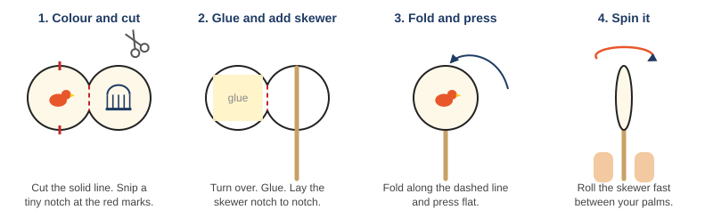
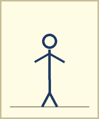
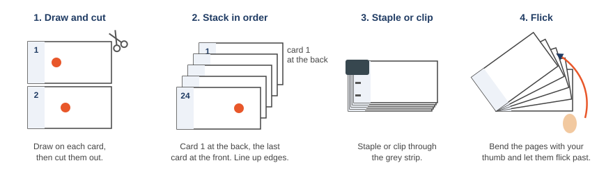

=====================
What is animation?
=====================

.. admonition:: Learning intentions

   * Explain how animation makes still pictures look like they move
   * Describe how animation has changed over time
   * Make a thaumatrope and a flip book to see how frames create movement
   * Name the main types of animation and give an example of each

----

Still pictures that move
------------------------

An animation is a set of still pictures shown one after another, very quickly.
Each picture is called a **frame**. Each frame is a little different from the one
before it. When the frames are shown fast enough, your brain joins them together
and you see smooth movement.

.. figure:: images/frames_strip.svg
   :width: 100%
   :alt: Six frames of a ball moving from left to right, getting a little further in each frame

   Six frames. Shown quickly, the ball seems to roll across the screen.

Here are the same six frames played as an animation, next to a version with
30 frames. Both take about the same time to cross the screen. Which looks
smoother?

.. tip::

   **Click a GIF to play it.** Click again to stop it. The GIFs on this page
   start still, so you can watch each one carefully. In the rolling ball
   comparisons, clicking any ball plays them all together.

.. grid:: 1
   :gutter: 0
   :class-container: clickgif-group

   .. grid-item::

      .. figure:: images/gifs/roll_6_frames.gif
         :class: clickgif clickgif-ms-1200
         :width: 420px
         :alt: Animated GIF of a ball rolling across the screen in 6 jumpy frames

         6 frames: you can see each jump.

   .. grid-item::

      .. figure:: images/gifs/roll_30_frames.gif
         :class: clickgif clickgif-ms-1200
         :width: 420px
         :alt: Animated GIF of the same ball rolling smoothly in 30 frames

         30 frames: smooth movement.

Why does this work?
~~~~~~~~~~~~~~~~~~~

For a long time people said animation worked because of **persistence of
vision**: the idea that each picture "lingers" on the back of your eye until the
next one arrives. Scientists now know this is **not** the real reason. You may
still see the term in older books and websites.

The real answer is that **your brain works out movement**. In 1912 the
psychologist **Max Wertheimer** studied how people see motion when lights flash
one after another. Scientists now describe two different effects.

Beta movement: seeing an object move
^^^^^^^^^^^^^^^^^^^^^^^^^^^^^^^^^^^^

Two still pictures are shown one after the other, in slightly different places.
Your brain sees **one object moving** from the first place to the second, even
though nothing actually crossed the gap. Your brain fills in the path.

Only spots A and B ever light up. Click each one. Which looks most like a
single dot moving?

.. grid:: 1 3 3 3
   :gutter: 1
   :class-container: compact-gifs

   .. grid-item::

      .. figure:: images/gifs/beta_close.gif
         :class: clickgif clickgif-ms-3000
         :width: 100%
         :alt: Two close spots, A and B, light up one after the other every 0.1 seconds

         Close together, switching every 0.1 s

   .. grid-item::

      .. figure:: images/gifs/beta_gap.gif
         :class: clickgif clickgif-ms-3000
         :width: 100%
         :alt: Spot A lights up, the screen goes blank for a moment, then spot B lights up

         A short blank gap between A and B

   .. grid-item::

      .. figure:: images/gifs/beta_one_way.gif
         :class: clickgif clickgif-ms-3600
         :width: 100%
         :alt: Spot A then spot B light up, then a pause, so it seems to jump one way

         One way only: A then B, then a pause

People see this effect differently, and screens can blur the timing a little.
Most people see movement most strongly when the spots are close together and
switch quickly, or when there is a clear direction.

* It works with gaps of about **0.1 to 0.2 seconds** between pictures (about 5 to
  10 frames per second), and keeps working at faster film and video rates.
* This is what makes **flip books, films, cartoons and GIFs** work. A character
  seems to walk across the screen, but really you are seeing still frames.

Phi phenomenon: seeing motion without an object
^^^^^^^^^^^^^^^^^^^^^^^^^^^^^^^^^^^^^^^^^^^^^^^

When lights flash **much faster**, you stop seeing a single thing travel.
Instead you see a sweeping, shimmering sense of movement, a bit like a wave or
a shadow passing along, without a clear object.

   Chasing lights flashing about 0.04 seconds apart. You see movement sweeping
   along, not separate bulbs.

* It happens with very short gaps of about **0.03 to 0.06 seconds**.
* You see it in **neon signs, cinema marquee lights and chasing Christmas
  lights**.

.. list-table::
   :header-rows: 1
   :widths: 24 38 38

   * -
     - **Beta movement**
     - **Phi phenomenon**
   * - What you see
     - A real-looking object moving from A to B
     - Movement with no clear object, like a sweeping shadow
   * - Time between flashes
     - Slower: about 0.1 to 0.2 s
     - Faster: about 0.03 to 0.06 s
   * - Examples
     - Flip books, films, cartoons, GIFs
     - Neon signs, chasing lights

Your brain builds motion
^^^^^^^^^^^^^^^^^^^^^^^^

Special nerve cells at the back of your brain, in the **visual cortex**, react
when something changes position in a short time. Some only fire for movement
in one direction (for example, left to right). So motion is not just something
your eyes record like a camera. It is something your **brain calculates**, all
the time, very fast. Animators take advantage of this.

.. admonition:: Try it

   Click the beta movement GIFs above. Tell yourself, "It is only two dots
   flashing." Can you stop seeing a moving dot? Most people find it very hard,
   because the brain does the calculation automatically.

Frame rate
~~~~~~~~~~

The **frame rate** is how many frames are shown each second. It is measured in
**frames per second (fps)**.

.. list-table::
   :header-rows: 1
   :widths: 35 20 45

   * - Where it is used
     - Frame rate
     - Notes
   * - Cinema film
     - 24 fps
     - The standard for movies for about 100 years
   * - Australian TV (PAL)
     - 25 fps
     - Australia and Europe use 25 fps
   * - Hand-drawn cartoons "on twos"
     - 12 drawings per second
     - Each drawing is shown for 2 frames to save work
   * - Video games
     - 30 to 120 fps or more
     - Higher frame rates feel smoother
   * - Simple GIFs
     - 5 to 15 fps
     - Fewer frames keep the file small

Same movement, four frame rates
^^^^^^^^^^^^^^^^^^^^^^^^^^^^^^^

Each ball takes 1.2 seconds to cross the screen. Only the frame rate changes.

.. grid:: 1
   :gutter: 0
   :class-container: clickgif-group

   .. grid-item::

      .. figure:: images/gifs/roll_5fps.gif
         :class: clickgif clickgif-ms-1800
         :width: 420px
         :alt: Ball rolling at 5 frames per second, very jerky

         5 fps (6 frames, 13 KB): jerky

   .. grid-item::

      .. figure:: images/gifs/roll_10fps.gif
         :class: clickgif clickgif-ms-1800
         :width: 420px
         :alt: Ball rolling at 10 frames per second, a little jerky

         10 fps (12 frames, 28 KB): OK

   .. grid-item::

      .. figure:: images/gifs/roll_25fps.gif
         :class: clickgif clickgif-ms-1800
         :width: 420px
         :alt: Ball rolling at 25 frames per second, smooth

         25 fps (30 frames, 70 KB): smooth

   .. grid-item::

      .. figure:: images/gifs/roll_50fps.gif
         :class: clickgif clickgif-ms-1800
         :width: 420px
         :alt: Ball rolling at 50 frames per second, very smooth

         50 fps (60 frames, 140 KB): very smooth

.. tip::

   More frames look smoother, but they take longer to make and make the file
   bigger. Look at the file sizes: doubling the frames from 25 to 50 fps
   doubles the file size, but most people can barely see the difference.
   Animators choose a frame rate that is smooth **enough** for the job.

.. admonition:: Animation maths

   **Number of frames = frame rate × length in seconds**

   A 3 second animation at 12 fps needs 12 × 3 = **36 frames**.

   **Delay per frame = 1 ÷ frame rate**

   At 10 fps each frame is shown for 1 ÷ 10 = **0.1 seconds**.

What is a GIF?
~~~~~~~~~~~~~~

A **GIF** (Graphics Interchange Format) is an image file that can hold several
frames, so it can play a short animation. It was first released in 1987 and is
still used everywhere: in messages, on social media and on websites.

.. grid:: 1 2 2 2
   :gutter: 1
   :class-container: compact-gifs

   .. grid-item::

      .. figure:: images/gifs/star_loop.gif
         :class: clickgif clickgif-ms-2880
         :width: 80%
         :alt: Animated GIF of a yellow star that grows, glows and shrinks again

   .. grid-item::

      * A GIF stores every **frame** and a **delay** for each one.
      * It can **loop**: play once, a set number of times, or forever.
      * It has **no sound**.
      * It can only use **256 colours**, so it suits cartoons and simple
        graphics better than photos.
      * It can have a **see-through** (transparent) background.
      * Any web browser can play a GIF without extra software.

The star GIF has 6 frames with a delay of 0.12 seconds each, so one loop lasts
6 × 0.12 = **0.72 seconds**.

----

A short history of animation
----------------------------

People have tried to make pictures move for a very long time. Here are some
important steps.

.. list-table::
   :header-rows: 1
   :widths: 16 10 24 50
   :class: history-table

   * - Picture
     - When
     - What
     - Why it matters
   * - .. image:: images/history/magic_lantern.svg
          :width: 110px
          :alt: A magic lantern projecting a picture onto a screen
     - 1659
     - Magic lantern
     - Painted glass slides were lit by a candle or lamp and projected onto a wall.
       Some slides had moving parts, so simple pictures could move.
   * - .. image:: images/history/thaumatrope.svg
          :width: 110px
          :alt: A thaumatrope disc on strings showing a bird inside a cage
     - 1825
     - Thaumatrope
     - A disc with a picture on each side. Spin it fast and the two pictures
       join (a bird appears in a cage).
   * - .. image:: images/history/phenakistiscope.svg
          :width: 110px
          :alt: A phenakistiscope disc with slits around the edge, held up to a mirror
     - 1832
     - Phenakistiscope (Joseph Plateau)
     - A spinning disc of drawings with slits around the edge. You look through
       the slits at a mirror and see the drawings move in a loop.
   * - .. image:: images/history/zoetrope.svg
          :width: 110px
          :alt: A zoetrope drum with slits and a strip of galloping horses inside
     - 1834
     - Zoetrope (William Horner)
     - A spinning drum with slits. A strip of drawings inside seems to move when
       you look through the slits. Several people can watch at once.
   * - .. image:: images/history/flip_book.svg
          :width: 110px
          :alt: A flip book with a stick figure on the top page
     - 1868
     - Flip book
     - A small book with a drawing on each page. Flick the pages and the drawing
       moves.
   * - .. image:: images/history/praxinoscope.svg
          :width: 110px
          :alt: A praxinoscope drum with a ring of mirrors in the centre
     - 1877
     - Praxinoscope (Émile Reynaud)
     - Like a zoetrope, but with mirrors in the middle instead of slits, so the
       moving picture is brighter and clearer.
   * - .. image:: images/history/muybridge.svg
          :width: 110px
          :alt: A row of photographs of a galloping horse
     - 1878
     - *The Horse in Motion* (Eadweard Muybridge)
     - A row of cameras took photos of a galloping horse, one after another. The
       photos proved that all four hooves leave the ground at once, and showed
       how to break movement into frames.
   * - .. image:: images/history/kinetoscope.svg
          :width: 110px
          :alt: A wooden kinetoscope cabinet with a viewing hole on top
     - 1893
     - Kinetoscope (Thomas Edison and William Dickson)
     - A cabinet that played a short film on a loop. One person at a time
       watched through a peephole.
   * - .. image:: images/history/cinematographe.svg
          :width: 110px
          :alt: A projector shining a moving picture onto a screen for an audience
     - 1895
     - Cinématographe (Lumière brothers)
     - Projected films onto a screen for a whole audience. This is often seen as
       the start of cinema.
   * - .. image:: images/history/fantasmagorie.svg
          :width: 110px
          :alt: A white stick figure drawn on a black background
     - 1908
     - *Fantasmagorie* (Émile Cohl)
     - One of the first hand-drawn animated films.
   * - .. image:: images/history/dinosaur.svg
          :width: 110px
          :alt: A friendly cartoon dinosaur
     - 1914
     - *Gertie the Dinosaur* (Winsor McCay)
     - One of the first cartoon characters with a personality. Gertie seemed to
       listen and react to McCay on stage.
   * - .. image:: images/history/cutout.svg
          :width: 110px
          :alt: Black paper cut-out silhouettes on a coloured background
     - 1926
     - *The Adventures of Prince Achmed* (Lotte Reiniger)
     - The oldest surviving animated feature film, made with paper cut-outs.
   * - .. image:: images/history/sound_film.svg
          :width: 110px
          :alt: A strip of film with a soundtrack line along the bottom
     - 1928
     - Cartoons with sound
     - Cartoons such as *Steamboat Willie* were among the first with sound
       matched to the pictures.
   * - .. image:: images/history/cel_layers.svg
          :width: 110px
          :alt: Clear cel sheets stacked over a painted background
     - 1930s
     - Cel animation studios
     - Drawings were painted on clear plastic sheets called **cels** and placed
       over a painted background, so the background only had to be painted once.
   * - .. image:: images/history/gif.svg
          :width: 110px
          :alt: A grid of coloured pixels with the letters GIF underneath
     - 1987
     - The GIF file
     - CompuServe created the GIF format. It later became the most common way to
       share short animations online.
   * - .. image:: images/history/cgi_3d.svg
          :width: 110px
          :alt: A shaded 3D sphere above a wireframe grid
     - 1995
     - *Toy Story*
     - The first feature film made fully with computer animation.
   * - .. image:: images/history/today.svg
          :width: 110px
          :alt: A phone playing an animation
     - Today
     - GIFs, apps and games
     - Anyone with a phone or computer can make animation.

.. tip::

   Click a picture in the table to see it full size.

See: `<https://www.youtube.com/watch?v=8V_D1g4_ZGo>`_

How a thaumatrope works
~~~~~~~~~~~~~~~~~~~~~~~

The word thaumatrope derives from the Ancient Greek words thaûma (θαῦμα, meaning "wonder" or "miracle") and trópos (τρόπος, meaning "a turn"), translating literally to "wonder turner".

A thaumatrope has a bird on one side and an empty cage on the other. Shown
slowly, you see two separate pictures. Spun fast, your brain joins them and the
bird appears **inside** the cage.

.. grid:: 1 2 2 2
   :gutter: 1
   :class-container: compact-gifs

   .. grid-item::

      .. figure:: images/gifs/thaumatrope_slow.gif
         :class: clickgif clickgif-ms-4200
         :width: 60%
         :alt: A bird and a cage shown one after the other slowly

         Slow: two pictures

   .. grid-item::

      .. figure:: images/gifs/thaumatrope_fast.gif
         :class: clickgif clickgif-ms-3200
         :width: 60%
         :alt: A bird and a cage swapping very fast so the bird seems to be in the cage

         Fast: the bird is in the cage

.. ordering:: text
   :no-indent:

   Thaumatrope
   Zoetrope
   Flip book
   Fantasmagorie, an early hand-drawn film
   Prince Achmed, a cut-out feature film
   Toy Story, the first fully computer-animated feature

----

Activity: make thaumatropes
---------------------------

A thaumatrope is one of the oldest animation toys (see the history table).
You will make several, then design your own.

.. admonition:: You need

   * :download:`thaumatrope_template.pdf <thaumatrope/thaumatrope_template.pdf>`
     printed on thin card at 100% (actual size)
   * Coloured pencils or textas
   * Scissors and a glue stick
   * A bamboo skewer for each thaumatrope (snip off the sharp tip), **or** a
     piece of string about 60 cm long

What they should look like
~~~~~~~~~~~~~~~~~~~~~~~~~~

Click each one to see what you should see when it spins.

.. grid:: 2 3 5 5
   :gutter: 1
   :class-container: compact-gifs

   .. grid-item::

      .. figure:: images/gifs/thaum_bird_cage.gif
         :class: clickgif clickgif-ms-3000
         :width: 100%
         :alt: Spinning thaumatrope: a bird appears inside a cage

         Bird in a cage

   .. grid-item::

      .. figure:: images/gifs/thaum_fish_bowl.gif
         :class: clickgif clickgif-ms-3000
         :width: 100%
         :alt: Spinning thaumatrope: a fish appears inside a fishbowl

         Fish in a bowl

   .. grid-item::

      .. figure:: images/gifs/thaum_flower_bee.gif
         :class: clickgif clickgif-ms-3000
         :width: 100%
         :alt: Spinning thaumatrope: a bee appears on a flower

         Bee on a flower

   .. grid-item::

      .. figure:: images/gifs/thaum_face_features.gif
         :class: clickgif clickgif-ms-3000
         :width: 100%
         :alt: Spinning thaumatrope: a blank face gets eyes, a mouth and hair

         Face

   .. grid-item::

      .. figure:: images/gifs/thaum_web_spider.gif
         :class: clickgif clickgif-ms-3000
         :width: 100%
         :alt: Spinning thaumatrope: a spider appears on a web

         Spider on a web

How to make one
~~~~~~~~~~~~~~~

   Making a thaumatrope with a skewer.

#. **Colour** both pictures. Bold, bright colours work best.
#. **Cut** around the solid black line. Keep the two circles joined at the fold.
   Snip a tiny notch at each of the two red marks on the front circle.
#. **Turn it over** so the blank side is facing up. Rub glue all over the blank
   side.
#. **Lay the skewer** up the middle of the front circle, from notch to notch, with
   most of the skewer sticking out the bottom as a handle.
#. **Fold** along the red dashed line so the back circle covers the skewer. Press
   flat and line up the edges. Let the glue dry.
#. **Spin it.** Hold the handle between your flat palms and rub your hands back and
   forth quickly. Watch the two pictures join into one.

.. admonition:: Using string instead of a skewer

   Lay a 60 cm string up the middle instead of the skewer, so about 20 cm sticks
   out the **top** and the **bottom**. Fold and glue as before. Hold one end in each
   hand, twist the disc around 20 times to wind the string up, then pull your hands
   apart gently. The disc spins one way, then winds back the other way.

.. important::

   The skewer or string must go **up and down**, along the same direction as the
   fold. Folding flips the back picture over, and spinning flips it back again,
   so it ends up the right way up. If the stick went side to side, the back
   picture would appear upside down.

Troubleshooting
~~~~~~~~~~~~~~~

.. list-table::
   :header-rows: 1
   :widths: 40 60

   * - Problem
     - Fix
   * - I see two separate pictures flickering
     - Spin faster. The pictures need to swap more than about 10 times a second.
   * - The pictures don't line up
     - The circles were not lined up when you folded. Make sure the cut edges
       match all the way round.
   * - The back picture is upside down
     - The skewer is going side to side. It must go up and down the middle.
   * - The disc wobbles or slips on the skewer
     - Use more glue near the skewer, or add a strip of tape over it before
       folding.

Design your own
~~~~~~~~~~~~~~~

Use the blank pieces on pages 2 and 3 of the template.

* Draw one part of the picture on the front and the other part on the back.
  Each half should look **incomplete** on its own.
* Keep both drawings in the **same position** in their circles, so they line up
  when they join.
* Use thick outlines and strong colours. Fine detail is lost when it spins.

**Ideas:** a rocket and its flames, a bare tree and its leaves, a night sky and
the moon, a jar and the jam inside, a dog and its kennel, a goal and a ball, a
person and a hat, a pizza base and its toppings.

.. admonition:: Think about it

   * What happens if you spin it slowly? Why?
   * Which of your designs worked best? What made it work?
   * How is a thaumatrope like a 2-frame GIF?

----

Activity: make a flip book
--------------------------

Before you use a computer, make an animation by hand. This shows you how frames
work.

   A 12-page flip book: crouch, jump, land. Notice the **anticipation** (the
   crouch before the jump).

There are two ways to make a flip book: on a pad of sticky notes, or with the
printable cards below.

.. admonition:: You need

   * :download:`flipbook_template.pdf <flipbook/flipbook_template.pdf>`: 24 blank
     cards on 2 pages (print on thin card), **or** a pad of sticky notes
   * A pencil and eraser, then coloured pencils or a fine black pen
   * Scissors, and a stapler or bulldog clip

Example to try first
~~~~~~~~~~~~~~~~~~~~

Print :download:`flipbook_example_ball.pdf <flipbook/flipbook_example_ball.pdf>`,
cut out the 24 cards and put them together. It is a bouncing ball that gets
lower with each bounce. Look for **squash and stretch** on the cards where the
ball lands.

   The example flip book: 24 pages, played at 12 pages a second.

Putting it together
~~~~~~~~~~~~~~~~~~~

   Making a flip book from the printed cards.

#. **Draw** on the right-hand part of each card, away from the grey strip. The
   flicking edge is on the right, so that is where your drawing is easiest to see.
#. **Cut** out the cards along the solid lines.
#. **Stack** them in number order with **card 1 at the back** and the last card at
   the front. Tap the stack on the desk so the left edges line up.
#. **Staple** (or bulldog-clip) through the grey strip, about 1 cm from the left
   edge.
#. **Flick** from the back to the front: hold the strip in one hand, bend the
   pages up with the thumb of your other hand, then let them flick past one at a
   time. If the animation plays backwards, flick the other way.

Making your own
~~~~~~~~~~~~~~~

#. **Plan first.** Decide what happens from start to finish. Keep it simple: one
   object and one action, such as a ball bouncing, a flower growing, a rocket
   taking off or a stick figure jumping.
#. **Draw the key poses** (pose to pose). Draw the most important positions
   first, on cards spread through the stack, such as the start (card 1), the
   middle (card 12) and the end (card 24).
#. **Fill in the in-betweens.** Lay the next card over the last one and hold them
   up to a window, so you can see the drawing underneath. Trace it, then move it
   a **tiny** bit.
#. **Keep still things still.** Trace the ground line and anything that does not
   move in exactly the same place on every card. Use the grey ground line on the
   cards to help.
#. **Draw in pencil first**, flick to test, then go over it in pen or colour.

.. tip::

   * Small changes between cards give smooth movement. Big changes make the
     picture jump.
   * Put cards **closer together** in spacing to make something slow down, and
     **further apart** to make it speed up (slow in and slow out).
   * 24 cards is about **2 seconds** of animation if you flick at 12 pages a
     second.

In-betweening practice
~~~~~~~~~~~~~~~~~~~~~~

:download:`flipbook_inbetween_practice.pdf <flipbook/flipbook_inbetween_practice.pdf>`
has the same bouncing ball, but only the **key poses** are drawn: the tops of
the bounces and the landings (cards 1, 5, 8, 12, 15, 19 and 24). Your job is to
draw the ball on all the other cards so it moves smoothly between them.

* Near the **top** of a bounce the ball is slow, so the gaps between drawings are
  small.
* Near the **ground** the ball is fast, so the gaps are big.
* Stretch the ball just before and after it lands, and squash it when it hits the
  ground.

When you have finished, put it together and compare it with the example. Which
looks smoother? Why?

.. admonition:: Think about it

   * How many cards did your animation use? How long did it last when you flicked
     it?
   * Where did your drawing jump instead of moving smoothly? What caused it?
   * Which principles of animation did you use?

----

Types of animation
------------------

.. list-table::
   :header-rows: 1
   :widths: 18 30 20 32

   * - Type
     - How it is made
     - Example of where you see it
     - Watch examples
   * - **Traditional (2D hand-drawn)**
     - Every frame is drawn by hand, on paper or on a screen.
     - Classic cartoons, anime
     - * `Fantasmagorie (1908) <https://www.youtube.com/watch?v=o1d28X0lkJ4>`__:
         one of the first hand-drawn cartoons
       * `Wolfwalkers trailer (Cartoon Saloon, 2020) <https://www.youtube.com/watch?v=d_Z_tybgPgg>`__:
         a modern hand-drawn feature film
   * - **Stop motion**
     - Real objects (clay, toys, paper) are moved a tiny bit and photographed
       one frame at a time.
     - Claymation films, LEGO films
     - * `A Boy and His Atom (IBM, 2013) <https://www.youtube.com/watch?v=oSCX78-8-q0>`__:
         the world's smallest stop motion film, made by moving single molecules
       * `Wallace & Gromit: Vengeance Most Fowl trailer (Aardman, 2024) <https://www.youtube.com/watch?v=HSbtlgo888w>`__:
         clay models moved and photographed frame by frame
   * - **Cut-out**
     - Flat shapes are moved around and photographed or moved on a computer.
     - Some children's TV shows
     - * `The Secret of the Marquise (Lotte Reiniger, 1922) <https://www.youtube.com/watch?v=4e5ZDfKokQ8>`__:
         paper cut-out silhouettes
       * `John Butler Trio, Spring To Come (2014) <https://www.youtube.com/watch?v=TkAwkxaFROM>`__:
         an Australian music video made from over 300 paper cut-outs
   * - **2D digital (vector)**
     - Shapes are drawn on a computer. The computer can fill in the movement
       between key poses.
     - Explainer videos, web cartoons
     - * `How to Make a Kurzgesagt Video <https://www.youtube.com/watch?v=uFk0mgljtns>`__:
         vector animation, and how it is made
       * `Busy (Not Boring) with #Bluey & #Bingo  ABC Kids <https://www.youtube.com/watch?v=iT_knZpdhEE>`__:
         a full episode of an Australian 2D digital cartoon
   * - **3D computer (CGI)**
     - Models are built in 3D software, then moved and lit like a film set.
     - Pixar films, video games
     - * `Big Buck Bunny (Blender, 2008) <https://www.youtube.com/watch?v=YE7VzlLtp-4>`__:
         a 3D short made with free software
       * `Inside Out 2 trailer (Pixar, 2024) <https://www.youtube.com/watch?v=LEjhY15eCx0>`__:
         a modern 3D feature film
   * - **Motion graphics**
     - Text, logos and shapes are animated to give information.
     - TV news titles, adverts, social media
     - * `Kinetic Typography Video | Cinthya Studios <https://www.youtube.com/watch?v=A0CKFb24MJ8>`__:
         words that move in time with a voice
       * `Tokyo 2020 Kinetic Sports Pictograms <https://www.youtube.com/watch?v=0Wmwc8u98lI>`__:
         the first animated Olympic sport symbols
   * - **Rotoscoping**
     - Animators trace over real video, frame by frame.
     - Music videos, some feature films
     - * `a-ha, Take On Me (1985) <https://www.youtube.com/watch?v=djV11Xbc914>`__:
         pencil drawings traced over filmed actors
       * `Loving Vincent trailer (2017) <https://www.youtube.com/watch?v=Gy0RVDM1sNA>`__:
         actors filmed, then painted over in oil paint, frame by frame

.. classifying::
   :delimiter: =>
   :instructions: Drag each description into the type of animation it describes.

   Clay models are moved and photographed one frame at a time => Stop motion
   Every frame is drawn by hand => Traditional 2D
   Models are built and lit inside 3D software => 3D computer
   Animated text and logos give information on the news => Motion graphics
   LEGO figures are moved a tiny bit between photos => Stop motion
   Drawings on paper are scanned and played in order => Traditional 2D
   A character is rigged with a skeleton and posed in 3D => 3D computer
   A company logo spins and flies onto the screen => Motion graphics

----

Check your understanding
------------------------

.. mcqgroup::
   :show-instant-feedback:
   :shuffle-questions:

   .. multichoice::

      What is a **frame** in animation?

      [x] One still picture in a sequence | Yes. Many frames shown quickly make the animation.
      [ ] The border around a video | That is a different meaning of the word frame.
      [ ] The speed of the animation | That is the frame rate.
      [ ] A type of camera | No. A frame is a single picture.

   .. multichoice::

      Why do we see movement when still frames are shown quickly?

      [ ] The pictures stay on the back of the eye until the next one arrives | This is the old "persistence of vision" idea. Scientists no longer accept it as the explanation.
      [x] The brain works out movement from the changes between frames | Yes. Nerve cells in the visual cortex detect changes in position.
      [ ] The screen really moves | The screen does not move.
      [ ] Our eyes blink in time with the frames | No.

   .. multichoice::

      Dot A flashes, then dot B flashes 0.15 seconds later. You see one dot moving from A to B. This is called...

      [x] beta movement | Yes. You see a single object moving.
      [ ] the phi phenomenon | Phi is objectless motion at faster speeds.
      [ ] persistence of vision | That is the old, outdated explanation.
      [ ] tweening | Tweening is making in-between frames.

   .. multichoice::

      Chasing lights flash very fast and you see a shimmer sweeping along, but no single moving bulb. This is...

      [ ] beta movement | Beta movement is seeing a clear object move.
      [x] the phi phenomenon | Yes. Motion without a clear object.
      [ ] a frame rate | Not quite.
      [ ] squash and stretch | That is a principle of animation.

   .. multichoice::

      What does **fps** stand for?

      [ ] Files per second | Not quite.
      [x] Frames per second | Yes. It tells you how many frames are shown each second.
      [ ] Frames per scene | Not quite.
      [ ] Fast picture speed | Not quite.

   .. multichoice::

      What frame rate do cinema films usually use?

      [ ] 12 fps | This is used for cartoons drawn "on twos".
      [x] 24 fps | Yes. Films have used 24 fps for about 100 years.
      [ ] 60 fps | This is more common in video games.
      [ ] 5 fps | This would look very jerky.

   .. multichoice::

      An animation runs at 10 fps for 4 seconds. How many frames does it need?

      [ ] 14 | You added. Multiply instead.
      [x] 40 | Yes. 10 × 4 = 40 frames.
      [ ] 2.5 | You divided. Multiply instead.
      [ ] 400 | Check your multiplication.

   .. multichoice::

      Which type of animation photographs real objects one frame at a time?

      [ ] CGI | CGI is made inside a computer.
      [ ] Motion graphics | Motion graphics animate text and shapes.
      [x] Stop motion | Yes. Clay, toys or paper are moved and photographed.
      [ ] Rotoscoping | Rotoscoping traces over video.

   .. multichoice::

      What was special about *Toy Story* (1995)?

      [ ] It was the first animated film | Animated films had been made since the early 1900s.
      [x] It was the first feature film made fully with computer animation | Correct.
      [ ] It was the first stop motion film | It was computer animated.
      [ ] It was the first film with sound | Sound films started in the 1920s.

   .. multichoice::

      How does a thaumatrope work?

      [ ] It shows 24 pictures one after another | A thaumatrope only has two pictures.
      [x] It spins two pictures so fast that your brain joins them into one | Yes. A bird and a cage become a bird in a cage.
      [ ] It projects a picture onto a wall | That is a magic lantern.
      [ ] It uses a camera to record movement | No camera is used.

   .. multichoice::

      Why must the skewer go **up and down** the middle of a thaumatrope, the same direction as the fold?

      [x] So the back picture ends up the right way up when it spins | Yes. Folding flips it over and spinning flips it back.
      [ ] So it spins more slowly | The direction does not change the speed.
      [ ] So the glue dries faster | No.
      [ ] It doesn't matter which way it goes | If it goes side to side, the back picture appears upside down.

   .. multichoice::

      In a flip book made from cards, where should card 1 go?

      [x] At the back of the stack, so it is seen first when you flick from back to front | Yes.
      [ ] In the middle | The cards must be in order.
      [ ] Anywhere, the order doesn't matter | The order is what makes the movement.
      [ ] It should be left out | Card 1 is the start of the animation.

   .. multichoice::

      When making a flip book, which drawings should you do **first**?

      [x] The key poses, such as the start, middle and end | Yes. Then you fill in the in-betweens.
      [ ] The background only | The background stays the same, but plan the movement first.
      [ ] Every card in order from 1 to 24 | You can, but drawing the key poses first is easier to plan.
      [ ] The last card only | You need the start and middle too.

   .. multichoice::

      Eadweard Muybridge's *The Horse in Motion* (1878) showed that...

      [x] all four of a galloping horse's hooves leave the ground at once | Yes. A row of cameras captured each moment.
      [ ] horses cannot run faster than 30 km/h | That was not what it showed.
      [ ] films could have sound | Sound came in the 1920s.
      [ ] cartoons could be drawn on computers | Computers came much later.

   .. multichoice::

      Which device has a spinning drum with slits, with a strip of drawings inside?

      [ ] Thaumatrope | A thaumatrope is a disc with two pictures.
      [x] Zoetrope | Yes. You look through the slits as it spins.
      [ ] Magic lantern | A magic lantern projects painted slides.
      [ ] Kinetoscope | A kinetoscope is a cabinet you look into.

   .. multichoice::

      What is the most colours a GIF can use?

      [ ] 16 | GIFs can use more than this.
      [x] 256 | Yes. That is why GIFs suit cartoons more than photos.
      [ ] 16.7 million | That is how many colours a JPG can show.
      [ ] Unlimited | No.

.. clozegroup::
   :show-instant-feedback:

   .. cloze:: text

      An animation is made of still pictures called @@frames@@.
      The number shown each second is the @@frame rate@@.
      Seeing one object move between two flashing pictures is called @@beta movement@@.
      Films usually run at @@24@@ frames per second.
      In @@stop motion@@ animation, real objects are photographed one frame at a time.
