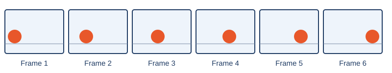

=====================
What is animation?
=====================

.. admonition:: Learning intentions

   * Explain how animation makes still pictures look like they move
   * Describe how animation has changed over time
   * Name the main types of animation and give an example of each
   * Describe how First Nations media artists use animation to tell stories

----

Still pictures that move
------------------------

An animation is a set of still pictures shown one after another, very quickly.
Each picture is called a **frame**. Each frame is a little different from the one
before it. When the frames are shown fast enough, your brain joins them together
and you see smooth movement.

   Six frames. Shown quickly, the ball seems to roll across the screen.

Why does this work?
~~~~~~~~~~~~~~~~~~~

Your eyes and brain do not see the world as separate snapshots. When pictures
change quickly, your brain fills in the gaps between them. This is often called
**persistence of vision**. Scientists today also talk about the **phi
phenomenon** and **beta movement**: the brain sees a series of still pictures as
one moving object.

Frame rate
~~~~~~~~~~

The **frame rate** is how many frames are shown each second. It is measured in
**frames per second (fps)**.

.. list-table::
   :header-rows: 1
   :widths: 35 20 45

   * - Where it is used
     - Frame rate
     - Notes
   * - Cinema film
     - 24 fps
     - The standard for movies for about 100 years
   * - Australian TV (PAL)
     - 25 fps
     - Australia and Europe use 25 fps
   * - Hand-drawn cartoons "on twos"
     - 12 drawings per second
     - Each drawing is shown for 2 frames to save work
   * - Video games
     - 30 to 120 fps or more
     - Higher frame rates feel smoother
   * - Simple GIFs
     - 5 to 15 fps
     - Fewer frames keep the file small

.. admonition:: Animation maths

   **Number of frames = frame rate × length in seconds**

   A 3 second animation at 12 fps needs 12 × 3 = **36 frames**.

   **Delay per frame = 1 ÷ frame rate**

   At 10 fps each frame is shown for 1 ÷ 10 = **0.1 seconds**.

----

A short history of animation
----------------------------

People have tried to make pictures move for a very long time. Here are some
important steps.

.. list-table::
   :header-rows: 1
   :widths: 15 25 60

   * - When
     - What
     - Why it matters
   * - 1825
     - Thaumatrope
     - A disc with a picture on each side. Spin it on strings and the two pictures
       join (a bird appears in a cage).
   * - 1834
     - Zoetrope
     - A spinning drum with slits. A strip of drawings inside seems to move when
       you look through the slits.
   * - 1868
     - Flip book
     - A small book with a drawing on each page. Flick the pages and the drawing
       moves.
   * - 1908
     - *Fantasmagorie* by Émile Cohl
     - One of the first hand-drawn animated films.
   * - 1926
     - *The Adventures of Prince Achmed* by Lotte Reiniger
     - The oldest surviving animated feature film, made with paper cut-outs.
   * - 1930s
     - Cel animation studios
     - Drawings were painted on clear plastic sheets called **cels** and placed
       over a painted background.
   * - 1995
     - *Toy Story*
     - The first feature film made fully with computer animation.
   * - Today
     - GIFs, apps and games
     - Anyone with a phone or computer can make animation.

.. ordering:: text
   :no-indent:

   Thaumatrope (1825)
   Zoetrope (1834)
   Flip book (1868)
   Fantasmagorie, an early hand-drawn film (1908)
   Prince Achmed, a cut-out feature film (1926)
   Toy Story, the first fully computer-animated feature (1995)

----

Types of animation
------------------

.. list-table::
   :header-rows: 1
   :widths: 25 45 30

   * - Type
     - How it is made
     - Example of where you see it
   * - **Traditional (2D hand-drawn)**
     - Every frame is drawn by hand, on paper or on a screen.
     - Classic cartoons, anime
   * - **Stop motion**
     - Real objects (clay, toys, paper) are moved a tiny bit and photographed
       one frame at a time.
     - Claymation films, LEGO films
   * - **Cut-out**
     - Flat shapes are moved around and photographed or moved on a computer.
     - Some children's TV shows
   * - **2D digital (vector)**
     - Shapes are drawn on a computer. The computer can fill in the movement
       between key poses.
     - Explainer videos, web cartoons
   * - **3D computer (CGI)**
     - Models are built in 3D software, then moved and lit like a film set.
     - Pixar films, video games
   * - **Motion graphics**
     - Text, logos and shapes are animated to give information.
     - TV news titles, adverts, social media
   * - **Rotoscoping**
     - Animators trace over real video, frame by frame.
     - Music videos, some feature films

.. classifying::
   :delimiter: =>
   :instructions: Drag each description into the type of animation it describes.

   Clay models are moved and photographed one frame at a time => Stop motion
   Every frame is drawn by hand => Traditional 2D
   Models are built and lit inside 3D software => 3D computer
   Animated text and logos give information on the news => Motion graphics
   LEGO figures are moved a tiny bit between photos => Stop motion
   Drawings on paper are scanned and played in order => Traditional 2D
   A character is rigged with a skeleton and posed in 3D => 3D computer
   A company logo spins and flies onto the screen => Motion graphics

----

First Nations storytelling through animation
--------------------------------------------

Aboriginal and Torres Strait Islander Peoples have the oldest continuing
storytelling cultures in the world. Today, many First Nations artists and
communities use animation to share stories, languages and culture in new ways.

*Dust Echoes* (ABC)
~~~~~~~~~~~~~~~~~~~

*Dust Echoes* is a series of short animated films. Each film retells a Dreaming
story from the Wugularr (Beswick) community in Arnhem Land, in the Northern
Territory. The ABC made the series with the Djilpin Arts Aboriginal Corporation
and the community. The stories were first recorded as audio, then young
Australian animators turned them into films, each in a different style.

*Little J & Big Cuz* (NITV)
~~~~~~~~~~~~~~~~~~~~~~~~~~~

*Little J & Big Cuz* first screened on NITV in 2017. It was Australia's first
animated children's series with Aboriginal main characters. It follows two
cousins as they explore family, school and Country. Episodes have been made in a
number of First Nations languages, so children can hear their own language on
screen.

.. admonition:: Think about it

   * Why might a community choose animation instead of live action to tell a
     Dreaming story?
   * Why does it matter that children see characters like themselves on screen?
   * Whose permission is needed before a cultural story is shared? Why?

.. note::

   Many cultural stories belong to a particular community or family. Media
   artists must work **with** communities and get permission before they retell
   these stories. This idea is called **cultural protocol**.

----

Activity: make a flip book
--------------------------

Before you use a computer, make an animation by hand. This shows you how frames
work.

#. Take a pad of sticky notes (or the corner of an old exercise book).
#. On the **last** page, draw a simple picture, such as a stick figure or a ball.
#. On the page above, trace the picture but move it a **tiny** bit.
#. Keep going for at least **12 pages**.
#. Flick the pages from the back to the front. Your drawing should move.

.. tip::

   Small changes between frames give smooth movement. Big changes make the
   picture jump.

----

Check your understanding
------------------------

.. mcqgroup::
   :show-instant-feedback:
   :shuffle-questions:

   .. multichoice::

      What is a **frame** in animation?

      [x] One still picture in a sequence | Yes. Many frames shown quickly make the animation.
      [ ] The border around a video | That is a different meaning of the word frame.
      [ ] The speed of the animation | That is the frame rate.
      [ ] A type of camera | No. A frame is a single picture.

   .. multichoice::

      What does **fps** stand for?

      [ ] Files per second | Not quite.
      [x] Frames per second | Yes. It tells you how many frames are shown each second.
      [ ] Frames per scene | Not quite.
      [ ] Fast picture speed | Not quite.

   .. multichoice::

      What frame rate do cinema films usually use?

      [ ] 12 fps | This is used for cartoons drawn "on twos".
      [x] 24 fps | Yes. Films have used 24 fps for about 100 years.
      [ ] 60 fps | This is more common in video games.
      [ ] 5 fps | This would look very jerky.

   .. multichoice::

      An animation runs at 10 fps for 4 seconds. How many frames does it need?

      [ ] 14 | You added. Multiply instead.
      [x] 40 | Yes. 10 × 4 = 40 frames.
      [ ] 2.5 | You divided. Multiply instead.
      [ ] 400 | Check your multiplication.

   .. multichoice::

      Which type of animation photographs real objects one frame at a time?

      [ ] CGI | CGI is made inside a computer.
      [ ] Motion graphics | Motion graphics animate text and shapes.
      [x] Stop motion | Yes. Clay, toys or paper are moved and photographed.
      [ ] Rotoscoping | Rotoscoping traces over video.

   .. multichoice::

      What was special about *Toy Story* (1995)?

      [ ] It was the first animated film | Animated films had been made since the early 1900s.
      [x] It was the first feature film made fully with computer animation | Correct.
      [ ] It was the first stop motion film | It was computer animated.
      [ ] It was the first film with sound | Sound films started in the 1920s.

   .. multichoice::

      *Dust Echoes* retells Dreaming stories from which community?

      [x] The Wugularr (Beswick) community in Arnhem Land | Yes. The ABC worked with this community and Djilpin Arts.
      [ ] A community in Tasmania | Not this series.
      [ ] The Torres Strait Islands | Not this series.
      [ ] It uses stories made up by the animators | No. The stories came from the community.

   .. multichoice::

      What is **cultural protocol**?

      [ ] A type of animation software | No.
      [x] Working with a community and getting permission before sharing its stories | Yes.
      [ ] Making an animation in your own language | Not quite.
      [ ] Rules about frame rates | No.

.. clozegroup::
   :show-instant-feedback:

   .. cloze:: text

      An animation is made of still pictures called @@frames@@.
      The number shown each second is the @@frame rate@@.
      Your brain joins the pictures together. This is often called @@persistence@@ of vision.
      Films usually run at @@24@@ frames per second.
      In @@stop motion@@ animation, real objects are photographed one frame at a time.
