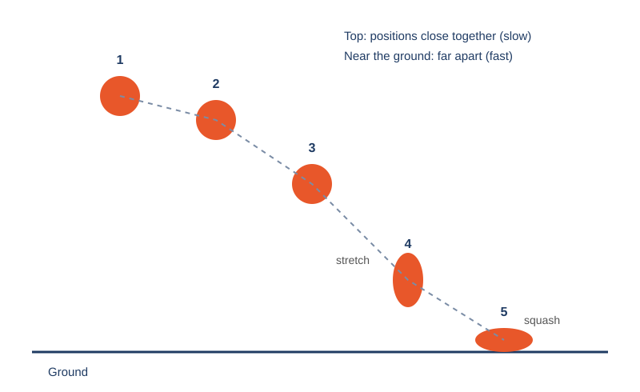

===========================
The principles of animation
===========================

.. admonition:: Learning intentions

   * Name and explain the main principles of animation
   * Spot the principles in animations you watch
   * Plan to use the principles in your own GIF

----

Where the principles come from
------------------------------

In 1981 two Disney animators, **Frank Thomas** and **Ollie Johnston**, wrote a
book called *The Illusion of Life*. In it they listed **12 principles of
animation**. These are tips that make movement look believable and full of life.
Animators all over the world still use them, in hand-drawn, stop motion and 3D
animation.

You do not need to use all twelve in a short GIF. The table shows them all, and
the ones marked ★ are the most useful for this unit.

   A bouncing ball shows squash and stretch, arcs, and slow in and slow out.

The 12 principles
-----------------

.. list-table::
   :header-rows: 1
   :widths: 28 72

   * - Principle
     - What it means
   * - ★ **Squash and stretch**
     - Objects squash when they hit something and stretch when they move fast.
       This makes them look soft or bouncy. The object should keep the same
       amount of "stuff" (volume): if it gets flatter it also gets wider.
   * - ★ **Anticipation**
     - A small movement that gets the audience ready for the main action. A
       character crouches before they jump.
   * - **Staging**
     - Present the action clearly so the audience knows where to look. Keep the
       background simple behind important action.
   * - **Straight ahead and pose to pose**
     - *Straight ahead*: draw each frame in order from start to finish.
       *Pose to pose*: draw the key poses first, then fill in the frames between.
   * - ★ **Follow through and overlapping action**
     - Parts keep moving after the main body stops. Hair, a tail or a cape swings
       on after a character stops running.
   * - ★ **Slow in and slow out (easing)**
     - Things speed up and slow down gradually. Put more frames near the start
       and end of a movement and fewer in the middle.
   * - ★ **Arcs**
     - Most natural movements follow a curved path, not a straight line. A thrown
       ball travels in an arc.
   * - **Secondary action**
     - A smaller action that supports the main one. A character whistles while
       walking.
   * - ★ **Timing**
     - The number of frames used for an action. More frames make an action slow;
       fewer frames make it fast. Timing shows weight and mood.
   * - **Exaggeration**
     - Push movements and expressions further than real life so they read clearly
       and are more fun.
   * - **Solid drawing**
     - Draw characters so they look like they have weight and depth, in 3D space.
   * - **Appeal**
     - Characters and designs should be interesting and pleasant to watch. A
       villain can have appeal too.

Timing and weight
~~~~~~~~~~~~~~~~~

Timing tells the audience how heavy something is.

* A **bowling ball** falls fast, bounces low and stops quickly. It hardly squashes.
* A **beach ball** floats down slowly, bounces high and squashes a lot.
* A **ping-pong ball** bounces many times, very quickly.

----

Activity: principle spotting
----------------------------

Watch a short animation your teacher shows you (or a cartoon of your choice).
Copy and fill in the table in your workbook.

.. list-table::
   :header-rows: 1
   :widths: 30 35 35

   * - Principle
     - Where did you see it?
     - What did it add?
   * - Squash and stretch
     -
     -
   * - Anticipation
     -
     -
   * - Follow through
     -
     -
   * - Slow in and slow out
     -
     -
   * - Arcs
     -
     -

----

Check your understanding
------------------------

.. classifying::
   :delimiter: =>
   :instructions: Match each example to the principle it shows.

   A ball flattens when it hits the floor => Squash and stretch
   A cat crouches down before it pounces => Anticipation
   A dog's ears keep flapping after it stops running => Follow through
   A car starts slowly then speeds up => Slow in and slow out
   A thrown ball travels in a curve => Arcs
   A rubber duck stretches long as it falls => Squash and stretch
   A batter swings the bat back before hitting => Anticipation
   A skirt keeps swinging after a dancer stops => Follow through

.. mcqgroup::
   :show-instant-feedback:
   :shuffle-questions:

   .. multichoice::

      Who listed the 12 principles of animation?

      [ ] Walt Disney and Mickey Mouse | Not quite.
      [x] Frank Thomas and Ollie Johnston | Yes, in their 1981 book *The Illusion of Life*.
      [ ] Émile Cohl | Cohl made early animated films in 1908.
      [ ] Pixar | Pixar uses the principles, but did not write them.

   .. multichoice::

      A character bends their knees before jumping. Which principle is this?

      [x] Anticipation | Yes. The small movement prepares the audience for the jump.
      [ ] Follow through | Follow through happens **after** the action.
      [ ] Staging | Staging is about presenting the action clearly.
      [ ] Appeal | Appeal is about making characters interesting.

   .. multichoice::

      To make a movement look slow, you should...

      [x] use more frames | Yes. More frames for the same movement means it takes longer.
      [ ] use fewer frames | Fewer frames make a movement faster.
      [ ] use brighter colours | Colour does not change the speed.
      [ ] make the object bigger | Size does not change the speed.

   .. multichoice::

      When a ball squashes as it hits the ground, it should also...

      [ ] get smaller overall | It should keep the same volume.
      [x] get wider | Yes. Flatter and wider, so it keeps the same amount of "stuff".
      [ ] change colour | No.
      [ ] disappear | No.

   .. multichoice::

      Which object would bounce the **lowest** and squash the **least**?

      [x] A bowling ball | Yes. It is heavy and hard.
      [ ] A beach ball | A beach ball is light and squashes a lot.
      [ ] A tennis ball | A tennis ball bounces quite high.
      [ ] A balloon | A balloon is very light and floaty.

   .. multichoice::

      Most natural movements follow...

      [ ] straight lines | Machines move in straight lines; living things usually do not.
      [x] curved paths called arcs | Yes.
      [ ] zig-zags | No.
      [ ] squares | No.

.. flashcards:: The 12 principles of animation
   :id: y10mm-anim-principles
   :shuffle:

   Squash and stretch | Objects squash on impact and stretch when moving fast, keeping the same volume
   Anticipation | A small movement that prepares the audience for the main action
   Staging | Presenting the action clearly so the audience knows where to look
   Straight ahead and pose to pose | Drawing frames in order, or drawing key poses first and filling in between
   Follow through and overlapping action | Parts keep moving after the main body stops
   Slow in and slow out | Movements speed up and slow down gradually (easing)
   Arcs | Natural movements follow curved paths
   Secondary action | A smaller action that supports the main action
   Timing | The number of frames for an action, which shows speed, weight and mood
   Exaggeration | Pushing movement further than real life so it reads clearly
   Solid drawing | Drawing so characters look like they have weight and depth
   Appeal | Making characters interesting and pleasant to watch
