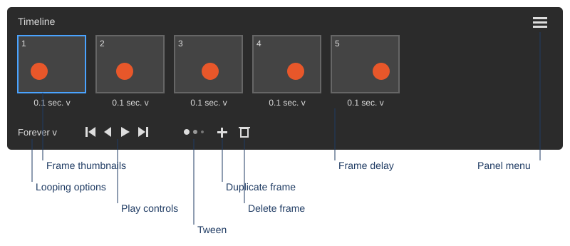

=====================================
Photoshop basics: layers and frames
=====================================

.. admonition:: Learning intentions

   * Find your way around the Photoshop workspace
   * Use layers to keep parts of a picture separate
   * Use the Timeline panel to turn layers into animation frames
   * Make your first looping GIF: a face that blinks

----

The Photoshop workspace
-----------------------

.. list-table::
   :header-rows: 1
   :widths: 25 75

   * - Part
     - What it does
   * - **Menu bar** (top)
     - File, Edit, Image, Layer and more. Most commands live here.
   * - **Options bar** (under the menu)
     - Settings for the tool you have chosen, such as brush size.
   * - **Toolbar** (left)
     - Tools such as Move (**V**), Brush (**B**), Eraser (**E**), Type (**T**) and
       Rectangle Marquee (**M**).
   * - **Canvas** (middle)
     - Your picture.
   * - **Panels** (right)
     - Layers, Properties, Colour and more. Open any panel from the **Window** menu.
   * - **Timeline** (bottom)
     - Where you build animations. Open it with **Window > Timeline**.

.. tip::

   If your panels get messy, choose **Window > Workspace > Reset Essentials**.

----

Layers
------

Think of layers as clear plastic sheets stacked on top of each other. You can
draw on one sheet without changing the others.

* The layer at the **top** of the Layers panel is in **front**.
* Click the **eye** icon to hide or show a layer.
* Drag a layer up or down to change its order.
* Double-click a layer's name to rename it. **Always give layers clear names.**
* Click the **+** button (Create a new layer) at the bottom of the panel to add a layer.

.. admonition:: Why layers matter for animation

   In Photoshop, each animation frame remembers **which layers are visible**,
   **where they are**, and their **opacity**. So you animate by turning layers
   on and off, or by moving them, from frame to frame.

----

The Timeline panel
------------------

Photoshop has two kinds of timeline. For GIFs we use the **frame animation**
timeline.

#. Click **Window > Timeline**.
#. In the middle of the Timeline panel is a button with a small arrow next to it.
   Click the **arrow** and choose **Create Frame Animation**.
#. Click the **button**. You now have one frame.

   The parts of the frame animation timeline.

.. list-table::
   :header-rows: 1
   :widths: 30 70

   * - Control
     - What it does
   * - **Frame thumbnails**
     - Each box is one frame. Click a frame to edit it.
   * - **Frame delay** (e.g. ``0 sec.`` under a frame)
     - Click it to choose how long the frame is shown.
   * - **Looping options** (e.g. ``Forever``)
     - How many times the GIF plays. Most GIFs loop **Forever**.
   * - **Play controls**
     - Go to first frame, back one frame, play, forward one frame.
   * - **Tween button**
     - Makes in-between frames for you (see :doc:`anim_05_tweening_banner`).
   * - **Duplicate frame** (+ icon)
     - Copies the selected frame.
   * - **Delete frame** (bin icon)
     - Deletes the selected frame.
   * - **Panel menu** (four lines, top right)
     - Extra commands, such as **Make Frames From Layers** and **Reverse Frames**.

----

Tutorial: a blinking face
-------------------------

In this tutorial you will make a face that blinks. The face uses two frames: eyes
open and eyes closed. By changing the delay on each frame, the blink looks
natural.

.. admonition:: You need

   From the **animation student kit**, the ``blink`` folder:
   ``face.png``, ``eyes_open.png`` and ``eyes_closed.png``.

Step 1: Load the parts as layers
~~~~~~~~~~~~~~~~~~~~~~~~~~~~~~~~

#. Open Photoshop.
#. Click **File > Scripts > Load Files into Stack...**
#. Click **Browse**. Open the ``blink`` folder. Select all three PNG files and
   click **Open**, then **OK**.
#. Check the **Layers** panel. You should have three layers.
#. Drag the layers so ``face`` is at the **bottom** and the two eye layers are
   above it.

Step 2: Make frame 1 (eyes open)
~~~~~~~~~~~~~~~~~~~~~~~~~~~~~~~~

#. Open the Timeline (**Window > Timeline**) and click **Create Frame Animation**.
#. In the Layers panel, turn **on** ``face`` and ``eyes_open``.
#. Turn **off** ``eyes_closed`` (click its eye icon).

Step 3: Make frame 2 (eyes closed)
~~~~~~~~~~~~~~~~~~~~~~~~~~~~~~~~~~

#. In the Timeline, click **Duplicate selected frame** (the + icon). You now have
   two frames. Frame 2 is selected.
#. In the Layers panel, turn **off** ``eyes_open`` and turn **on** ``eyes_closed``.
#. Click frame 1, then frame 2. The eyes should open and close.

Step 4: Set the timing
~~~~~~~~~~~~~~~~~~~~~~

People keep their eyes open for a few seconds, then blink very quickly.

#. Click the delay under **frame 1** and choose **2.0** seconds.
#. Click the delay under **frame 2** and choose **0.1** seconds.
#. Set the looping option to **Forever**.
#. Press the **Play** button (or the **space bar**). Does it look like a real
   blink?

Step 5: Save your work
~~~~~~~~~~~~~~~~~~~~~~

#. **File > Save As**. Choose **Photoshop (*.PSD)** and name it ``blink_yourname.psd``.
   The PSD keeps all your layers and frames so you can edit it later.
#. **File > Export > Save for Web (Legacy)...** (shortcut **Alt + Shift + Ctrl + S**).
#. Choose the **GIF** preset, check **Looping Options: Forever**, and click **Save**.
#. Name it ``blink_yourname.gif``.
#. Drag the GIF into a web browser to watch it play.

.. warning::

   A **GIF** cannot be edited like a PSD. It only keeps the finished frames.
   Always keep your **PSD** too.

Extension challenges
~~~~~~~~~~~~~~~~~~~~

* Add a third frame with the eyes **half closed** between open and closed. Does
  the blink look smoother?
* Make the face blink **twice** quickly, then wait. (Hint: you need more frames.)
* Draw your own mouth layers and make the face smile after it blinks.

----

Useful frame tricks
-------------------

.. list-table::
   :header-rows: 1
   :widths: 35 65

   * - Trick
     - How
   * - Make one frame per layer
     - Panel menu > **Make Frames From Layers**
   * - Frames are in the wrong order
     - Select all frames, then Panel menu > **Reverse Frames**
   * - Change the delay on many frames
     - Click the first frame, **Shift**-click the last frame, then change one
       delay. They all change.
   * - Change a layer in every frame at once
     - Select all frames first, then change the layer.
   * - A new layer keeps appearing in every frame
     - Panel menu > untick **New Layers Visible in All Frames**
   * - Trace over the last frame
     - Lower the old layer's **Opacity** to about 30% so you can see it under
       your new drawing. Set it back to 100% when you are finished.

----

Check your understanding
------------------------

.. mcqgroup::
   :show-instant-feedback:
   :shuffle-questions:

   .. multichoice::

      How do you open the Timeline panel?

      [x] Window > Timeline | Yes. All panels can be found in the Window menu.
      [ ] File > Timeline | Not in the File menu.
      [ ] Layer > Timeline | Not in the Layer menu.
      [ ] Image > Animation | Not quite.

   .. multichoice::

      Which layer appears in **front** of all the others?

      [x] The layer at the top of the Layers panel | Yes.
      [ ] The layer at the bottom of the Layers panel | That one is at the back.
      [ ] The layer with the longest name | Names do not change the order.
      [ ] The layer you made first | Not necessarily.

   .. multichoice::

      What does each frame in a frame animation remember? (Choose **all** that are correct.)

      [x] Which layers are visible | Correct.
      [x] Where each layer is positioned | Correct.
      [x] Each layer's opacity | Correct.
      [ ] Which tool you were using | No. The tool is not saved in a frame.

   .. multichoice::

      Why should you save a **PSD** as well as a GIF?

      [ ] PSD files are smaller | PSD files are usually much bigger.
      [x] The PSD keeps your layers and frames so you can edit them later | Yes.
      [ ] Web browsers can only show PSD files | Browsers show GIFs, not PSDs.
      [ ] GIFs cannot loop | GIFs can loop.

   .. multichoice::

      Which looping option do most GIFs use?

      [ ] Once | The GIF would play once and stop.
      [ ] 3 times | Possible, but not the usual choice.
      [x] Forever | Yes.
      [ ] Never | Then it would not play.

   .. multichoice::

      In the blinking face, why is frame 1 shown for 2 seconds and frame 2 for only 0.1 seconds?

      [x] Real eyes stay open for a while and blink very quickly | Yes. Timing makes it look natural.
      [ ] So the file is smaller | Delay does not change file size much.
      [ ] Photoshop will not allow equal delays | It will.
      [ ] It does not matter | Try equal delays: it looks strange.

.. ordering:: text
   :no-indent:

   Load the picture files into a stack of layers
   Open the Timeline and choose Create Frame Animation
   Set up the layers for frame 1
   Duplicate the frame and change the layers for frame 2
   Set the delay for each frame and choose Forever
   Save a PSD, then export the GIF with Save for Web
