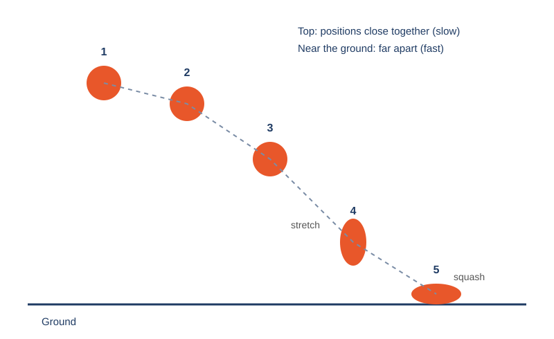

==========================
Tutorial: a bouncing ball
==========================

.. admonition:: Learning intentions

   * Use **pose to pose** planning to animate a bouncing ball
   * Show **squash and stretch**, **timing** and **slow in and slow out**
   * Move layers between frames to create movement

The bouncing ball is the first exercise almost every animator learns. It looks
simple, but it uses many of the principles of animation.

   The ball moves slowly at the top (positions close together) and fast near the
   ground (positions far apart).

----

Plan the bounce
---------------

Look at the diagram above.

* At the **top** of the bounce the ball slows down, stops for a moment, then
  starts to fall. The positions are **close together**.
* Near the **ground** the ball is moving fast. The positions are **far apart**.
* Just before it hits the ground, the ball **stretches** (it is moving fast).
* When it hits the ground it **squashes** flat and wide.
* As it leaves the ground it **stretches** again, then goes back to round.

.. admonition:: You need

   From the **animation student kit**, the ``bouncing_ball`` folder:

   * ``bounce_background.png``: the floor and wall
   * ``bounce_guide.png``: numbered circles showing where the ball goes in each frame
   * ``ball.png``, ``ball_stretch.png`` and ``ball_squash.png``: three shapes of the ball

----

Step 1: Set up the layers
-------------------------

#. In Photoshop, open ``bounce_background.png`` (**File > Open**).
#. Drag ``bounce_guide.png`` from File Explorer onto the canvas. Press **Enter**
   to place it. Rename the layer ``guide``.
#. Drag in ``ball.png``, ``ball_stretch.png`` and ``ball_squash.png`` the same way.
   Press **Enter** after each one.
#. Right-click each placed layer and choose **Rasterize Layer**.
#. Check your layer order, from top to bottom:

   .. code-block:: text
      :class: no-copybutton

      ball_squash
      ball_stretch
      ball
      guide
      Background

#. Hide ``ball_stretch`` and ``ball_squash`` for now.

.. tip::

   The guide layer is only there to help you. You will hide it before you export.

----

Step 2: Make the frames
-----------------------

Open the Timeline (**Window > Timeline**) and click **Create Frame Animation**.
You will make **8 frames**. For each frame you choose **which ball** is showing
and **move it** onto the matching numbered circle on the guide.

.. list-table::
   :header-rows: 1
   :widths: 12 28 60

   * - Frame
     - Ball layer shown
     - Where
   * - 1
     - ``ball``
     - Circle 1, at the top
   * - 2
     - ``ball``
     - Circle 2, just below the top
   * - 3
     - ``ball``
     - Circle 3, halfway down
   * - 4
     - ``ball_stretch``
     - Circle 4, just above the floor
   * - 5
     - ``ball_squash``
     - Circle 5, flat on the floor
   * - 6
     - ``ball_stretch``
     - Circle 4 again, going up
   * - 7
     - ``ball``
     - Circle 3 again
   * - 8
     - ``ball``
     - Circle 2 again

For **each** new frame:

#. Click **Duplicate selected frame** (+) in the Timeline.
#. In the Layers panel, show the right ball layer and hide the other two.
#. Click the ball layer, choose the **Move tool** (**V**) and drag the ball onto
   the numbered circle. Use the **arrow keys** to nudge it 1 pixel at a time
   (**Shift + arrow** moves 10 pixels).

After frame 8 the animation loops back to frame 1, so the ball keeps bouncing.

.. note::

   You do not need a frame 9 at the top. Frame 1 is the top, and the loop takes
   the ball back there.

----

Step 3: Timing
--------------

#. Click frame 1, then **Shift**-click frame 8 to select all the frames.
#. Click any delay and choose **Other...** Type ``0.06`` and click **OK**.
#. Click frame 1 only and set its delay to ``0.12``. The ball "hangs" at the
   top for a moment, which looks more natural.
#. Set looping to **Forever** and press **Play**.

.. admonition:: Experiment

   * Make every delay ``0.2``. What kind of ball does it look like now?
   * Make every delay ``0.03``. What happens?
   * Remove the squash frame. Does the bounce still feel bouncy?

----

Step 4: Hide the guide and export
---------------------------------

#. Select **all** frames (click frame 1, **Shift**-click frame 8).
#. Hide the ``guide`` layer. Because all frames are selected, it is hidden in
   every frame.
#. Press **Play** to check.
#. Save as ``bounce_yourname.psd``.
#. **File > Export > Save for Web (Legacy)**. Choose **GIF**, **Looping: Forever**,
   and save as ``bounce_yourname.gif``.

----

Extension challenges
--------------------

.. list-table::
   :header-rows: 1
   :widths: 25 75

   * - Challenge
     - Hint
   * - **Shadow**
     - Draw a dark grey oval on a new layer under the ball. Make three sizes.
       Show the biggest shadow when the ball is on the ground.
   * - **Bounce across the screen**
     - Move the ball a little to the right in every frame, as well as up and down.
       You will need more frames, and the ball should follow an **arc**.
   * - **Losing height**
     - Each bounce is lower than the one before, until the ball stops. A real ball
       loses energy with every bounce.
   * - **Different balls**
     - Make a bowling ball and a beach ball. Change the timing and the squash to
       show their weight.

----

Check your understanding
------------------------

.. mcqgroup::
   :show-instant-feedback:
   :shuffle-questions:

   .. multichoice::

      Why are the ball positions close together at the top of the bounce?

      [x] The ball is moving slowly there | Yes. Small gaps between positions mean slow movement.
      [ ] The ball is moving fast there | Fast movement means big gaps.
      [ ] To save frames | No, it actually uses more frames.
      [ ] The guide was drawn wrongly | No, this is on purpose.

   .. multichoice::

      In which frame does the ball **squash**?

      [ ] When it is at the top | At the top the ball is round.
      [x] When it hits the ground | Yes. The impact pushes it flat and wide.
      [ ] Halfway down | Halfway down it is moving fast but has not hit anything.
      [ ] Never | A bouncy ball squashes when it hits the ground.

   .. multichoice::

      Why do we use three separate ball layers instead of changing the shape of one ball with Free Transform?

      [x] Free Transform changes the pixels in every frame, but turning layers on and off is saved per frame | Yes.
      [ ] Free Transform does not work on circles | It does.
      [ ] Three layers make a smaller GIF | Not the reason.
      [ ] Photoshop only allows three layers | No limit like this.

   .. multichoice::

      What does using **pose to pose** mean?

      [ ] Drawing every frame in order from the start | That is straight ahead.
      [x] Planning the key positions first, then filling in the frames between | Yes. The guide shows the key positions.
      [ ] Copying poses from a photo | Not quite.
      [ ] Using only two frames | No.

   .. multichoice::

      Every frame delay is set to 0.2 seconds. The ball will look...

      [ ] faster and lighter | Longer delays make it slower.
      [x] slower, like it is floating or in slow motion | Yes.
      [ ] exactly the same | Timing changes the feel a lot.
      [ ] squashed | Delay does not change the shape.

.. clozegroup::
   :show-instant-feedback:

   .. cloze:: text

      At the top of a bounce the ball moves @@slowly@@ so the positions are close together.
      Just before it hits the ground the ball @@stretches@@ because it is moving fast.
      When it hits the ground it @@squashes@@ flat and wide.
      Planning key positions first is called @@pose@@ to pose animation.
      A heavy ball bounces @@lower@@ than a light ball.
