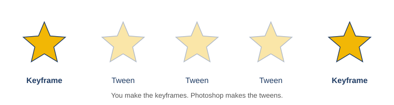

=========================================
Tutorial: tweening and an animated banner
=========================================

.. admonition:: Learning intentions

   * Use **tweening** to let Photoshop make the in-between frames
   * Animate **position** and **opacity** (fading)
   * Combine text and pictures in an animated banner
   * Export a GIF that is a sensible file size

----

What is tweening?
-----------------

Drawing every frame takes a long time. In **pose to pose** animation the
animator makes the important frames, called **keyframes**, and then fills in the
frames between them. These middle frames are called **in-betweens**, or
**tweens**.

Photoshop can make the tweens for you. You give it two frames and tell it how
many frames to add. It works out the steps in between for:

* **Position**: a layer slides from one place to another
* **Opacity**: a layer fades in or out
* **Effects**: layer styles, such as a drop shadow, change gradually

   You make the two keyframes. Photoshop makes the tweens.

.. warning::

   Tweening does **not** change the shape of a drawing. It only changes position,
   opacity and effects. For a change of shape (such as squash and stretch), you
   need separate layers, like in the bouncing ball.

----

Tutorial part 1: a sliding skateboard
-------------------------------------

The client is a new skate park, **Harbourside Skate Park**. They want a banner
for their website that says the park is opening.

.. admonition:: You need

   From the **animation student kit**, the ``banner`` folder:
   ``banner_background.png`` (800 × 300 pixels) and ``skateboard.png``.

Step 1: Set up
~~~~~~~~~~~~~~

#. Open ``banner_background.png``.
#. Drag ``skateboard.png`` onto the canvas, press **Enter**, then right-click the
   layer and choose **Rasterize Layer**. Rename it ``skateboard``.
#. Open the Timeline and click **Create Frame Animation**.

Step 2: Make the two keyframes
~~~~~~~~~~~~~~~~~~~~~~~~~~~~~~

#. With frame 1 selected, use the **Move tool** to drag the skateboard **off the
   left edge** of the canvas so you can only just see the front wheel.
#. Click **Duplicate selected frame**. Frame 2 is now selected.
#. Drag the skateboard to the **middle** of the banner. Hold **Shift** while you
   drag to keep it in a straight line.

Step 3: Tween
~~~~~~~~~~~~~

#. Click **frame 1**.
#. Click the **Tween** button in the Timeline (or Panel menu > **Tween...**).
#. Set:

   * **Tween With:** Next Frame
   * **Frames to Add:** 8
   * **Layers:** All Layers
   * **Parameters:** tick Position, Opacity and Effects

#. Click **OK**. You now have 10 frames.
#. Select all the frames and set the delay to ``0.05``. Press **Play**.

----

Tutorial part 2: fade in the text
---------------------------------

#. Click the **last** frame.
#. Choose the **Type tool** (**T**), click on the banner and type
   ``OPENING SATURDAY``. Choose a bold font and a colour that stands out.
#. Press **Ctrl + Enter** to finish typing.
#. In the Layers panel, set the text layer's **Opacity** to ``0%``.
#. Click **Duplicate selected frame**. In this new last frame, set the text
   layer's opacity to ``100%``.
#. Click the frame **before** the last one. Click **Tween**, choose **Next
   Frame**, add **6** frames, and click **OK**.
#. Click the very last frame and set its delay to ``2`` seconds, so people can
   read the message before the animation loops.

.. important::

   **Check the earlier frames.** If the text appears in frames 1 to 10, select
   those frames and hide the text layer. To stop this happening, go to the Panel
   menu and untick **New Layers Visible in All Frames** before you add new layers.

Extension
~~~~~~~~~

* Add a second line, ``harbourside.example.com``, that slides up from the bottom.
* Make the skateboard roll off the right side before the loop starts again.
* Add a layer style (**Layer > Layer Style > Outer Glow**) to the text and
  tween it from 0 to full strength.

----

Exporting a GIF well
--------------------

GIFs can only use up to **256 colours**. Photoshop has to choose which colours
to keep. The choices you make in **Save for Web** change how the GIF looks and
how big the file is.

.. list-table::
   :header-rows: 1
   :widths: 25 75

   * - Setting
     - What it does
   * - **Colours**
     - Up to 256. Fewer colours make a smaller file, but too few look blotchy.
       Try 64 or 128 for simple graphics.
   * - **Colour reduction** (Selective, Adaptive, Perceptual)
     - How Photoshop picks the colours. **Selective** is a good default.
   * - **Dither**
     - Mixes dots of colour to fake colours that are not in the palette. Helps
       with gradients and photos, but makes the file bigger.
   * - **Transparency**
     - Keeps see-through areas. A GIF pixel is either fully see-through or not
       at all, so soft edges can look rough.
   * - **Matte**
     - The colour used to blend the edges of transparent areas. Choose the colour
       of the page your GIF will sit on.
   * - **Image size**
     - Smaller width and height means a much smaller file.
   * - **Looping Options**
     - Once, or Forever.

.. tip::

   The bottom-left corner of the Save for Web window shows the **file size** and
   how long it would take to load. Try to keep a web banner under about **1 MB**.
   Use the **Preview** button to watch the GIF before you save.

How to make a GIF smaller
~~~~~~~~~~~~~~~~~~~~~~~~~

#. Use fewer frames.
#. Make the picture smaller (width and height).
#. Use fewer colours.
#. Turn dither off or down.
#. Use flat colours instead of photos and gradients.

.. ordering:: text
   :no-indent:

   Make the first keyframe
   Duplicate the frame
   Move or fade the layer to make the second keyframe
   Select the first keyframe
   Click Tween and choose the number of frames to add
   Set the frame delays and preview

----

Check your understanding
------------------------

.. mcqgroup::
   :show-instant-feedback:
   :shuffle-questions:

   .. multichoice::

      What is a **tween**?

      [x] A frame in between two keyframes | Yes. Tween is short for in-between.
      [ ] The first frame of an animation | That is a keyframe.
      [ ] A type of file | No.
      [ ] Two animations side by side | No.

   .. multichoice::

      Which of these can Photoshop tween? (Choose **all** that are correct.)

      [x] Position | Correct.
      [x] Opacity | Correct.
      [x] Layer effects | Correct.
      [ ] The shape of a drawing | No. Shape changes need separate layers.

   .. multichoice::

      What is the most colours a GIF can have?

      [ ] 16 | GIFs can have more than this.
      [x] 256 | Yes.
      [ ] 16.7 million | That is how many colours a JPG or PNG can show.
      [ ] Unlimited | No. That is why GIFs can look blotchy.

   .. multichoice::

      Your GIF is 6 MB. Which change would help **most** to make it smaller?

      [x] Make the width and height smaller and use fewer frames | Yes. These make the biggest difference.
      [ ] Change the looping to Forever | Looping does not change the size.
      [ ] Add dither | Dither makes files bigger.
      [ ] Add more colours | More colours make files bigger.

   .. multichoice::

      Why should the last frame of a text banner have a long delay?

      [ ] So the file is smaller | Delay barely changes file size.
      [x] So people have time to read the message | Yes.
      [ ] Photoshop needs it to loop | It does not.
      [ ] It makes the animation smoother | Not really.

   .. multichoice::

      What does **dither** do?

      [ ] Makes the GIF loop | That is the looping option.
      [x] Mixes dots of colour to fake colours that are not in the palette | Yes.
      [ ] Removes the background | No.
      [ ] Speeds up the animation | No.

.. clozegroup::
   :show-instant-feedback:

   .. cloze:: text

      The important frames that the animator makes are called @@keyframes@@.
      Photoshop can make the frames in between. This is called @@tweening@@.
      To make a layer fade in, you change its @@opacity@@.
      A GIF can use up to @@256@@ colours.
      Mixing dots of colour to fake missing colours is called @@dither@@.
