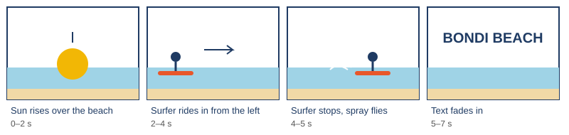

=================================
Assessment: animated GIF
=================================

.. admonition:: Task summary

   **Type:** Media production

   **You will:** choose a design brief, plan your GIF with a storyboard, make it in
   Photoshop, export it, and write a reflection.

   **Hand in:** storyboard, ``.psd`` file, ``.gif`` file, reflection.

----

Choose a design brief
---------------------

A **design brief** is a set of instructions from a client. It tells you what the
client wants, who the audience is, and any rules you must follow. Choose **one**
brief.

.. tab-set::

   .. tab-item:: Brief A: Local hero

      **Client:** Your local council

      **Purpose:** A looping GIF for the council's social media that celebrates a
      place, animal or event that makes your local area special.

      **Audience:** People of all ages who live in the area

      **Must include:**

      * The name of the place, animal or event as text
      * At least one object that moves across or around the frame
      * At least one principle of animation (squash and stretch, anticipation,
        follow through or easing)

      **Size:** 1080 × 1080 pixels (square)

   .. tab-item:: Brief B: Our Australia

      **Client:** A youth arts festival

      **Purpose:** A GIF that shows what Australian identity means to you. It could
      be about family, sport, food, Country, the beach, the bush, languages or
      cultures.

      **Audience:** Young people aged 12 to 18

      **Must include:**

      * A short message or slogan (no more than 8 words)
      * At least two moving elements
      * Respect for all cultures. If you include Aboriginal and Torres Strait
        Islander art styles or stories, you must **not** copy them. Talk with your
        teacher about cultural protocols first.

      **Size:** 1080 × 1350 pixels (portrait)

   .. tab-item:: Brief C: Product launch

      **Client:** A business of your choice (real or made up), such as a café,
      a sports shop or a game company

      **Purpose:** An animated web banner that advertises a new product or special
      offer.

      **Audience:** You decide, and you must describe them in your plan

      **Must include:**

      * The business name or logo
      * The product and a call to action, such as ``Order now`` or ``Visit us``
      * Text that stays on screen long enough to read

      **Size:** 800 × 300 pixels (wide banner)

Rules for all briefs
~~~~~~~~~~~~~~~~~~~~

* Length: **2 to 8 seconds** before it loops
* At least **12 frames**
* File size: **under 3 MB**
* All pictures must be **your own** or used legally, with credits in your reflection
* Must loop smoothly (the last frame should lead back into the first)

----

Step 1: Investigate
-------------------

Answer these questions in your planning document.

#. Which brief did you choose?
#. Who is the audience? What do they like? What will grab their attention?
#. Find **two** GIFs or animated banners made by other people. For each one, write
   what works well and what you would change.
#. What message or feeling should your GIF give?

Step 2: Storyboard
------------------

A **storyboard** is a set of sketches that shows what happens in the animation,
like a comic strip. Use ``storyboard_template.pdf`` from the student kit.

For each panel, draw the scene and write:

* what is moving and which way (use arrows)
* any text that appears
* roughly how long it lasts

   An example storyboard for Brief A.

Make at least **two different** storyboard ideas, then choose the best one. Write
one sentence explaining why you chose it.

Step 3: Produce
---------------

* Set up your canvas at the size in the brief (**File > New**, Width and Height in
  **Pixels**, Resolution **72**).
* Name every layer.
* Save your PSD often, with version numbers (``v1``, ``v2``...).
* Show your work to a classmate halfway through and ask for one piece of feedback.

Step 4: Export
--------------

Export with **File > Export > Save for Web (Legacy)**. Check the file size and
looping. Watch your GIF in a web browser before you hand it in.

Step 5: Reflect
---------------

Answer the reflection questions at the bottom of this page.

----

Rubric
------

.. list-table::
   :header-rows: 1
   :widths: 16 21 21 21 21

   * - Criterion
     - Beginning
     - Developing
     - Proficient
     - Advanced
   * - **Planning** (storyboard and investigation)
     - Plan is missing or does not match the GIF
     - One storyboard with some detail
     - Clear storyboard with movement, text and timing shown
     - Two well-developed ideas; clear reasons for the final choice
   * - **Production** (Photoshop skills)
     - Few frames; movement is jerky
     - Works and loops; some layer or timing problems
     - Smooth movement; uses tweening and layers well
     - Smooth, polished work; uses at least two principles of animation with skill
   * - **Communication** (meets the brief)
     - Does not meet the brief
     - Meets some requirements
     - Meets all requirements; message is clear for the audience
     - Creative, eye-catching response; strong sense of purpose and audience
   * - **Evaluation** (reflection)
     - Very brief answers
     - Describes what was made
     - Explains choices using animation words
     - Judges the work against the brief and gives specific improvements

----

Reflection questions
--------------------

.. structuredquestion:: GIF reflection
   :total-marks: 12

   .. subquestion:: Describe how your GIF meets the design brief. Refer to at least two requirements.
      :marks: 3

      .. model-answer::

         A strong answer names the brief, lists the requirements (such as size,
         text, moving elements and length) and explains how each one was met, for
         example "My GIF is 1080 × 1080 pixels and the name of the beach fades in
         over 0.5 seconds."

   .. subquestion:: Explain which principle(s) of animation you used and how they improved your GIF.
      :marks: 3

      .. model-answer::

         Names a principle correctly (such as slow in and slow out), describes
         where it was used (such as the surfer slowing down before stopping) and
         explains the effect (the movement looks more natural and less robotic).

   .. subquestion:: Describe one problem you had while making your GIF and how you solved it.
      :marks: 3

      .. model-answer::

         Describes a specific problem (such as text appearing in every frame),
         explains the cause (New Layers Visible in All Frames was turned on) and
         the solution (selected the earlier frames and hid the layer).

   .. subquestion:: If you had another week, what would you change and why?
      :marks: 3

      .. model-answer::

         Gives one or two specific, realistic improvements linked to the brief or
         audience, for example "I would reduce the colours to 128 to bring the file
         under 1 MB so it loads faster on phones."

----

Hand-in checklist
-----------------

.. list-table::
   :header-rows: 1
   :widths: 75 25

   * - Item
     - Done?
   * - Investigation answers and two example GIFs
     - ☐
   * - Two storyboard ideas and a reason for the final choice
     - ☐
   * - ``yourname_gif.psd`` with named layers
     - ☐
   * - ``yourname_gif.gif`` under 3 MB, loops forever
     - ☐
   * - Credits for any images, fonts or sounds you did not make
     - ☐
   * - Reflection answers
     - ☐
