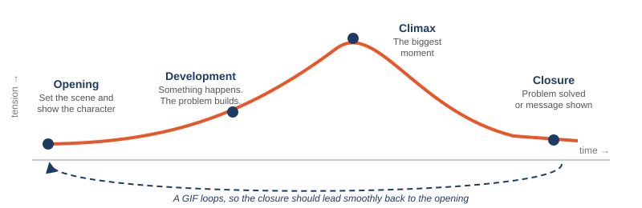

========================
Telling a story in a GIF
========================

.. admonition:: Learning intentions

   * Explain what media **codes** and **conventions** are
   * Plan a short story with an **opening**, **development** and **closure**
   * Use **cause and effect**, **point of view** and **time** to make a GIF easy to follow
   * Choose colours, settings, props and text that send the right message

----

Even a tiny animation tells a story
-----------------------------------

Your GIF might only last 2 to 8 seconds, but the audience still wants to know
**what is happening**, **who it is about** and **why it matters**. A GIF that
just moves things around is forgettable. A GIF that tells a tiny story, or
makes the viewer feel something, gets watched again and shared.

Media makers use **codes** and **conventions** to tell stories quickly.

.. list-table::
   :header-rows: 1
   :widths: 22 78

   * - Word
     - What it means
   * - **Media codes**
     - The tools a media maker chooses to create meaning: the camera shot,
       colour, lighting, setting, props, costume, text, movement and sound.
   * - **Conventions**
     - The usual ways those tools are put together, which audiences have
       learned to expect. For example, a story has a beginning, middle and end,
       and a fade to black means time has passed or the story is over.

There are three main kinds of code.

.. list-table::
   :header-rows: 1
   :widths: 22 40 38

   * - Type of code
     - What it is
     - Examples in a GIF
   * - **Technical**
     - How the picture is made with the camera and software
     - Shot size, camera angle, zooms and pans, fades, frame timing
   * - **Symbolic**
     - Things in the picture that stand for an idea or feeling
     - Colour, setting, props, costume, facial expression, body language
   * - **Written**
     - Words that appear in the picture
     - A title, a slogan, a call to action such as ``Order now``

----

Opening, development and closure
--------------------------------

Almost every story, from a feature film to a 5-second advert, has three parts.

   A story arc. In a GIF the whole arc might last only a few seconds.

.. list-table::
   :header-rows: 1
   :widths: 20 45 35

   * - Part
     - What it does
     - In the beach GIF example
   * - **Opening**
     - Sets the scene. Shows where we are and who the story is about.
     - The sun rises over the beach.
   * - **Development**
     - Something happens. A problem, a change or a journey builds up to the
       biggest moment (the **climax**).
     - A surfer rides in on a wave and stops with a big spray.
   * - **Closure**
     - Ends the story. The problem is solved, or the message is shown.
     - The words BONDI BEACH fade in.

.. tip::

   A GIF **loops**, so think about how the closure leads back into the
   opening. The text could fade out as the sun sets, ready for the sun to
   rise again. A smooth loop feels finished; a sudden jump feels like a
   mistake.

Put the story in order
~~~~~~~~~~~~~~~~~~~~~~

These storyboard notes are for a GIF advertising a café. Drag them into order,
from the opening to the closure.

.. ordering:: text
   :no-indent:

   A sleepy student yawns at a desk
   The student smells coffee and looks up
   A hot cup slides across the desk
   One sip and their eyes pop wide open
   The café logo and slogan appear

----

Cause and effect
----------------

In a story, one thing **causes** the next. The audience understands your GIF
when each action has a clear reason and a clear result.

* **Cause:** the cat sees a mouse. **Effect:** the cat pounces.
* **Cause:** the student sips the coffee. **Effect:** their eyes pop open.

If something happens with no cause, the audience gets confused. If a cause has
no effect, the story feels unfinished. In your storyboard, check that every
panel leads to the next.

.. note::

   **Anticipation** (from :doc:`anim_02_principles`) helps here. The crouch
   before a jump warns the audience that something is about to happen, so the
   effect makes sense when it comes.

----

Point of view
-------------

**Point of view** is whose eyes we see the story through.

* **Watching from outside:** we see the whole character and what they do. This
  is the most common choice.
* **Through the character's eyes:** we see what the character sees, for
  example a hand reaching for a cup as if it were our own hand. This makes the
  audience feel part of the action.

Pick one point of view and keep to it, unless changing is part of your story.
Your camera angle can also show how we should feel about a character. You will
learn more in :doc:`anim_07_shots_and_angles`.

----

Structuring time
----------------

You control time in a GIF with the **frame delay**.

.. list-table::
   :header-rows: 1
   :widths: 30 70

   * - Technique
     - How to do it in a GIF
   * - **Hold** an important moment
     - Give the key frame a longer delay (for example 1 second) so the audience
       has time to notice it. Always hold text long enough to read.
   * - **Speed up** boring parts
     - Use short delays, or leave frames out. You do not need to show every
       step of a walk across the screen.
   * - **Slow motion**
     - Add more tweened frames with short delays to stretch out an exciting
       moment, like a splash.
   * - **Jump in time**
     - Cut straight to later, such as from sunrise to sunset. A fade to black or
       a change in colour helps the audience understand time has passed.

.. admonition:: Reading time rule of thumb

   Leave text on screen for at least **1 second, plus about a quarter of a
   second for every word**. A 6-word slogan needs about 2.5 seconds.

----

Symbolic codes: colour, setting and props
-----------------------------------------

Audiences read meaning into what they see, often without thinking about it.
Choose these details on purpose.

.. list-table::
   :header-rows: 1
   :widths: 22 78

   * - Code
     - What it can suggest
   * - **Colour**
     - Warm colours (red, orange, yellow) feel energetic, happy or hot. Cool
       colours (blue, green, purple) feel calm, sad or cold. See
       :doc:`/graphic_design/gd_02_colour`.
   * - **Lighting**
     - Bright, even light feels cheerful and safe. Dark scenes with strong
       shadows feel mysterious or scary.
   * - **Setting**
     - Where and when the story happens. A beach at sunrise and a city street at
       night tell very different stories.
   * - **Props and costume**
     - Objects and clothes tell us about a character. A briefcase and a suit
       suggest work; a skateboard and a cap suggest a teenager having fun.
   * - **Expression and body language**
     - A smile, a frown, slumped shoulders or a jump for joy show feelings
       without any words.

.. tip::

   Colours and symbols do not mean the same thing to everyone. In some cultures
   white is worn at weddings; in others it is worn at funerals. Think about
   **your audience** from the design brief.

----

Activity: plan your story
-------------------------

Before you draw your storyboard for :doc:`anim_08_gif_assessment`, copy and fill
in this table in your planning document.

.. list-table::
   :header-rows: 1
   :widths: 30 70

   * - Question
     - My answer
   * - Which brief? Who is the audience?
     -
   * - What message or feeling should the GIF give?
     -
   * - **Opening:** where are we and who is it about?
     -
   * - **Development:** what happens? What is the biggest moment?
     -
   * - **Closure:** how does it end? How does it loop back?
     -
   * - **Cause and effect:** what causes the main action?
     -
   * - **Symbolic codes:** which colours, setting and props will I use, and why?
     -
   * - **Written codes:** what text appears, and for how long?
     -

----

Check your understanding
------------------------

.. classifying::
   :delimiter: =>
   :instructions: Sort each example into the type of code it is.

   A close-up of a worried face => Technical
   The camera slowly zooms in => Technical
   The picture fades to black => Technical
   A dark, stormy sky => Symbolic
   A character wearing a crown => Symbolic
   Everything in the scene is bright red => Symbolic
   The slogan "Taste the summer" => Written
   A "50% off" sign => Written
   The words "Order now" => Written

.. mcqgroup::
   :show-instant-feedback:
   :shuffle-questions:

   .. multichoice::

      What is the job of the **opening** of a story?

      [x] To set the scene and show who the story is about | Yes.
      [ ] To show the biggest, most exciting moment | That is the climax.
      [ ] To show the logo and slogan | That usually comes at the closure.
      [ ] To list the credits | No.

   .. multichoice::

      Which of these is a **symbolic** code?

      [ ] A medium shot | Shot size is a technical code.
      [ ] A slow fade | A fade is a technical code.
      [x] A character holding an umbrella | Yes. The prop suggests rain or being prepared.
      [ ] The words "Visit us today" | Words are written codes.

   .. multichoice::

      A cat sees a mouse and then pounces. The pounce is the...

      [ ] cause | The cause is the cat seeing the mouse.
      [x] effect | Yes. Seeing the mouse **caused** the pounce.
      [ ] opening | Not quite.
      [ ] point of view | Point of view is whose eyes we see through.

   .. multichoice::

      Your slogan has 8 words. About how long should it stay on screen?

      [ ] 0.5 seconds | Far too short to read.
      [ ] 1 second | Still too short for 8 words.
      [x] 3 seconds | Yes. 1 second + 8 × 0.25 seconds = 3 seconds.
      [ ] 10 seconds | Longer than most whole GIFs.

   .. multichoice::

      Why should the closure of a GIF lead smoothly into the opening?

      [x] Because GIFs loop, so a sudden jump looks like a mistake | Yes.
      [ ] Because it makes the file smaller | It does not change the file size much.
      [ ] Because the brief says it must be 12 frames | Not related.
      [ ] It does not matter | A smooth loop makes the GIF feel finished.

   .. multichoice::

      Which colours would best suit a calm, relaxing GIF for a day spa?

      [ ] Bright red and orange | Warm, bright colours feel energetic.
      [x] Soft blues and greens | Yes. Cool, soft colours feel calm.
      [ ] Black and yellow stripes | These look like a warning sign.
      [ ] Flashing rainbow colours | Too busy to feel relaxing.

.. flashcards:: Telling a story
   :id: y10mm-anim-story
   :shuffle:

   Media codes | The tools a media maker chooses to create meaning, such as camera shot, colour, setting and text
   Conventions | The usual, expected ways codes are put together
   Technical codes | How the picture is made: shot size, angle, camera movement, fades, timing
   Symbolic codes | Things in the picture that stand for ideas or feelings: colour, setting, props, costume
   Written codes | Words in the picture: titles, slogans, calls to action
   Opening | The start of a story, which sets the scene and introduces the character
   Development | The middle of a story, where something happens and builds up
   Climax | The biggest, most exciting moment of the story
   Closure | The end of a story, where the problem is solved or the message is shown
   Cause and effect | One event makes the next one happen
   Point of view | Whose eyes we see the story through
   Hold | A frame given a longer delay so the audience notices it
