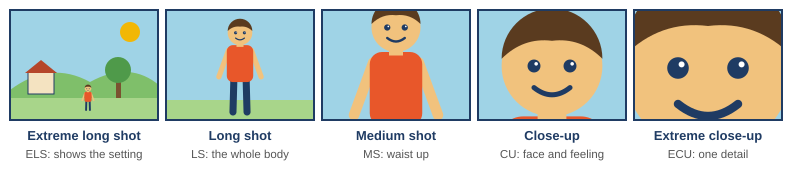
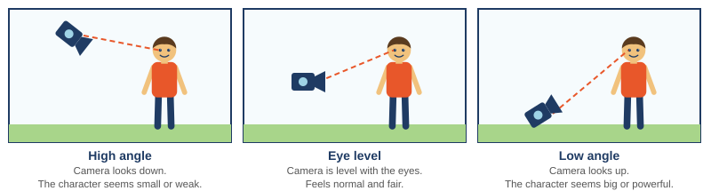
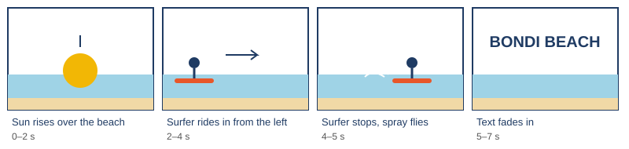

=======================================
Shots, angles and framing for your GIF
=======================================

.. admonition:: Learning intentions

   * Name the main **shot sizes** and **camera angles** and say what each one does
   * Fake camera movement (**pan** and **zoom**) and transitions in Photoshop
   * Frame a picture so the audience looks in the right place
   * Label a storyboard with shot sizes, angles and timing

----

Thinking like a camera
----------------------

An animation has no real camera, but you still decide **how close** the viewer
is and **where they are looking from**. These choices are **technical codes**
(see :doc:`anim_06_telling_a_story`). They change how the audience feels about
what they see.

Shot sizes
----------

   The same character at five shot sizes.

.. list-table::
   :header-rows: 1
   :widths: 24 12 64

   * - Shot
     - Short name
     - What it is used for
   * - **Extreme long shot**
     - ELS
     - Shows the whole setting, with the character very small. Often used at
       the **opening** to show where the story happens. Also called an
       **establishing shot**.
   * - **Long shot**
     - LS
     - Shows the whole body and some of the setting. Good for showing actions
       like running, jumping or surfing.
   * - **Medium shot**
     - MS
     - From the waist up. Shows body language and gestures, such as holding up
       a product.
   * - **Close-up**
     - CU
     - The face, or one object filling the frame. Shows feelings clearly and
       makes the audience feel close to the character.
   * - **Extreme close-up**
     - ECU
     - One small detail, such as eyes, a logo or a button being pressed.
       Builds drama or points out something important.

.. tip::

   In a small GIF, especially on a phone, tiny details are hard to see. Use
   **close-ups** for anything the audience must notice, such as a product, a
   facial expression or a logo.

----

Camera angles
-------------

   Where the camera is changes how the character looks.

.. list-table::
   :header-rows: 1
   :widths: 24 76

   * - Angle
     - Effect
   * - **Eye level**
     - The camera is at the same height as the character's eyes. It feels
       normal, fair and natural. Most shots are eye level.
   * - **High angle**
     - The camera looks down. The character looks small, weak, lonely or in
       danger.
   * - **Low angle**
     - The camera looks up. The character looks tall, strong, powerful or
       scary. Heroes and villains are often shown from a low angle.
   * - **Bird's-eye view**
     - Straight down from above, like a map. Good for showing a pattern or a
       journey, such as a car driving along a road.
   * - **Worm's-eye view**
     - Straight up from the ground. Makes things look huge, such as a
       skyscraper or a giant.

----

Camera movement and transitions
-------------------------------

You can fake camera moves in Photoshop by moving or resizing layers and then
using **Tween** (see :doc:`anim_05_tweening_banner`).

.. list-table::
   :header-rows: 1
   :widths: 18 37 45

   * - Move
     - What the viewer sees
     - How to fake it in Photoshop
   * - **Pan**
     - The view slides sideways across a wide scene
     - Make the background layer wider than the canvas. In the last keyframe
       move it left or right, then tween.
   * - **Zoom in**
     - The view moves closer, from a long shot to a close-up
     - In the last keyframe use **Edit > Free Transform** to scale the layers
       up (hold **Shift** to keep the proportions), then tween.
   * - **Tracking**
     - The camera follows a moving character
     - Keep the character still in the centre and move the background the
       opposite way.
   * - **Cut**
     - One shot changes straight to the next
     - Just switch to a new frame with different layers showing.
   * - **Fade**
     - The picture slowly appears from, or disappears to, black or white
     - Put a black or white layer on top and tween its **opacity**.
   * - **Dissolve**
     - One shot slowly blends into the next
     - Tween the top shot's opacity from 100% down to 0%.

.. note::

   Fades and dissolves feel slow and gentle. Cuts feel quick and energetic. Pick
   the transition that suits the mood of your brief.

----

Framing and composition
-----------------------

**Framing** is deciding what goes inside the edges of the picture and where it
goes. Good framing shows the audience where to look.

* **Rule of thirds:** imagine the frame split into a 3 × 3 grid. Put important
  things on the lines or where they cross, not dead centre. You used this in
  :doc:`/graphic_design/gd_01_elements_principles`.
* **Leave room to move:** if a character is moving or looking to the right,
  leave more empty space on the right. Otherwise they look squashed against the
  edge.
* **Keep it simple:** a busy background behind the main action makes it hard to
  follow. This is the principle of **staging**.
* **Leave space for text:** plan where your words will go so they do not cover
  the action. Keep text away from the very edges of the frame.

----

Labelling a storyboard
----------------------

Professional storyboards use short labels so everyone on the team can read
them quickly. For each panel, write:

#. the **shot size** (ELS, LS, MS, CU or ECU) and **angle** if it is not eye level
#. **arrows** to show what moves, and any camera move (pan, zoom)
#. any **text** that appears
#. the **transition** to the next panel (cut, fade, dissolve)
#. roughly **how long** the panel lasts

   The beach storyboard from the assessment page.

Here is how the beach storyboard could be labelled.

.. list-table::
   :header-rows: 1
   :widths: 10 30 60

   * - Panel
     - Label
     - Why
   * - 1
     - ELS, eye level. Fade in. 0–2 s
     - Opening: shows the setting. The fade feels like the day starting.
   * - 2
     - LS, tracking left to right. Cut. 2–4 s
     - Development: shows the whole surfer in action.
   * - 3
     - MS, low angle. Cut. 4–5 s
     - Climax: the low angle makes the surfer look powerful.
   * - 4
     - ELS. Text dissolves in. 5–7 s
     - Closure: shows the message. Matches panel 1 so the loop is smooth.

----

Activity: shot spotting
-----------------------

Watch a short advert or animated GIF your teacher shows you. Copy and complete
this table for **four** shots.

.. list-table::
   :header-rows: 1
   :widths: 10 22 22 46

   * - Shot
     - Size
     - Angle
     - Why do you think the maker chose it?
   * - 1
     -
     -
     -
   * - 2
     -
     -
     -
   * - 3
     -
     -
     -
   * - 4
     -
     -
     -

----

Check your understanding
------------------------

.. classifying::
   :delimiter: =>
   :instructions: Match each storyboard idea to the best shot size.

   Show the whole town where the story happens => Extreme long shot
   Open on a city skyline at night => Extreme long shot
   Show a skater doing a full trick => Long shot
   Show a runner crossing the finish line => Long shot
   A chef holds up a plate of food => Medium shot
   Show how scared the character feels => Close-up
   Show a tear running down a cheek => Extreme close-up
   A finger presses the Start button => Extreme close-up

.. mcqgroup::
   :show-instant-feedback:
   :shuffle-questions:

   .. multichoice::

      Which shot is best for the **opening** of a story, to show where it happens?

      [x] Extreme long shot | Yes. It shows the whole setting.
      [ ] Close-up | A close-up shows a face or detail, not the setting.
      [ ] Extreme close-up | Far too close to show the setting.
      [ ] Medium shot | A medium shot shows a person from the waist up.

   .. multichoice::

      You want a villain to look powerful and scary. Which angle should you use?

      [ ] High angle | A high angle makes characters look small and weak.
      [ ] Eye level | Eye level feels neutral.
      [x] Low angle | Yes. Looking up makes the character seem big and powerful.
      [ ] Bird's-eye view | This looks straight down, like a map.

   .. multichoice::

      How can you fake a **pan** in Photoshop?

      [x] Make the background wider than the canvas, move it in the last keyframe, then tween | Yes.
      [ ] Change the frame delay to 0 | That only changes speed.
      [ ] Use Reverse Frames | That plays the frames backwards.
      [ ] Add a drop shadow | That is a layer style, not a camera move.

   .. multichoice::

      A character is walking to the right. Where should you leave the most space?

      [ ] On the left, behind them | They will look squashed against the right edge.
      [x] On the right, in front of them | Yes. Leave room for them to move into.
      [ ] Above their head | Not the main concern here.
      [ ] Nowhere: fill the frame | They need room to move.

   .. multichoice::

      Which transition feels slow and gentle?

      [ ] A cut | A cut is quick.
      [x] A fade | Yes. A fade slowly appears or disappears.
      [ ] A flash | A flash is sudden.
      [ ] A jump | A jump is sudden.

   .. multichoice::

      On a storyboard, what does **CU** stand for?

      [ ] Cut | Cuts are usually written in full.
      [x] Close-up | Yes.
      [ ] Camera up | Not a standard label.
      [ ] Continue | No.

.. flashcards:: Shots, angles and movement
   :id: y10mm-anim-shots
   :shuffle:

   # Shot sizes
   Extreme long shot (ELS) | Shows the whole setting with the character very small; often used to open a story
   Long shot (LS) | Shows the whole body and some of the setting
   Medium shot (MS) | Shows a person from the waist up
   Close-up (CU) | A face or one object fills the frame; shows feelings
   Extreme close-up (ECU) | One small detail, such as eyes or a button

   # Angles
   Eye level | Camera level with the eyes; feels normal and fair
   High angle | Camera looks down; character seems small or weak
   Low angle | Camera looks up; character seems big or powerful
   Bird's-eye view | Straight down from above, like a map

   # Movement and transitions
   Pan | The view slides sideways across a scene
   Zoom | The view moves closer or further away
   Cut | One shot changes straight to the next
   Fade | The picture slowly appears from or disappears to black or white
   Dissolve | One shot slowly blends into the next
   Rule of thirds | Placing important things on the lines of a 3 × 3 grid
