=========================================
Christmas flip books
=========================================

A **flip book** is a little book with a slightly different drawing on every page.
Flick the pages quickly and the drawing moves. Each page is one **frame**, just
like the frames in an animated GIF.

In this activity you will put together a Christmas flip book, then draw your
own on a template with guide lines to help you.

.. admonition:: You need

   * The PDFs below, printed on thin card at 100% (actual size)
   * Scissors, and a stapler or bulldog clip
   * A pencil, eraser and coloured pencils for your own flip book

----

Example 1: Santa's sleigh
-------------------------

:download:`christmas_flipbook_sleigh.pdf <flipbook/christmas_flipbook_sleigh.pdf>`
(24 cards on 2 pages)

   Santa's sleigh: 24 pages, played at 12 pages a second.

**Things to notice:**

* The sky, moon, stars and snowy hills are **exactly the same** on every card.
  Only the sleigh moves, so your eye follows it.
* The sleigh flies along a **curve** (an arc), not a straight line. It looks more
  natural.
* The reindeer's legs swap position on every card, so it looks like it is
  galloping.

Example 2: The present
----------------------

:download:`christmas_flipbook_present.pdf <flipbook/christmas_flipbook_present.pdf>`
(24 cards on 2 pages)

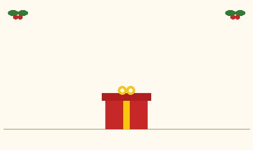

   The present: 24 pages, played at 12 pages a second.

**Things to notice:**

* For the first few cards **nothing happens**. A pause makes the surprise better.
* The present **shakes**, then **squashes down** before the lid pops. This is
  **anticipation**: a small movement that gets you ready for the big one.
* The star rises fast at first, then **slows down** as it reaches the top.
* At the end, the sparkles switch between two shapes on every card, so the star
  **twinkles**.

----

Putting a flip book together
----------------------------

.. figure:: flipbook/flipbook_steps.svg
   :width: 100%
   :alt: Four steps: draw and cut out the cards; stack them with card 1 at the back; staple or clip through the strip; bend the pages with your thumb and let them flick past

   Making a flip book from the printed cards.

#. **Cut** out the cards along the solid lines.
#. **Stack** them in number order with **card 1 at the back** and card 24 at the
   front. Tap the stack on the desk so the left edges line up.
#. **Staple** or bulldog-clip through the pink strip, about 1 cm from the left
   edge.
#. **Flick** from the back to the front: hold the strip in one hand, bend the
   pages up with the thumb of your other hand, then let them flick past. If it
   plays backwards, flick the other way.

----

Make your own
-------------

:download:`christmas_flipbook_template.pdf <flipbook/christmas_flipbook_template.pdf>`
(24 blank cards on 2 pages)

Each card in the template has **guide lines** to help you draw:

.. list-table::
   :header-rows: 1
   :widths: 25 75

   * - Guide
     - How to use it
   * - **Ground line**
     - Things standing on the ground (a snowman, a present, an elf's feet) sit on
       this line on every card, so they don't float up and down by accident.
   * - **Dot grid**
     - The dots are 5 mm apart. Use them to measure how far something moves. For
       example, move the sleigh **one dot** to the right on every card. Move it
       **half a dot** to make it slow down.
   * - **Centre mark** (+)
     - Helps you put things in the same place on every card, such as a tree or a
       chimney in the middle of the scene.

Steps
~~~~~

#. **Plan.** Choose one simple Christmas action. Write down what happens at the
   start, the middle and the end.
#. **Draw the key poses** in pencil: card 1 (start), card 12 (middle) and
   card 24 (end).
#. **Draw the in-betweens.** Do card 6 (first in-between), then card 17 (second in-between).
   Then do card 3, card 9, card 15 and card 21. Then do the rest. This is called **in-betweening**.
   The two worked examples below show each stage.
#. **Test it.** Clip the cards together and flick. Fix any jumps.
#. **Finish** in pen and colour. Keep the colours the same on every card.

Worked example: a stick figure walking
~~~~~~~~~~~~~~~~~~~~~~~~~~~~~~~~~~~~~~

Here are the steps above used to make a stick figure walk from left to right
across the blank template.

Each GIF plays like a **pencil test**: a card that hasn't been drawn yet just shows
the last card that has. You can see the walk get smoother at every stage.

In each diagram, the line at the top shows **where the figure is** on each card
that has been drawn. Red is a key frame, orange is drawn in that stage and grey
was drawn earlier.

**Stage 0: the blank template**

Every card has the same ground line, dot grid and centre mark. Nothing moves yet.

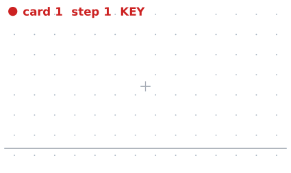

   The blank template: 24 cards with guide lines and no drawing.

**Stage 1: draw the key frames (cards 1, 12 and 24)**

Draw the figure at the **start** (card 1, left side), the **middle** (card 12,
in the centre) and the **end** (card 24, right side). Its feet sit on the ground
line on every card.

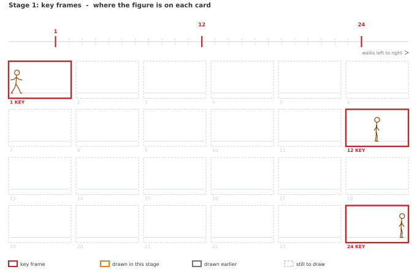

   Only the key frames are drawn. The figure jumps a long way between them.

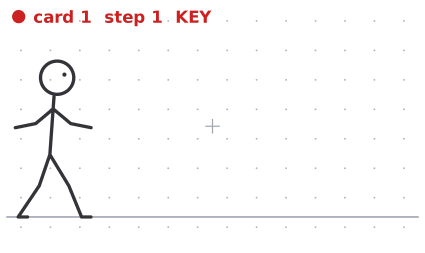

   Pencil test with 3 drawings. It jumps, it doesn't walk.

**Stage 2: draw the first in-betweens (cards 6 and 17)**

Card 6 goes about **halfway** between card 1 and card 12. Card 17 goes about
halfway between card 12 and card 24.

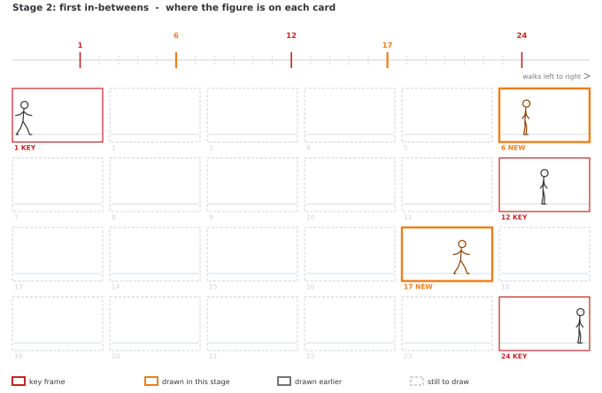

   Cards 6 and 17 split each big gap in half.

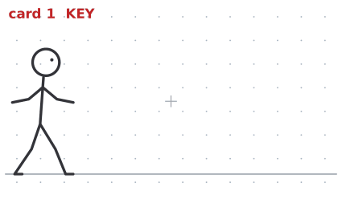

   Pencil test with 5 drawings. Smaller jumps, but still jerky.

**Stage 3: draw the next in-betweens (cards 3, 9, 15 and 21)**

Each new card goes halfway between the two drawn cards on either side of it.

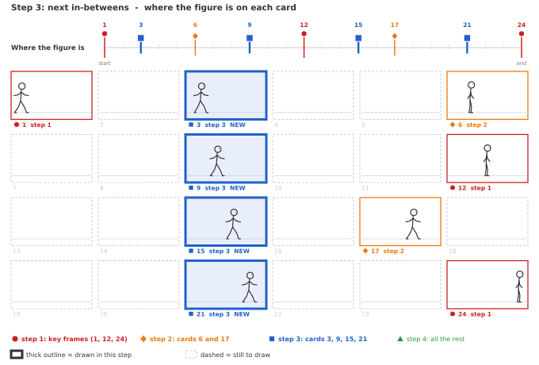

   Cards 3, 9, 15 and 21 split the gaps again.

   Pencil test with 9 drawings. It is starting to look like walking.

**Stage 4: draw all the rest**

Fill in every card that is left. The figure moves the **same distance** on
every card (about half a dot), so it walks at a steady speed.

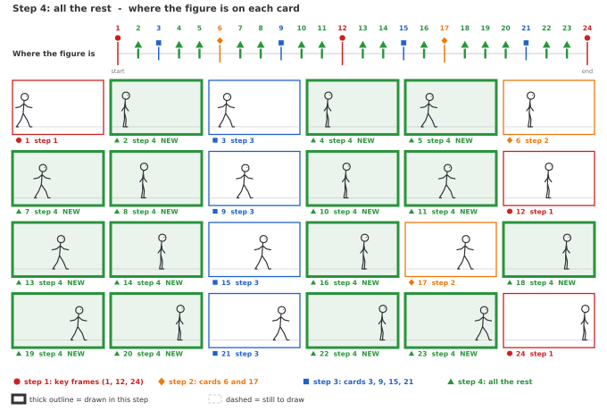

   All 24 cards are drawn. The marks on the spacing line are evenly spaced.

   The finished walk: 24 drawings, played at 12 pages a second.

**Things to notice:**

* The legs go **apart, together, apart, together**. Legs apart is a step; legs
  together is the moment one leg passes the other.
* The arms swing the **opposite** way to the legs.
* When the legs are together, the body is a little **higher**. This small bob
  up and down makes the walk look real.

Worked example: three shapes changing
~~~~~~~~~~~~~~~~~~~~~~~~~~~~~~~~~~~~~

A flip book doesn't have to show something walking. Here, three shapes each
change in a different way, all on the same 24 cards:

* the **circle moves**: it travels from left to right along an arc, and changes
  **colour** from red to yellow
* the **square changes size**: it grows from small to big and turns a quarter
  turn. It starts slowly, speeds up, then slows down at the end
* the **triangle changes shape**: it slowly turns into a circle, and changes
  **colour** from green to purple

The charts at the top of each diagram show **how far each change has got** on
every drawn card, from the start (left) to the end (right).

**Stage 1: draw the key frames (cards 1, 12 and 24)**

Draw all three shapes at the **start** (card 1), the **middle** (card 12) and the
**end** (card 24). Check that card 12 really is halfway for every change: the
circle is at the top of its arc, the square has turned half of its quarter turn
and the triangle is halfway to being a circle.

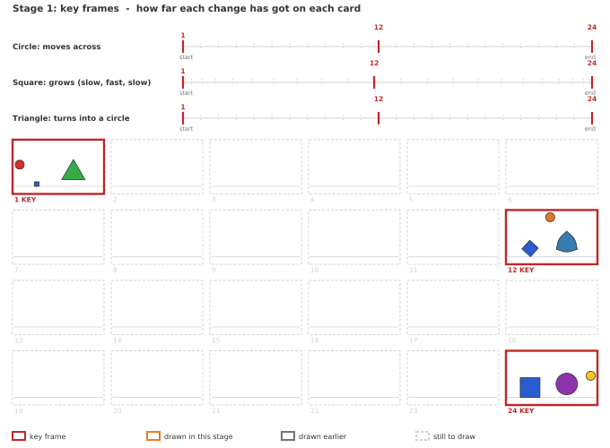

   Only the key frames are drawn. Every change jumps.

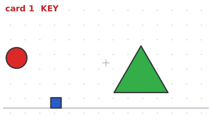

   Pencil test with 3 drawings.

**Stage 2: draw the first in-betweens (cards 6 and 17)**

For the circle and the triangle, card 6 is about **halfway** between card 1 and
card 12. The square is different: it starts **slowly**, so on card 6 it has
only grown a little. Look at the square's chart: its mark for card 6 is much
closer to the start.

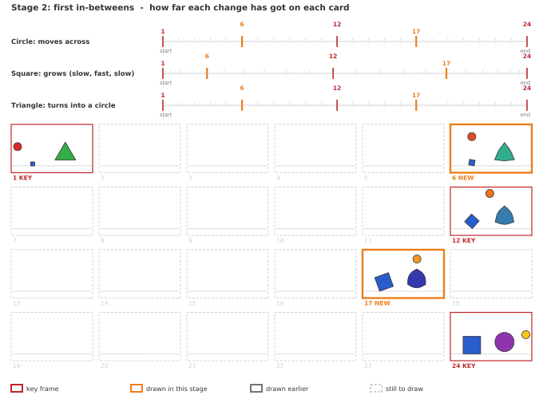

   Cards 6 and 17. The square's marks sit near the ends of its chart because it changes slowly there.

   Pencil test with 5 drawings.

**Stage 3: draw the next in-betweens (cards 3, 9, 15 and 21)**

Each new card goes between the two drawn cards on either side of it. The square
changes only a tiny bit on cards 3 and 21, and a lot on cards 9 and 15.

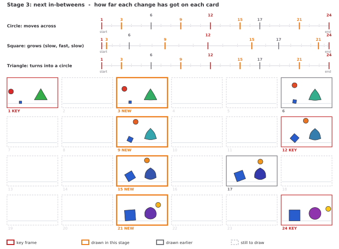

   Cards 3, 9, 15 and 21 split the gaps again.

   Pencil test with 9 drawings.

**Stage 4: draw all the rest**

Fill in every card that is left, then play it.

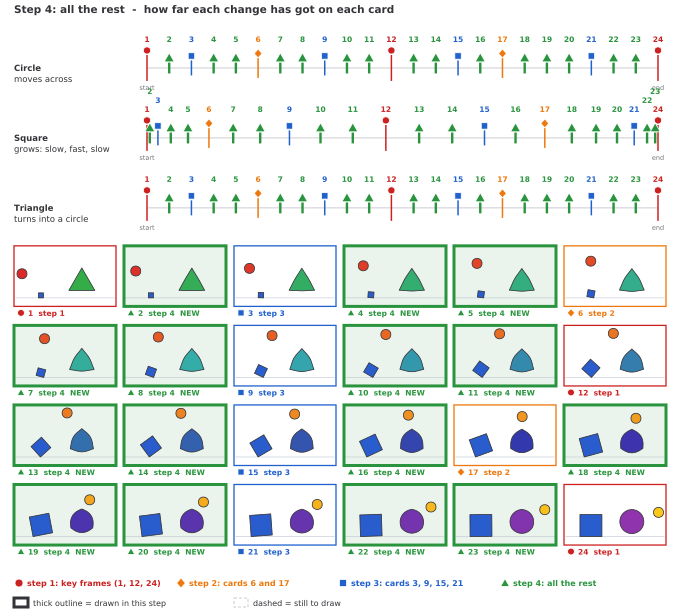

   All 24 cards. Even spacing gives a steady change; bunched-up marks give a slow change.

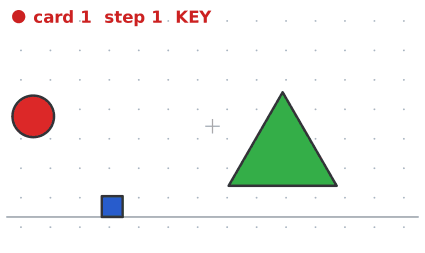

   The finished shapes: 24 drawings, played at 12 pages a second.

**Things to notice:**

* **Even spacing** (the circle and the triangle) makes a change happen at a
  steady speed.
* **Bunched-up spacing** (the square at the start and end) makes a change
  happen slowly. Spread-out spacing makes it happen quickly. Animators call
  this **slow in and slow out** (also called easing).
* Colour changes need in-betweens too: card 12 is halfway between the start
  colour and the end colour.
* Keep every shape in the same place when it isn't meant to move. The square
  stays on the ground line and the triangle stays in the same spot while it
  changes.

.. tip::

   Keep it simple: **one** thing moving is plenty. Small steps between cards give
   smooth movement. Big steps make the picture jump.

.. admonition:: Think about it

   * How many cards did your flip book use? How long did it last when you flicked
     it?
   * Which parts stayed still? Why does that matter?
   * Did you use anticipation, an arc or slowing down? Where?

----

Christmas ideas
---------------

Here are eight Christmas ideas, each with **two** PDFs:

* a **finished flip book** to cut out and flick, so you can see how it should move
* a **template** where cards 1, 12 and 24 are already drawn for you as **key
  frames**. They are outlines only, ready to colour. The scenery is outlined on
  every card. You draw the moving part on all the other cards.

Use the in-betweening order from the steps above: card 6, card 17, then 3, 9, 15
and 21, then the rest. Colour every card the same way at the end.

A snowman being built, one snowball at a time
~~~~~~~~~~~~~~~~~~~~~~~~~~~~~~~~~~~~~~~~~~~~~

* :download:`christmas_flipbook_snowman.pdf <flipbook/christmas_flipbook_snowman.pdf>`
  (finished, 24 cards on 2 pages)
* :download:`christmas_flipbook_snowman_template.pdf <flipbook/christmas_flipbook_snowman_template.pdf>`
  (template with key frames 1, 12 and 24)

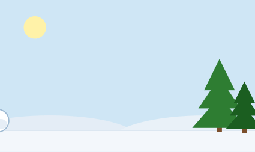

   Building a snowman: 24 pages, played at 12 pages a second.

**Things to notice:**

* The bottom snowball **grows** as it rolls in, and turns as it goes.
* Each new snowball **squashes** a little when it lands, then pops back.
* Only one new thing happens at a time: body, head, face, hat, arms.

A Christmas tree's lights switching on, one by one
~~~~~~~~~~~~~~~~~~~~~~~~~~~~~~~~~~~~~~~~~~~~~~~~~~

* :download:`christmas_flipbook_tree_lights.pdf <flipbook/christmas_flipbook_tree_lights.pdf>`
  (finished, 24 cards on 2 pages)
* :download:`christmas_flipbook_tree_lights_template.pdf <flipbook/christmas_flipbook_tree_lights_template.pdf>`
  (template with key frames 1, 12 and 24)

.. figure:: flipbook/christmas_flipbook_tree_lights.gif
   :class: clickgif clickgif-ms-2400
   :width: 420px
   :alt: A dark Christmas tree; coloured lights switch on one at a time from the bottom up, the star lights up, then everything twinkles

   Tree lights: 24 pages, played at 12 pages a second.

**Things to notice:**

* The tree never moves. Only the lights change, so the tree is the same on every card.
* One more light switches on each card, from the bottom to the top.
* At the end the lights swap between big and small glows, so they **twinkle**.

A snowflake drifting down and landing on a nose
~~~~~~~~~~~~~~~~~~~~~~~~~~~~~~~~~~~~~~~~~~~~~~~

* :download:`christmas_flipbook_snowflake.pdf <flipbook/christmas_flipbook_snowflake.pdf>`
  (finished, 24 cards on 2 pages)
* :download:`christmas_flipbook_snowflake_template.pdf <flipbook/christmas_flipbook_snowflake_template.pdf>`
  (template with key frames 1, 12 and 24)

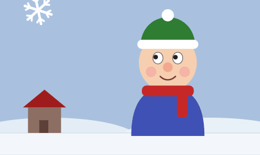

   Snowflake on a nose: 24 pages, played at 12 pages a second.

**Things to notice:**

* The snowflake drifts from side to side as it falls, and slowly spins.
* The eyes **follow** the snowflake all the way down.
* When it lands the eyes go cross-eyed, then the snowflake melts into a drop.

A star shooting across the sky
~~~~~~~~~~~~~~~~~~~~~~~~~~~~~~

* :download:`christmas_flipbook_shooting_star.pdf <flipbook/christmas_flipbook_shooting_star.pdf>`
  (finished, 24 cards on 2 pages)
* :download:`christmas_flipbook_shooting_star_template.pdf <flipbook/christmas_flipbook_shooting_star_template.pdf>`
  (template with key frames 1, 12 and 24)

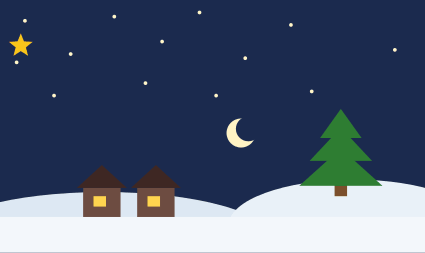

   Shooting star: 24 pages, played at 12 pages a second.

**Things to notice:**

* The star flies along a **curve** and spins as it goes.
* It leaves a trail behind it that gets thinner towards the end.
* It **slows down** and **squashes** as it lands on top of the tree, then twinkles.

A gingerbread person running away
~~~~~~~~~~~~~~~~~~~~~~~~~~~~~~~~~

* :download:`christmas_flipbook_gingerbread.pdf <flipbook/christmas_flipbook_gingerbread.pdf>`
  (finished, 24 cards on 2 pages)
* :download:`christmas_flipbook_gingerbread_template.pdf <flipbook/christmas_flipbook_gingerbread_template.pdf>`
  (template with key frames 1, 12 and 24)

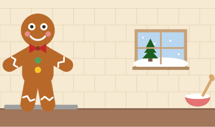

   Runaway gingerbread person: 24 pages, played at 12 pages a second.

**Things to notice:**

* Before the jump it **squashes down** (anticipation), then hops off the tray in an arc.
* The legs and arms swap on every card, and the body bobs up and down, so it looks like running.
* It moves the same distance on every card, so it runs at a steady speed.

An elf throwing a snowball
~~~~~~~~~~~~~~~~~~~~~~~~~~

* :download:`christmas_flipbook_elf_snowball.pdf <flipbook/christmas_flipbook_elf_snowball.pdf>`
  (finished, 24 cards on 2 pages)
* :download:`christmas_flipbook_elf_snowball_template.pdf <flipbook/christmas_flipbook_elf_snowball_template.pdf>`
  (template with key frames 1, 12 and 24)

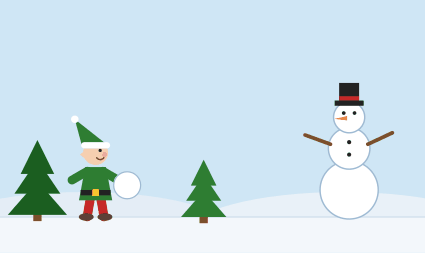

   Elf throws a snowball: 24 pages, played at 12 pages a second.

**Things to notice:**

* The elf leans back and pulls the arm right back before throwing. This is **anticipation**.
* The snowball flies in an **arc**: up, over and down onto the snowman.
* The hat flies off and lands, and the elf jumps for joy.

Santa sliding down a chimney
~~~~~~~~~~~~~~~~~~~~~~~~~~~~

* :download:`christmas_flipbook_santa_chimney.pdf <flipbook/christmas_flipbook_santa_chimney.pdf>`
  (finished, 24 cards on 2 pages)
* :download:`christmas_flipbook_santa_chimney_template.pdf <flipbook/christmas_flipbook_santa_chimney_template.pdf>`
  (template with key frames 1, 12 and 24)

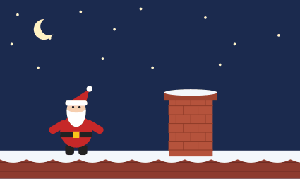

   Santa down the chimney: 24 pages, played at 12 pages a second.

**Things to notice:**

* Santa **squashes down** before he jumps (anticipation), then jumps in an arc.
* The chimney is drawn **in front** of Santa, so he disappears into it a bit more on every card.
* Puffs of soot rise and grow at the end.

A candle being lit and the flame flickering
~~~~~~~~~~~~~~~~~~~~~~~~~~~~~~~~~~~~~~~~~~~

* :download:`christmas_flipbook_candle.pdf <flipbook/christmas_flipbook_candle.pdf>`
  (finished, 24 cards on 2 pages)
* :download:`christmas_flipbook_candle_template.pdf <flipbook/christmas_flipbook_candle_template.pdf>`
  (template with key frames 1, 12 and 24)

.. figure:: flipbook/christmas_flipbook_candle.gif
   :class: clickgif clickgif-ms-2400
   :width: 420px
   :alt: A lit match moves in and lights a candle, the flame grows, the match goes out with a curl of smoke, and the candle flame flickers

   Lighting a candle: 24 pages, played at 12 pages a second.

**Things to notice:**

* The match **slows down** as it gets close to the wick.
* The candle flame starts tiny and grows.
* At the end the flame leans and changes height on every card, so it **flickers**.
