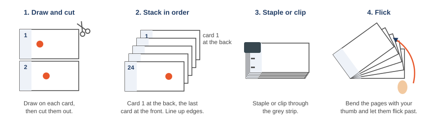
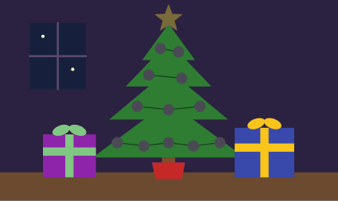
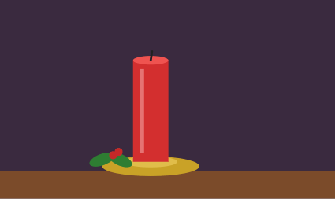

=========================================
Christmas flip books
=========================================

A **flip book** is a little book with a slightly different drawing on every page.
Flick the pages quickly and the drawing moves. Each page is one **frame**, just
like the frames in an animated GIF.

In this activity you will put together two Christmas flip books, then draw your
own on a template with guide lines to help you.

.. admonition:: You need

   * The PDFs below, printed on thin card at 100% (actual size)
   * Scissors, and a stapler or bulldog clip
   * A pencil, eraser and coloured pencils for your own flip book

----

Example 1: Santa's sleigh
-------------------------

:download:`christmas_flipbook_sleigh.pdf <flipbook/christmas_flipbook_sleigh.pdf>`
(24 cards on 2 pages)

.. figure:: flipbook/christmas_flipbook_sleigh.gif
   :class: clickgif clickgif-ms-2400
   :width: 420px
   :alt: Santa's sleigh and a reindeer fly across a starry night sky, rising in a curve

   Santa's sleigh: 24 pages, played at 12 pages a second.

**Things to notice:**

* The sky, moon, stars and snowy hills are **exactly the same** on every card.
  Only the sleigh moves, so your eye follows it.
* The sleigh flies along a **curve** (an arc), not a straight line. It looks more
  natural.
* The reindeer's legs swap position on every card, so it looks like it is
  galloping.

Example 2: The present
----------------------

:download:`christmas_flipbook_present.pdf <flipbook/christmas_flipbook_present.pdf>`
(24 cards on 2 pages)

.. figure:: flipbook/christmas_flipbook_present.gif
   :class: clickgif clickgif-ms-2600
   :width: 420px
   :alt: A present sits still, shakes, squashes down, then the lid pops off and a star rises out and twinkles

   The present: 24 pages, played at 12 pages a second.

**Things to notice:**

* For the first few cards **nothing happens**. A pause makes the surprise better.
* The present **shakes**, then **squashes down** before the lid pops. This is
  **anticipation**: a small movement that gets you ready for the big one.
* The star rises fast at first, then **slows down** as it reaches the top.
* At the end, the sparkles switch between two shapes on every card, so the star
  **twinkles**.

----

Putting a flip book together
----------------------------

   Making a flip book from the printed cards.

#. **Cut** out the cards along the solid lines.
#. **Stack** them in number order with **card 1 at the back** and card 24 at the
   front. Tap the stack on the desk so the left edges line up.
#. **Staple** or bulldog-clip through the pink strip, about 1 cm from the left
   edge.
#. **Flick** from the back to the front: hold the strip in one hand, bend the
   pages up with the thumb of your other hand, then let them flick past. If it
   plays backwards, flick the other way.

----

Make your own
-------------

:download:`christmas_flipbook_template.pdf <flipbook/christmas_flipbook_template.pdf>`
(24 blank cards on 2 pages)

Each card in the template has **guide lines** to help you draw:

.. list-table::
   :header-rows: 1
   :widths: 25 75

   * - Guide
     - How to use it
   * - **Ground line**
     - Things standing on the ground (a snowman, a present, an elf's feet) sit on
       this line on every card, so they don't float up and down by accident.
   * - **Dot grid**
     - The dots are 5 mm apart. Use them to measure how far something moves. For
       example, move the sleigh **one dot** to the right on every card. Move it
       **half a dot** to make it slow down.
   * - **Centre mark** (+)
     - Helps you put things in the same place on every card, such as a tree or a
       chimney in the middle of the scene.

Steps
~~~~~

#. **Plan.** Choose one simple Christmas action. Write down what happens at the
   start, the middle and the end.
#. **Draw the key poses** in pencil: card 1 (start), card 12 (middle) and
   card 24 (end).
#. **Draw the in-betweens.** Do card 6 (first in-between), then card 17 (second in-between).
   Then do card 3, card 9, card 15 and card 21. Then do the rest. This is called **in-betweening**.
#. **Test it.** Clip the cards together and flick. Fix any jumps.
#. **Finish** in pen and colour. Keep the colours the same on every card.

.. tip::

   Keep it simple: **one** thing moving is plenty. Small steps between cards give
   smooth movement. Big steps make the picture jump.

.. admonition:: Think about it

   * How many cards did your flip book use? How long did it last when you flicked
     it?
   * Which parts stayed still? Why does that matter?
   * Did you use anticipation, an arc or slowing down? Where?

----

Christmas ideas
---------------

Here are eight Christmas ideas, each with **two** PDFs:

* a **finished flip book** to cut out and flick, so you can see how it should move
* a **template** where cards 1, 12 and 24 are already drawn for you as **key
  frames**. They are outlines only, ready to colour. The scenery is outlined on
  every card. You draw the moving part on all the other cards.

Use the in-betweening order from the steps above: card 6, card 17, then 3, 9, 15
and 21, then the rest. Colour every card the same way at the end.

A snowman being built, one snowball at a time
~~~~~~~~~~~~~~~~~~~~~~~~~~~~~~~~~~~~~~~~~~~~~

* :download:`christmas_flipbook_snowman.pdf <flipbook/christmas_flipbook_snowman.pdf>`
  (finished, 24 cards on 2 pages)
* :download:`christmas_flipbook_snowman_template.pdf <flipbook/christmas_flipbook_snowman_template.pdf>`
  (template with key frames 1, 12 and 24)

.. figure:: flipbook/christmas_flipbook_snowman.gif
   :class: clickgif clickgif-ms-2400
   :width: 420px
   :alt: A snowball rolls in and grows, two more snowballs drop on top, then a face, hat and stick arms appear and the snowman waves

   Building a snowman: 24 pages, played at 12 pages a second.

**Things to notice:**

* The bottom snowball **grows** as it rolls in, and turns as it goes.
* Each new snowball **squashes** a little when it lands, then pops back.
* Only one new thing happens at a time: body, head, face, hat, arms.

A Christmas tree's lights switching on, one by one
~~~~~~~~~~~~~~~~~~~~~~~~~~~~~~~~~~~~~~~~~~~~~~~~~~

* :download:`christmas_flipbook_tree_lights.pdf <flipbook/christmas_flipbook_tree_lights.pdf>`
  (finished, 24 cards on 2 pages)
* :download:`christmas_flipbook_tree_lights_template.pdf <flipbook/christmas_flipbook_tree_lights_template.pdf>`
  (template with key frames 1, 12 and 24)

   Tree lights: 24 pages, played at 12 pages a second.

**Things to notice:**

* The tree never moves. Only the lights change, so the tree is the same on every card.
* One more light switches on each card, from the bottom to the top.
* At the end the lights swap between big and small glows, so they **twinkle**.

A snowflake drifting down and landing on a nose
~~~~~~~~~~~~~~~~~~~~~~~~~~~~~~~~~~~~~~~~~~~~~~~

* :download:`christmas_flipbook_snowflake.pdf <flipbook/christmas_flipbook_snowflake.pdf>`
  (finished, 24 cards on 2 pages)
* :download:`christmas_flipbook_snowflake_template.pdf <flipbook/christmas_flipbook_snowflake_template.pdf>`
  (template with key frames 1, 12 and 24)

.. figure:: flipbook/christmas_flipbook_snowflake.gif
   :class: clickgif clickgif-ms-2400
   :width: 420px
   :alt: A snowflake zig-zags down while a child watches it; it lands on their nose, they go cross-eyed and it melts into a drop

   Snowflake on a nose: 24 pages, played at 12 pages a second.

**Things to notice:**

* The snowflake drifts from side to side as it falls, and slowly spins.
* The eyes **follow** the snowflake all the way down.
* When it lands the eyes go cross-eyed, then the snowflake melts into a drop.

A star shooting across the sky
~~~~~~~~~~~~~~~~~~~~~~~~~~~~~~

* :download:`christmas_flipbook_shooting_star.pdf <flipbook/christmas_flipbook_shooting_star.pdf>`
  (finished, 24 cards on 2 pages)
* :download:`christmas_flipbook_shooting_star_template.pdf <flipbook/christmas_flipbook_shooting_star_template.pdf>`
  (template with key frames 1, 12 and 24)

.. figure:: flipbook/christmas_flipbook_shooting_star.gif
   :class: clickgif clickgif-ms-2400
   :width: 420px
   :alt: A spinning star with a glowing trail shoots in a curve across the night sky and lands on top of a Christmas tree, then twinkles

   Shooting star: 24 pages, played at 12 pages a second.

**Things to notice:**

* The star flies along a **curve** and spins as it goes.
* It leaves a trail behind it that gets thinner towards the end.
* It **slows down** and **squashes** as it lands on top of the tree, then twinkles.

A gingerbread person running away
~~~~~~~~~~~~~~~~~~~~~~~~~~~~~~~~~

* :download:`christmas_flipbook_gingerbread.pdf <flipbook/christmas_flipbook_gingerbread.pdf>`
  (finished, 24 cards on 2 pages)
* :download:`christmas_flipbook_gingerbread_template.pdf <flipbook/christmas_flipbook_gingerbread_template.pdf>`
  (template with key frames 1, 12 and 24)

.. figure:: flipbook/christmas_flipbook_gingerbread.gif
   :class: clickgif clickgif-ms-2400
   :width: 420px
   :alt: A gingerbread person stands on a baking tray, squashes down, hops off and runs across the bench with arms and legs swinging

   Runaway gingerbread person: 24 pages, played at 12 pages a second.

**Things to notice:**

* Before the jump it **squashes down** (anticipation), then hops off the tray in an arc.
* The legs and arms swap on every card, and the body bobs up and down, so it looks like running.
* It moves the same distance on every card, so it runs at a steady speed.

An elf throwing a snowball
~~~~~~~~~~~~~~~~~~~~~~~~~~

* :download:`christmas_flipbook_elf_snowball.pdf <flipbook/christmas_flipbook_elf_snowball.pdf>`
  (finished, 24 cards on 2 pages)
* :download:`christmas_flipbook_elf_snowball_template.pdf <flipbook/christmas_flipbook_elf_snowball_template.pdf>`
  (template with key frames 1, 12 and 24)

.. figure:: flipbook/christmas_flipbook_elf_snowball.gif
   :class: clickgif clickgif-ms-2400
   :width: 420px
   :alt: An elf winds up and throws a snowball in an arc; it knocks the hat off a snowman and the elf jumps for joy

   Elf throws a snowball: 24 pages, played at 12 pages a second.

**Things to notice:**

* The elf leans back and pulls the arm right back before throwing. This is **anticipation**.
* The snowball flies in an **arc**: up, over and down onto the snowman.
* The hat flies off and lands, and the elf jumps for joy.

Santa sliding down a chimney
~~~~~~~~~~~~~~~~~~~~~~~~~~~~

* :download:`christmas_flipbook_santa_chimney.pdf <flipbook/christmas_flipbook_santa_chimney.pdf>`
  (finished, 24 cards on 2 pages)
* :download:`christmas_flipbook_santa_chimney_template.pdf <flipbook/christmas_flipbook_santa_chimney_template.pdf>`
  (template with key frames 1, 12 and 24)

.. figure:: flipbook/christmas_flipbook_santa_chimney.gif
   :class: clickgif clickgif-ms-2400
   :width: 420px
   :alt: Santa stands on a snowy roof, crouches, jumps onto the chimney and slides down inside it; puffs of soot rise out of the top

   Santa down the chimney: 24 pages, played at 12 pages a second.

**Things to notice:**

* Santa **squashes down** before he jumps (anticipation), then jumps in an arc.
* The chimney is drawn **in front** of Santa, so he disappears into it a bit more on every card.
* Puffs of soot rise and grow at the end.

A candle being lit and the flame flickering
~~~~~~~~~~~~~~~~~~~~~~~~~~~~~~~~~~~~~~~~~~~

* :download:`christmas_flipbook_candle.pdf <flipbook/christmas_flipbook_candle.pdf>`
  (finished, 24 cards on 2 pages)
* :download:`christmas_flipbook_candle_template.pdf <flipbook/christmas_flipbook_candle_template.pdf>`
  (template with key frames 1, 12 and 24)

   Lighting a candle: 24 pages, played at 12 pages a second.

**Things to notice:**

* The match **slows down** as it gets close to the wick.
* The candle flame starts tiny and grows.
* At the end the flame leans and changes height on every card, so it **flickers**.
