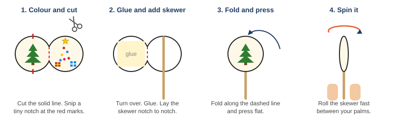
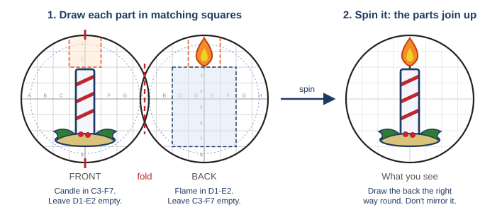

=========================================
Christmas thaumatropes
=========================================

A **thaumatrope** is a spinning disc with a different picture on each side. When
it spins fast, your brain joins the two pictures into one. It was invented in
1825, long before films and GIFs, and it is one of the simplest ways to see how
animation tricks your eyes.

In this activity you will make Christmas thaumatropes: a tree that fills with
presents, Santa landing in his sleigh, a reindeer that grows antlers, an elf with
a present, and a snow globe. Then you will design your own.

.. admonition:: You need

   * :download:`christmas_thaumatrope_template.pdf <thaumatrope/christmas_thaumatrope_template.pdf>`
     printed on thin card at 100% (actual size)
   * Optional extra templates, also printed on thin card at 100%:

     * :download:`christmas_thaumatrope_ideas_template.pdf <thaumatrope/christmas_thaumatrope_ideas_template.pdf>`
       (8 Christmas ideas drawn as outlines, ready to colour)
     * :download:`christmas_thaumatrope_blank_template.pdf <thaumatrope/christmas_thaumatrope_blank_template.pdf>`
       (6 blank grid pieces for your own designs)

   * Coloured pencils or textas
   * Scissors and a glue stick
   * A bamboo skewer for each thaumatrope (snip off the sharp tip), **or** a
     piece of string about 60 cm long

----

What they look like when they spin
----------------------------------

Click each one to spin it.

.. grid:: 2 3 5 5
   :gutter: 1
   :class-container: compact-gifs

   .. grid-item::

      .. figure:: thaumatrope/xmas_thaum_tree.gif
         :class: clickgif clickgif-ms-3000
         :width: 100%
         :alt: Spinning thaumatrope: a plain Christmas tree fills with baubles, a star and presents

         Tree and presents

   .. grid-item::

      .. figure:: thaumatrope/xmas_thaum_sleigh.gif
         :class: clickgif clickgif-ms-3000
         :width: 100%
         :alt: Spinning thaumatrope: Santa and his sack appear in an empty sleigh

         Santa in his sleigh

   .. grid-item::

      .. figure:: thaumatrope/xmas_thaum_reindeer.gif
         :class: clickgif clickgif-ms-3000
         :width: 100%
         :alt: Spinning thaumatrope: a reindeer gets antlers and a red nose

         Reindeer

   .. grid-item::

      .. figure:: thaumatrope/xmas_thaum_elf.gif
         :class: clickgif clickgif-ms-3000
         :width: 100%
         :alt: Spinning thaumatrope: an elf gets a pointy hat and holds a present

         Elf with a present

   .. grid-item::

      .. figure:: thaumatrope/xmas_thaum_globe.gif
         :class: clickgif clickgif-ms-3000
         :width: 100%
         :alt: Spinning thaumatrope: a snowman appears inside a snow globe

         Snow globe

Look at each design on the template. Notice that **neither picture is complete
on its own**. The tree has no decorations, and the decorations have no tree. The
finished picture only appears when they spin.

----

How to make one
---------------

   Making a thaumatrope with a skewer.

#. **Colour** both pictures. Bold, bright colours work best.
#. **Cut** around the solid black line. Keep the two circles joined at the fold.
   Snip a tiny notch at each of the two red marks on the front circle.
#. **Turn it over** so the blank side faces up. Rub glue all over the blank side.
#. **Lay the skewer** up the middle of the front circle, from notch to notch, with
   most of the skewer sticking out the bottom as a handle.
#. **Fold** along the red dashed line so the back circle covers the skewer. Press
   flat and line up the edges. Let the glue dry.
#. **Spin it.** Hold the handle between your flat palms and rub your hands back and
   forth quickly.

.. admonition:: Using string instead of a skewer

   Lay a 60 cm string up the middle instead of the skewer, so about 20 cm sticks
   out the **top** and the **bottom**. Fold and glue as before. Hold one end in each
   hand, twist the disc around 20 times, then pull your hands apart gently. The
   disc spins one way, then winds back the other way.

.. important::

   The skewer or string must go **up and down**, the same direction as the fold.
   If it goes side to side, the back picture will appear upside down.

Troubleshooting
~~~~~~~~~~~~~~~

.. list-table::
   :header-rows: 1
   :widths: 40 60

   * - Problem
     - Fix
   * - I see two pictures flickering
     - Spin faster. The pictures need to swap more than about 10 times a second.
   * - The pictures don't line up
     - The circles were not lined up when you folded. Make sure the cut edges match
       all the way round. On your own designs, check both parts use the same grid
       squares.
   * - The back picture is upside down
     - The skewer is going side to side. It must go up and down the middle.
   * - The disc slips on the skewer
     - Add more glue near the skewer, or a strip of tape over it before folding.

----

Design your own
---------------

Pages 2 and 3 of the template have blank pieces with faint grey guide lines.
For more blank pieces, print
:download:`christmas_thaumatrope_blank_template.pdf <thaumatrope/christmas_thaumatrope_blank_template.pdf>`
(6 pieces on 2 pages). Draw one part of a Christmas picture on the front and the
rest on the back.

   Plan with the grid: each part goes in the squares the other part leaves empty.

.. tip::

   * Each half should look **unfinished** on its own.
   * Both circles have the **same grid**: columns **A to H** and rows **1 to 8**.
     Draw the matching parts in the **same squares** on each circle.
   * Draw the back picture **the right way round**, just as you want to see it.
     Do not mirror or flip it.
   * Keep your drawing **inside the dotted blue ring** so nothing gets cut off.
   * Sketch lightly in pencil first. Colouring in will hide the grey guides.
   * Use thick outlines and strong colours. Tiny details disappear when it spins.

**Christmas ideas:**

* A chimney and Santa's boots sticking out of it
* A stocking and the toys inside it
* A gingerbread person and its icing and buttons
* A candle and its flame
* A Christmas pudding and the holly on top
* A window and falling snow outside
* Santa and his bag of toys
* An empty plate and the cookies left out for Santa

All eight ideas are drawn for you as light grey outlines in
:download:`christmas_thaumatrope_ideas_template.pdf <thaumatrope/christmas_thaumatrope_ideas_template.pdf>`
(3 pages, with a blank piece on the last page). Colour them in, cut them out and
spin them. Look at how each picture is split between the front and the back, then
try one of your own.

Click each one to see it spin.

.. grid:: 2 3 4 4
   :gutter: 1
   :class-container: compact-gifs

   .. grid-item::

      .. figure:: thaumatrope/xmas_thaum_chimney.gif
         :class: clickgif clickgif-ms-3000
         :width: 100%
         :alt: Spinning thaumatrope: Santa's boots appear sticking out of a chimney on a snowy roof

         Santa down the chimney

   .. grid-item::

      .. figure:: thaumatrope/xmas_thaum_stocking.gif
         :class: clickgif clickgif-ms-3000
         :width: 100%
         :alt: Spinning thaumatrope: a teddy, candy cane and present appear in a stocking

         Stocking full of toys

   .. grid-item::

      .. figure:: thaumatrope/xmas_thaum_gingerbread.gif
         :class: clickgif clickgif-ms-3000
         :width: 100%
         :alt: Spinning thaumatrope: a plain gingerbread person gets icing, a bow tie and buttons

         Gingerbread person

   .. grid-item::

      .. figure:: thaumatrope/xmas_thaum_candle.gif
         :class: clickgif clickgif-ms-3000
         :width: 100%
         :alt: Spinning thaumatrope: a flame appears on top of a red candle

         Candle and flame

   .. grid-item::

      .. figure:: thaumatrope/xmas_thaum_pudding.gif
         :class: clickgif clickgif-ms-3000
         :width: 100%
         :alt: Spinning thaumatrope: custard and holly appear on top of a Christmas pudding

         Christmas pudding

   .. grid-item::

      .. figure:: thaumatrope/xmas_thaum_window.gif
         :class: clickgif clickgif-ms-3000
         :width: 100%
         :alt: Spinning thaumatrope: snow falls outside a window at night

         Snowy window

   .. grid-item::

      .. figure:: thaumatrope/xmas_thaum_santa_sack.gif
         :class: clickgif clickgif-ms-3000
         :width: 100%
         :alt: Spinning thaumatrope: Santa holds up a sack full of toys

         Santa and his bag of toys

   .. grid-item::

      .. figure:: thaumatrope/xmas_thaum_cookies.gif
         :class: clickgif clickgif-ms-3000
         :width: 100%
         :alt: Spinning thaumatrope: cookies appear on an empty plate and milk fills the glass

         Cookies for Santa

.. admonition:: Think about it

   * What happens if you spin your thaumatrope slowly? Why?
   * Which design worked best? What made it work?
   * A thaumatrope has only two pictures. How is it like a 2-frame GIF?
