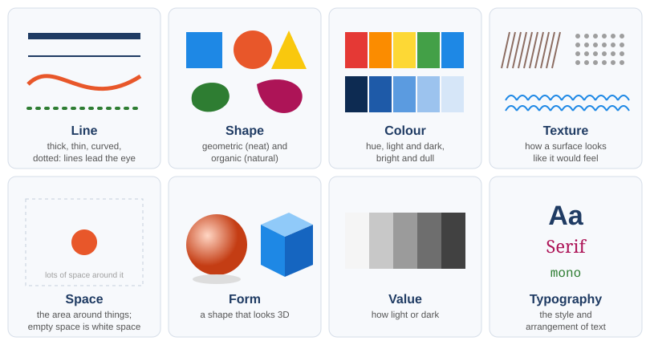
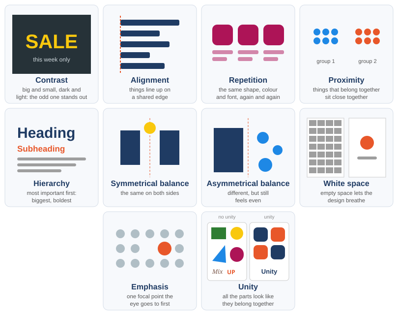
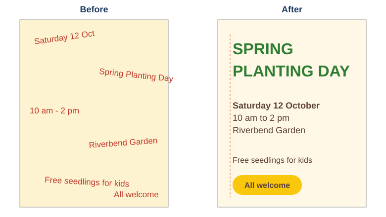
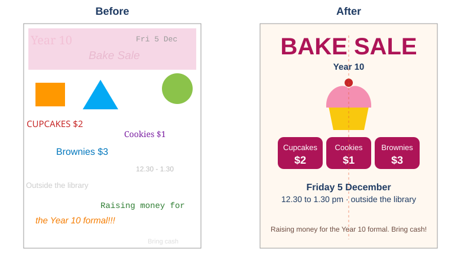
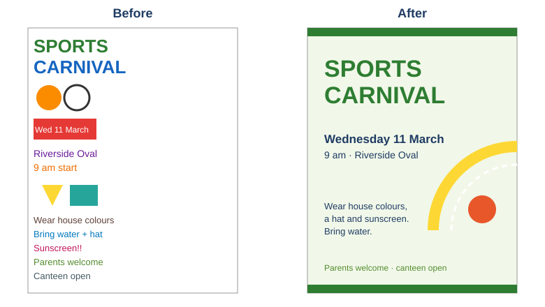
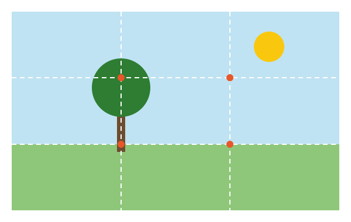

=====================================
Elements and principles of design
=====================================

.. admonition:: Learning intentions

   * Name the elements of design (the "ingredients")
   * Explain the principles of design (the "recipe")
   * Use design words to judge a poster or social media post

----

Ingredients and recipe
----------------------

A good way to think about design is cooking.

* The **elements** of design are the **ingredients**: line, shape, colour and so on.
* The **principles** of design are the **recipe**: how you put the ingredients
  together so the result works.

----

The elements of design
----------------------

.. list-table::
   :header-rows: 1
   :widths: 20 80

   * - Element
     - What it is
   * - **Line**
     - A mark between two points. Lines can be thick, thin, straight, curved or
       dotted. They can lead the eye around a design.
   * - **Shape**
     - A flat, closed area. *Geometric* shapes (circles, squares) look neat and
       modern. *Organic* shapes (leaves, blobs) look natural and friendly.
   * - **Colour**
     - Hue (red, blue...), plus how light or dark and how bright or dull it is.
       Colour creates mood. See :doc:`gd_02_colour`.
   * - **Texture**
     - How a surface feels or looks like it would feel: rough, smooth, grainy.
   * - **Space**
     - The area around and between things. Empty space is also called
       **white space** or **negative space**.
   * - **Form**
     - A shape that looks 3D, using shading or perspective.
   * - **Value**
     - How light or dark something is.
   * - **Typography**
     - The style and arrangement of text. See :doc:`gd_03_typography`.

   The elements of design.

----

The principles of design
------------------------

.. list-table::
   :header-rows: 1
   :widths: 20 80

   * - Principle
     - What it means
   * - **Contrast**
     - Things that are different stand out: big and small, dark and light, bold and
       thin. Contrast makes text easy to read and grabs attention.
   * - **Alignment**
     - Lining things up along an edge or the centre. Alignment makes a design look
       tidy and organised.
   * - **Repetition**
     - Using the same colours, fonts or shapes again and again. This makes a set of
       posts look like they belong together (consistency).
   * - **Proximity**
     - Putting related things close together. A date and time should sit together,
       away from unrelated text.
   * - **Hierarchy**
     - Showing what is most important first. The most important thing is usually
       the biggest, boldest or brightest.
   * - **Balance**
     - Spreading visual "weight" so the design feels stable. *Symmetrical* balance
       is the same on both sides. *Asymmetrical* balance uses different things
       that still feel even.
   * - **White space**
     - Leaving empty areas so the design can "breathe". Crowded designs are hard
       to read.
   * - **Emphasis**
     - A focal point that the eye goes to first.
   * - **Unity**
     - All the parts look like they belong in the same design.

   The principles of design.

.. tip::

   Many designers remember five core layout principles with the word **SPACE**:
   **S**\ pacing (Proximity), **P**\ atterns (Repetition), **A**\ lignment,
   **C**\ ontrast, **E**\ mphasis.

----

Before and after
~~~~~~~~~~~~~~~~

   The same information, before and after using hierarchy, alignment and
   proximity.

In the **after** version:

* The event name is biggest (**hierarchy**).
* Everything lines up on the left edge (**alignment**).
* Date, time and place are grouped together (**proximity**).
* The heading is dark on a light background (**contrast**).

----

Another example: using SPACE
~~~~~~~~~~~~~~~~~~~~~~~~~~~~

   A bake sale poster, before and after using the SPACE principles.

In the **after** version:

* **S**\ pacing (proximity): the date, time and place are grouped together, with
  empty space around each group so the poster can breathe.
* **P**\ atterns (repetition): the three price tags use the same shape, colour and
  font, so they clearly belong together.
* **A**\ lignment: everything is centred on one line down the middle (the dotted
  line).
* **C**\ ontrast: dark, bold text on a light background is easy to read. In the
  before version, pale pink and grey text almost disappears.
* **E**\ mphasis: "BAKE SALE" and the cupcake are the focal point, so you know
  what the poster is about straight away.

.. admonition:: Your turn

   Look at the **before** version again. List three problems you can see, and name
   the SPACE principle that would fix each one.

----

Another example: balance and white space
~~~~~~~~~~~~~~~~~~~~~~~~~~~~~~~~~~~~~~~~

   A sports carnival poster, before and after improving balance, white space and
   unity.

In the **before** version, everything is squashed against the left edge and the
right side is empty, so the poster feels lopsided. Every gap is filled with a
different shape or colour, so nothing stands out.

In the **after** version:

* **Asymmetrical balance**: the heavy heading on the left is balanced by the big
  running track and ball on the right. The two sides are different but feel even.
* **White space**: there are clear gaps between the heading, the date and place,
  and the reminders. The poster has room to breathe.
* **Unity**: one font family and a small set of colours (green, yellow, navy and
  one orange accent) are used everywhere, and the green bars at the top and bottom
  tie it together.
* **Hierarchy**: the heading first, then the date and place, then the reminders.

----

Analyse the balance: four posters
~~~~~~~~~~~~~~~~~~~~~~~~~~~~~~~~~

Look carefully at these four posters. Two are well balanced and two have
problems. Click a poster to see it full size.

.. grid:: 2 4 4 4
   :gutter: 1
   :class-container: compact-gifs

   .. grid-item::

      .. figure:: images/balance/poster_a.svg
         :width: 100%
         :alt: Poster A: a centred Spring Concert poster with a music note, lots of empty space around the text

         A: Spring Concert

   .. grid-item::

      .. figure:: images/balance/poster_b.svg
         :width: 100%
         :alt: Poster B: a Nippers poster with a large blue picture of a surfer on the left half and text on the right half

         B: Nippers

   .. grid-item::

      .. figure:: images/balance/poster_c.svg
         :width: 100%
         :alt: Poster C: a Book Week poster with a heavy orange block and all the content in the top half, and the bottom half empty

         C: Book Week

   .. grid-item::

      .. figure:: images/balance/poster_d.svg
         :width: 100%
         :alt: Poster D: a School Fete poster packed edge to edge with ten coloured boxes and lots of small text

         D: School Fete

----

How to analyse balance
^^^^^^^^^^^^^^^^^^^^^^

Use these four steps for each poster.

#. **Find the middle.** Imagine a line down the centre of the poster. Are both
   sides the same (**symmetrical**), different but even (**asymmetrical**), or
   does one side or end feel heavier (**unbalanced**)?
#. **Find the visual weight.** Big things, dark colours, bright colours and solid
   blocks feel *heavy*. Small things, light colours and thin text feel *light*.
   Where are the heavy parts?
#. **Look at the white space.** Is there empty space around the groups of
   information? Is it spread around the poster, or all in one place?
#. **Suggest a change.** What one change would make the poster more balanced or
   easier to read?

Sentence starters
^^^^^^^^^^^^^^^^^

Copy and complete these for **each** poster in your workbook.

* Poster \_\_ is **symmetrical / asymmetrical / unbalanced** because ...
* The heaviest part of the poster is ... because ...
* The poster has **enough / not enough** white space. I can tell because ...
* To improve the poster, I would ... This would help because ...

When you have written your answers, open the model answers to check.

.. admonition:: Model answer: Poster A
   :class: dropdown

   * **Symmetrical.** Everything is centred, so the left and right sides are mirror images.
   * **Heaviest part:** the big purple heading SPRING CONCERT, because it is the largest, boldest and darkest text.
   * **White space:** plenty. There are wide margins all around and clear gaps between the heading, the music note and the details.
   * **Improvement:** it already works well. You could make the date a little larger so it is easier to read from a distance. A symmetrical layout suits a formal event like a concert.

.. admonition:: Model answer: Poster B
   :class: dropdown

   * **Asymmetrical but balanced.** The left and right halves are different, but they feel even.
   * **Heaviest part:** the big blue picture block on the left. It is balanced by the large heading and the bright orange button on the right.
   * **White space:** enough. The text on the right has space around it, and the gaps between the heading, the details and the button make the order clear.
   * **Improvement:** the details text is quite small. Making it a little larger would improve readability while keeping the balance. An asymmetrical layout feels lively, which suits a sport for kids.

.. admonition:: Model answer: Poster C
   :class: dropdown

   * **Unbalanced.** It is top-heavy: the big dark orange block and all the content are in the top half.
   * **Heaviest part:** the orange heading block at the top. Nothing in the bottom half balances it.
   * **White space:** there is a lot, but it is all in one place (the bottom half), so it looks empty and unfinished rather than calm.
   * **Improvement:** move the books and date down and make them larger, or add a picture of a character in the bottom half, so the weight is spread through the poster.

.. admonition:: Model answer: Poster D
   :class: dropdown

   * **Neither: it is crowded.** The boxes are in a grid, so it is roughly symmetrical, but it is filled from edge to edge.
   * **Heaviest part:** everything feels heavy. Ten strong colours compete with each other, so no part stands out.
   * **White space:** not enough. There are almost no margins and no gaps between groups, so it is tiring to read.
   * **Improvement:** choose the three or four most important activities, use one or two colours, add margins and space between groups, and make the date and place stand out.

.. classifying::
   :delimiter: =>
   :bins: Symmetrical, Asymmetrical, Unbalanced, Crowded
   :instructions: Classify each poster.

   Poster A: Spring Concert => Symmetrical
   Poster B: Nippers => Asymmetrical
   Poster C: Book Week => Unbalanced
   Poster D: School Fete => Crowded

.. admonition:: Your turn: redesign

   Choose **Poster C** or **Poster D**. Sketch a new version that fixes its
   balance and white space problems. Keep all the important information. Under
   your sketch, write two sentences explaining what you changed and why, using
   the words **balance** and **white space**.

----

Analyse hierarchy, repetition, proximity and alignment
------------------------------------------------------

These four posters each do one of these principles very well or very badly.
Click a poster to see it full size.

.. grid:: 2 4 4 4
   :gutter: 1
   :class-container: compact-gifs

   .. grid-item::

      .. figure:: images/balance/poster_e.svg
         :width: 100%
         :alt: Poster E: a Lost Cat poster where every line of text is the same small size, with a small picture of a ginger cat

         E: Lost cat

   .. grid-item::

      .. figure:: images/balance/poster_f.svg
         :width: 100%
         :alt: Poster F: a Coding Club poster with a large heading and three matching session cards, all lined up on the left

         F: Coding Club

   .. grid-item::

      .. figure:: images/balance/poster_g.svg
         :width: 100%
         :alt: Poster G: a Farmers Market poster where the date is at the top, the time at the bottom and the place is mixed into the list of food

         G: Farmers Market

   .. grid-item::

      .. figure:: images/balance/poster_h.svg
         :width: 100%
         :alt: Poster H: a Science Fair poster where every piece of text starts in a different place: some left, some centred, some right

         H: Science Fair

How to analyse these principles
~~~~~~~~~~~~~~~~~~~~~~~~~~~~~~~

Ask these questions about each poster.

.. list-table::
   :header-rows: 1
   :widths: 22 78

   * - Principle
     - Questions to ask
   * - **Hierarchy**
     - What do you read first, second and third? Is the most important
       information the biggest or boldest? Can you find the key details in
       3 seconds?
   * - **Repetition**
     - Are the same colours, fonts and shapes used again for things that are
       the same kind? Does the poster look like one design or a mix?
   * - **Proximity**
     - Are things that belong together (date, time and place) grouped close
       together? Are unrelated things kept apart?
   * - **Alignment**
     - Draw an imaginary line down the left edge or the centre. How many things
       line up on it? Do things start in random places?

Sentence starters
~~~~~~~~~~~~~~~~~

Copy and complete these for **each** poster in your workbook.

* The first thing I read is ... because ...
* **Hierarchy** in this poster is **strong / weak** because ...
* **Repetition** is used / not used when ...
* **Proximity**: the date, time and place are **grouped / spread out**, so ...
* **Alignment**: the text lines up on the **left / centre / nothing**, which makes
  it look ...
* The poster's biggest strength or problem is ... To improve it, I would ...

When you have written your answers, open the model answers to check.

.. admonition:: Model answer: Poster E
   :class: dropdown

   * **Hierarchy: weak, the main problem.** Every line is the same size and weight, so nothing stands out. You have to read everything to find out what the poster is about.
   * **Repetition:** one font and one colour are used throughout, which is consistent, but because everything is the same, nothing is emphasised.
   * **Proximity:** fairly good. The description lines are together, and the phone number and reward are together at the bottom.
   * **Alignment:** good. Everything is centred.
   * **Improvement:** make LOST CAT huge and bold at the top, make the picture much bigger, and make the phone number large and bold so people can read it from a distance.

.. admonition:: Model answer: Poster F
   :class: dropdown

   * **Hierarchy: strong.** Coding Club is read first, then the three sessions, then the details.
   * **Repetition: strong, a main strength.** The three session cards use the same shape, colour, stripe and fonts, so you can see straight away that they are the same kind of information.
   * **Proximity:** strong. Each day is grouped with its topic inside its card, and there are even gaps between the cards.
   * **Alignment: strong, a main strength.** Everything lines up on one left edge, so the poster looks neat and is easy to scan.
   * **Improvement:** very little. A small picture or icon on the right would add interest without upsetting the alignment.

.. admonition:: Model answer: Poster G
   :class: dropdown

   * **Hierarchy:** fairly good. The heading Farmers Market is biggest and boldest.
   * **Repetition:** consistent. All the small text uses the same font, size and colour.
   * **Proximity: weak, the main problem.** The date is at the top, the time is at the very bottom, and the place (Community hall car park) is mixed into the list of food. Bring your own bags is hidden among the food too. Readers have to search the whole poster to find when and where.
   * **Alignment:** good. Everything lines up on the left.
   * **Improvement:** put the date, time and place together in one group under the heading. Put the food list in its own group, and the reminder about bags on its own line at the bottom.

.. admonition:: Model answer: Poster H
   :class: dropdown

   * **Hierarchy:** fairly good. SCIENCE FAIR is biggest, then the date.
   * **Repetition:** one font family and one blue colour, which is consistent.
   * **Proximity:** the date and place are near each other, but the gaps between lines are uneven.
   * **Alignment: weak, the main problem.** Every line starts somewhere different: some on the left, some centred, some on the right, and even the two heading words are offset. The poster looks messy and is hard to read.
   * **Improvement:** choose one alignment, either all centred or all lined up on the left, and keep the gaps between groups even.

.. classifying::
   :delimiter: =>
   :bins: Hierarchy, Repetition and alignment, Proximity, Alignment
   :instructions: Classify each poster by its biggest strength or problem.

   Poster E: Lost cat => Hierarchy
   Poster F: Coding Club => Repetition and alignment
   Poster G: Farmers Market => Proximity
   Poster H: Science Fair => Alignment

.. admonition:: Your turn: redesign

   Choose **Poster E**, **G** or **H**. Sketch a new version that fixes its main
   problem without losing any information. Under your sketch, write two sentences
   explaining what you changed, using the name of the principle you fixed.

----

The rule of thirds
------------------

Imagine a grid that splits your design into three columns and three rows. Place
important things **on the lines** or where they **cross**, instead of right in
the middle. This usually looks more interesting. Most phone cameras can show this
grid.

   The tree is on a vertical third line and the horizon is on a horizontal third
   line.

----

Activity: design critique
-------------------------

Your teacher will show you three posters or social media posts. For each one,
answer in your workbook:

#. What is the **first** thing you see? Why? (hierarchy, contrast, emphasis)
#. Is the text easy to read? Why or why not?
#. Find one example of **alignment**, **repetition** or **proximity**.
#. Who do you think the **audience** is? What tells you?
#. Give **one** specific change that would improve it.

.. admonition:: Good critique language

   Say what you see and why it works or does not work. Instead of "It looks bad",
   say: "The date is the same size as the rest of the text, so it is hard to find.
   Making it larger and bold would improve the hierarchy."

----

Check your understanding
------------------------

.. classifying::
   :delimiter: =>
   :bins: Element, Principle
   :instructions: Is it an element (ingredient) or a principle (recipe)?

   Line => Element
   Shape => Element
   Texture => Element
   Colour => Element
   Value => Element
   Contrast => Principle
   Alignment => Principle
   Hierarchy => Principle
   Proximity => Principle
   Balance => Principle

.. mcqgroup::
   :show-instant-feedback:
   :shuffle-questions:

   .. multichoice::

      The date, time and place of an event are grouped together. Which principle is this?

      [ ] Contrast | Contrast is about difference.
      [x] Proximity | Yes. Related things are placed close together.
      [ ] Balance | Balance is about visual weight.
      [ ] Texture | Texture is an element.

   .. multichoice::

      A set of five posts all use the same two fonts and three colours. Which principle is this?

      [x] Repetition | Yes. Repeating fonts and colours makes them look like a set.
      [ ] Proximity | Not quite.
      [ ] Alignment | Not quite.
      [ ] Emphasis | Not quite.

   .. multichoice::

      What does **hierarchy** mean in design?

      [x] Showing what is most important first, often by making it biggest or boldest | Yes.
      [ ] Putting everything in the middle | That is centre alignment.
      [ ] Using lots of colours | No.
      [ ] Filling every space | That is the opposite of white space.

   .. multichoice::

      What is **white space**?

      [ ] Only areas coloured white | It does not have to be white.
      [x] Empty space around and between things in a design | Yes. It can be any colour.
      [ ] A spelling mistake | No.
      [ ] The edge of the page | Not quite.

   .. multichoice::

      Where does the rule of thirds suggest you place the main subject?

      [ ] Exactly in the centre | The rule suggests moving away from the centre.
      [x] On the third lines or where they cross | Yes.
      [ ] In a corner, touching the edge | Too far.
      [ ] Anywhere | Not quite.

   .. multichoice::

      What do the letters in **SPACE** stand for?

      [x] Spacing, Patterns, Alignment, Contrast, Emphasis | Yes.
      [ ] Shape, Pixels, Art, Colour, Edges | No.
      [ ] Size, Position, Area, Centre, Edge | No.
      [ ] Spacing, Pictures, Arrows, Colour, Effects | Not quite.

   .. multichoice::

      A poster has a big heading on the left and a large picture on the right. The two sides are different but feel even. This is...

      [x] asymmetrical balance | Yes. Different things that still feel even.
      [ ] symmetrical balance | Symmetrical means the same on both sides.
      [ ] repetition | Repetition is using the same thing again and again.
      [ ] proximity | Proximity is grouping related things together.

   .. multichoice::

      A poster is filled from edge to edge with pictures and text, and nothing stands out. What would help most?

      [x] Remove some items and add more white space | Yes. Space lets the important parts stand out.
      [ ] Add more pictures | That makes it more crowded.
      [ ] Make all the text the same size | That removes hierarchy.
      [ ] Use more different fonts | That makes it messier.
