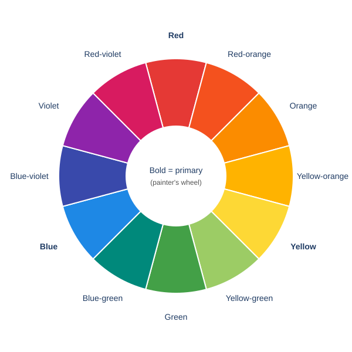
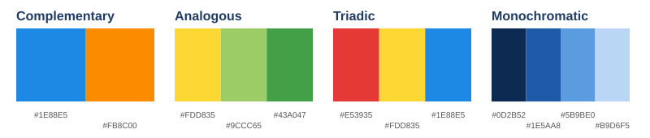

======
Colour
======

.. admonition:: Learning intentions

   * Use the colour wheel to build colour schemes
   * Explain the difference between RGB and CMYK
   * Read and use hex colour codes
   * Choose colours that suit a purpose and audience

----

The colour wheel
----------------

   A 12-part colour wheel.

.. list-table::
   :header-rows: 1
   :widths: 25 75

   * - Group
     - Colours
   * - **Primary**
     - Red, yellow, blue. (In the traditional painter's wheel these cannot be mixed
       from other colours.)
   * - **Secondary**
     - Orange, green, violet. Made by mixing two primaries.
   * - **Tertiary**
     - Red-orange, yellow-green and so on. Made by mixing a primary and a
       secondary next to it.

Words about colour
~~~~~~~~~~~~~~~~~~

* **Hue**: the name of the colour (red, blue, green).
* **Tint**: a hue with white added (pink is a tint of red).
* **Shade**: a hue with black added (maroon is a shade of red).
* **Saturation**: how bright and strong (saturated) or dull and grey the colour is.
* **Warm colours**: reds, oranges, yellows. They feel energetic and seem to come
  forward.
* **Cool colours**: blues, greens, violets. They feel calm and seem to move back.

----

Colour schemes
--------------

A **colour scheme** (or **palette**) is a small set of colours that work well
together. Most brands use two or three main colours plus a neutral (white, black
or grey).

.. list-table::
   :header-rows: 1
   :widths: 25 45 30

   * - Scheme
     - How to find it on the wheel
     - Feeling
   * - **Complementary**
     - Two colours **opposite** each other (blue and orange)
     - Bold, high contrast
   * - **Analogous**
     - Three colours **next to** each other (yellow, yellow-green, green)
     - Calm, natural, harmonious
   * - **Triadic**
     - Three colours **evenly spaced** around the wheel (red, yellow, blue)
     - Lively, playful
   * - **Monochromatic**
     - Tints and shades of **one** hue
     - Simple, elegant

   Examples of each scheme.

----

Colour and meaning
------------------

Colours can make people feel or think certain things. The meaning can change
between cultures, so always think about your audience.

.. list-table::
   :header-rows: 1
   :widths: 20 80

   * - Colour
     - Often linked with (in Australia)
   * - Red
     - Energy, danger, excitement, sales and food
   * - Orange
     - Fun, warmth, friendliness
   * - Yellow
     - Happiness, sunshine, caution
   * - Green
     - Nature, health, growth, "go"
   * - Blue
     - Trust, calm, technology, the ocean
   * - Purple
     - Creativity, luxury
   * - Black
     - Power, elegance, seriousness
   * - White
     - Clean, simple, fresh

.. note::

   In some cultures white is worn for mourning, and in others red is worn at
   weddings and celebrations. Do not assume your audience reads colour the same
   way you do.

----

Screen colour and print colour
------------------------------

.. list-table::
   :header-rows: 1
   :widths: 20 40 40

   * -
     - **RGB**
     - **CMYK**
   * - Stands for
     - Red, Green, Blue
     - Cyan, Magenta, Yellow, Key (black)
   * - Used for
     - Screens: phones, websites, social media, TV
     - Printing: posters, flyers, magazines
   * - How it mixes
     - **Additive**: adding light. All three at full makes **white**.
     - **Subtractive**: inks absorb light. All together make a dark colour, so
       black ink (K) is added.

.. important::

   Social media and websites are seen on screens, so always design them in **RGB**.
   In Photoshop, check with **Image > Mode > RGB Color**.

Hex codes
~~~~~~~~~

On screens, colours are often written as a **hex code**: a ``#`` followed by six
characters. The first two are red, the middle two green, the last two blue. Each
pair goes from ``00`` (none) to ``FF`` (full).

.. list-table::
   :header-rows: 1
   :widths: 25 25 50

   * - Hex code
     - Colour
     - Why
   * - ``#FF0000``
     - Red
     - Full red, no green, no blue
   * - ``#00FF00``
     - Green
     - No red, full green, no blue
   * - ``#0000FF``
     - Blue
     - No red, no green, full blue
   * - ``#FFFFFF``
     - White
     - All three at full (adding light)
   * - ``#000000``
     - Black
     - No light at all
   * - ``#1F3B63``
     - Dark navy
     - A little red, a bit more green, more blue

You will use hex codes again in CSS in the web design unit.

----

Activity: build a brand palette
-------------------------------

#. Choose a made-up business: a surf shop, a bakery, a gaming café or your own idea.
#. Write three words that describe how the brand should **feel** (for example
   *calm, natural, local*).
#. Open `Adobe Color <https://color.adobe.com>`_ (or the Photoshop **Color** panel).
   Pick a colour rule (complementary, analogous, triadic or monochromatic).
#. Choose a palette of **3 to 5** colours that matches your three words.
#. Copy the **hex code** of each colour into your workbook.
#. Explain in two sentences why your palette suits the brand and its audience.

----

Check your understanding
------------------------

.. classifying::
   :delimiter: =>
   :instructions: Sort each item into the colour model it belongs to.

   Instagram post => RGB
   Website banner => RGB
   Phone wallpaper => RGB
   Printed school poster => CMYK
   Magazine page => CMYK
   Flyer handed out at the shops => CMYK

.. mcqgroup::
   :show-instant-feedback:
   :shuffle-questions:

   .. multichoice::

      Which two colours are **complementary**?

      [x] Blue and orange | Yes. They are opposite each other on the wheel.
      [ ] Blue and green | These are next to each other (analogous).
      [ ] Red and pink | Pink is a tint of red.
      [ ] Yellow and yellow-green | These are next to each other.

   .. multichoice::

      Adding white to a colour makes a...

      [x] tint | Yes.
      [ ] shade | A shade has black added.
      [ ] hue | Hue is the colour name.
      [ ] tone | Not the word we used.

   .. multichoice::

      Which colour model should you use for an Instagram post?

      [x] RGB | Yes. It is seen on a screen.
      [ ] CMYK | CMYK is for printing.
      [ ] Either, it makes no difference | Colours can look wrong in the wrong mode.
      [ ] Greyscale | Only for black and white.

   .. multichoice::

      What colour is ``#FFFFFF``?

      [ ] Black | Black is ``#000000``.
      [x] White | Yes. Red, green and blue are all at full.
      [ ] Red | Red is ``#FF0000``.
      [ ] Grey | Grey has three equal middle values, such as ``#808080``.

   .. multichoice::

      Which colour scheme uses three colours next to each other on the wheel?

      [ ] Complementary | Complementary colours are opposite.
      [x] Analogous | Yes.
      [ ] Triadic | Triadic colours are evenly spaced.
      [ ] Monochromatic | Monochromatic uses one hue.

   .. multichoice::

      A bank wants its logo to say "trust" and "calm". Which colour is the best fit?

      [x] Blue | Yes. Blue is often linked with trust and calm.
      [ ] Bright orange | Orange feels fun and energetic.
      [ ] Red | Red feels exciting or urgent.
      [ ] Neon pink | Not a calm choice.

.. clozegroup::
   :show-instant-feedback:

   .. cloze:: text

      Red, yellow and blue are the @@primary@@ colours on the painter's colour wheel.
      Colours opposite each other on the wheel are @@complementary@@.
      Screens mix light using the @@RGB@@ colour model.
      Printers mix inks using the @@CMYK@@ colour model.
      A colour with black added is called a @@shade@@.
