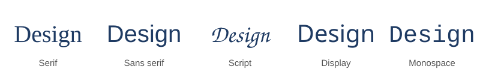
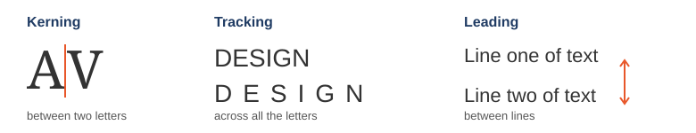

==========
Typography
==========

.. admonition:: Learning intentions

   * Name the main groups of fonts and when to use them
   * Use spacing words: kerning, tracking and leading
   * Pair fonts and use hierarchy to make text easy to read

----

Fonts and typefaces
-------------------

A **typeface** is a family of letters with the same design, such as Arial. A
**font** is one version of it, such as Arial Bold 24 point. Most people use the
two words to mean the same thing.

Font groups
~~~~~~~~~~~

   Five font groups.

.. list-table::
   :header-rows: 1
   :widths: 18 42 40

   * - Group
     - What it looks like
     - Good for
   * - **Serif**
     - Small "feet" (serifs) on the ends of letters. Examples: Times New Roman,
       Georgia.
     - Books, newspapers, a traditional or trusted feel
   * - **Sans serif**
     - No feet ("sans" means "without"). Examples: Arial, Helvetica, Calibri.
     - Screens, social media, a clean modern feel
   * - **Script**
     - Looks like handwriting or calligraphy.
     - Invitations, short headings. Hard to read in large amounts.
   * - **Display**
     - Bold, decorative or unusual.
     - Big headings and logos only
   * - **Monospace**
     - Every letter takes the same width. Example: Courier.
     - Computer code, a "typewriter" look

----

Spacing words
-------------

   Kerning, tracking and leading.

.. list-table::
   :header-rows: 1
   :widths: 20 80

   * - Word
     - Meaning
   * - **Kerning**
     - The space between **two particular letters**, such as "A" and "V".
   * - **Tracking**
     - The space between **all** the letters in a word or line. Wide tracking can
       look stylish in short headings.
   * - **Leading** (say "ledding")
     - The space between **lines** of text. Too little and the lines crash into
       each other.
   * - **Point size**
     - How big the text is.
   * - **Weight**
     - How thick the letters are: Light, Regular, Bold, Black.

In Photoshop you change these in the **Character** panel (**Window > Character**).

----

Rules for readable text
-----------------------

#. **Use no more than two or three fonts** in one design.
#. **Pair a fancy font with a plain one.** A display or script heading looks
   best with a simple sans serif for the details.
#. **Create hierarchy**: heading, then subheading, then details. Change the size
   and weight so the order is clear.
#. **Keep contrast high.** Dark text on a light background, or light on dark.
   Avoid text on busy parts of a photo.
#. **Keep it short.** On social media, people scroll fast. A few words in large
   text work better than a paragraph.
#. **Avoid ALL CAPITALS for long text.** It is harder to read. Short headings are
   fine.

.. warning::

   Many fonts are **not** free to use. Fonts are software and have licences. Use
   fonts that come with your computer or that have an open licence, such as
   `Google Fonts <https://fonts.google.com>`_ or Adobe Fonts through your school
   account.

----

Activity: font pairing
----------------------

#. Go to `Google Fonts <https://fonts.google.com>`_.
#. Choose **one heading font** (display or serif) and **one body font** (sans serif).
#. In Photoshop, make a 1080 × 1080 canvas. Type a heading such as
   ``SATURDAY MARKET`` in the heading font and three lines of details (date, time,
   place) in the body font.
#. Use size and weight to create clear hierarchy.
#. Show a classmate. Can they find the date in under 3 seconds?

----

Check your understanding
------------------------

.. classifying::
   :delimiter: =>
   :instructions: Sort each font description into its group.

   Has small feet on the ends of the letters => Serif
   Times New Roman => Serif
   Clean letters with no feet => Sans serif
   Arial => Sans serif
   Looks like joined-up handwriting => Script
   Every letter is the same width => Monospace
   Courier => Monospace
   Big, bold and decorative, for headings only => Display

.. mcqgroup::
   :show-instant-feedback:
   :shuffle-questions:

   .. multichoice::

      What is **leading**?

      [ ] The space between two letters | That is kerning.
      [ ] The space between all the letters in a word | That is tracking.
      [x] The space between lines of text | Yes.
      [ ] How thick the letters are | That is weight.

   .. multichoice::

      What is **kerning**?

      [x] The space between two particular letters | Yes.
      [ ] The space between lines | That is leading.
      [ ] The size of the text | That is point size.
      [ ] A type of font | No.

   .. multichoice::

      How many fonts should you usually use in one design?

      [ ] One only | One can work, but two gives you contrast.
      [x] Two or three at most | Yes.
      [ ] Five or more | Too many fonts look messy.
      [ ] As many as you like | Too many fonts look messy.

   .. multichoice::

      Which font group is usually best for small text on screens?

      [ ] Script | Script is hard to read at small sizes.
      [x] Sans serif | Yes. Clean letters are easy to read on screens.
      [ ] Display | Display fonts are for big headings.
      [ ] Monospace | Mainly used for code.

   .. multichoice::

      Why should you check a font's licence?

      [x] Fonts are software, and many cannot be used without permission | Yes.
      [ ] Licences make fonts look better | No.
      [ ] Only to see the font size | No.
      [ ] You never need to | You do. Fonts can be protected.

.. flashcards:: Typography words
   :id: y10mm-gd-type
   :shuffle:

   Serif | A font with small feet on the ends of the letters
   Sans serif | A font without feet, clean and modern
   Script | A font that looks like handwriting
   Display | A bold or decorative font for headings
   Monospace | A font where every letter takes the same width
   Kerning | The space between two particular letters
   Tracking | The space between all the letters in a word or line
   Leading | The space between lines of text
   Weight | How thick the letters are, such as Light or Bold
   Hierarchy | Showing the most important text first using size and weight
