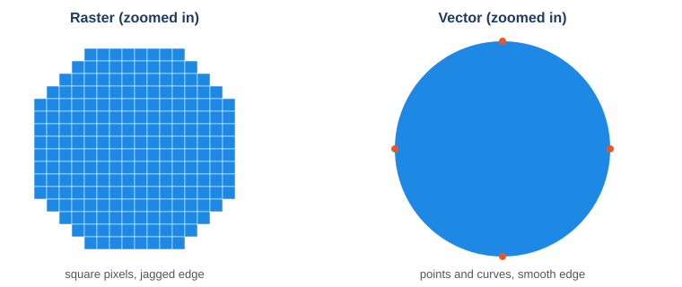

=================================
Images, file types and copyright
=================================

.. admonition:: Learning intentions

   * Explain the difference between raster and vector images
   * Choose the right file type and resolution for a job
   * Use other people's images legally and give credit
   * Think about the ethics of editing photos

----

Raster and vector
-----------------

   Zoom in on a raster image and you see pixels. A vector stays smooth.

.. list-table::
   :header-rows: 1
   :widths: 20 40 40

   * -
     - **Raster (bitmap)**
     - **Vector**
   * - Made of
     - A grid of tiny coloured squares called **pixels**
     - Points, lines and curves worked out with maths
   * - When you make it bigger
     - It gets blurry or blocky (pixelated)
     - It stays sharp at any size
   * - Best for
     - Photos and detailed paintings
     - Logos, icons, simple illustrations
   * - Software
     - Photoshop
     - Illustrator, Canva shapes, Inkscape
   * - File types
     - JPG, PNG, GIF, WebP, PSD
     - SVG, AI, EPS, PDF

Resolution
~~~~~~~~~~

**Resolution** is how much detail an image has.

* For screens we care about the **pixel size**, such as 1080 × 1080 pixels.
* For printing we also care about **pixels per inch (ppi)**. Print usually needs
  about **300 ppi**. A photo that looks fine on a phone may look blurry printed
  as a big poster.

.. tip::

   You can make an image **smaller** without losing quality, but making a raster
   image **bigger** makes it blurry. Always start with an image that is big
   enough.

----

File types
----------

.. list-table::
   :header-rows: 1
   :widths: 12 18 15 15 40

   * - Type
     - Raster or vector
     - Transparent?
     - Animation?
     - Best for
   * - **JPG**
     - Raster
     - No
     - No
     - Photos. Uses **lossy** compression: some detail is thrown away to make the
       file small.
   * - **PNG**
     - Raster
     - Yes
     - No
     - Logos, graphics with text, anything needing a see-through background.
       **Lossless**: no detail is lost.
   * - **GIF**
     - Raster
     - Yes (on or off)
     - Yes
     - Simple animations. Only 256 colours.
   * - **WebP**
     - Raster
     - Yes
     - Yes
     - Websites. Small files with good quality.
   * - **SVG**
     - Vector
     - Yes
     - Yes (with code)
     - Logos and icons on websites
   * - **PSD**
     - Raster (with layers)
     - Yes
     - Yes (frames)
     - Your Photoshop working file. Not for sharing online.

.. classifying::
   :delimiter: =>
   :instructions: Choose the best file type for each job.

   A holiday photo for a website => JPG
   A logo with a see-through background for a post => PNG
   A short looping animation => GIF
   A photo of a sunset to send to a friend => JPG
   Text and shapes that must stay crisp with no background => PNG
   A dancing cat that loops forever => GIF

----

Copyright
---------

In Australia, **copyright** is protected by the *Copyright Act 1968*. The
important ideas are:

* Copyright starts **automatically** as soon as someone makes an original photo,
  drawing, song, video or piece of writing. They do not need to register it or add
  a © symbol.
* Only the owner can decide who may copy, share or change their work.
* Copyright usually lasts for **70 years after the creator dies**.
* Finding an image on Google does **not** mean it is free to use.

Fair dealing
~~~~~~~~~~~~

Australian law allows some use without permission. This is called **fair
dealing**. It includes using a small part of a work for **research or study**,
**criticism or review**, **parody or satire**, and **reporting the news**. A
school assignment that only your teacher sees may fit "research or study". A
post for a client that is shared publicly does **not**.

Moral rights
~~~~~~~~~~~~

Creators in Australia also have **moral rights**: the right to be named as the
creator, the right not to have someone else named as the creator, and the right
not to have their work changed in a way that harms their reputation.

----

Images you can use
------------------

.. list-table::
   :header-rows: 1
   :widths: 30 70

   * - Source
     - Notes
   * - **Your own** photos and drawings
     - The safest choice. You own the copyright.
   * - **Creative Commons** images
     - The creator has given permission with conditions (see below).
   * - **Public domain** images
     - No copyright, or the copyright has run out. Free to use.
   * - **Free stock sites** (such as Unsplash and Pexels)
     - Free to use under the site's own licence. Read the licence and credit the
       photographer anyway.
   * - **Licensed** stock (such as Adobe Stock through school)
     - Paid for, or included in a school licence.

Creative Commons licences
~~~~~~~~~~~~~~~~~~~~~~~~~

`Creative Commons <https://creativecommons.org>`_ licences are made from these
building blocks:

.. list-table::
   :header-rows: 1
   :widths: 15 25 60

   * - Code
     - Name
     - What it means
   * - **BY**
     - Attribution
     - You **must credit** the creator. (All CC licences include this except CC0.)
   * - **SA**
     - ShareAlike
     - If you change it, you must share your new work under the **same** licence.
   * - **NC**
     - NonCommercial
     - You **cannot** use it to make money.
   * - **ND**
     - NoDerivatives
     - You **cannot change** it. Use it as it is.
   * - **CC0**
     - Public domain dedication
     - The creator gives up their rights. No conditions.

For example, **CC BY-NC** means: credit the creator, and do not use it to make
money.

How to credit an image
~~~~~~~~~~~~~~~~~~~~~~

Remember **TASL**: **T**\ itle, **A**\ uthor, **S**\ ource, **L**\ icence.

.. code-block:: text
   :class: no-copybutton

   "Sunrise at Bells Beach" by Jo Smith, from Flickr (link), licensed under CC BY 2.0

----

The ethics of editing photos
----------------------------

Photoshop can change a photo so much that it no longer shows the truth. Something
can be **legal** but still not **ethical** (fair and honest).

.. admonition:: Discuss

   * Is it OK to remove a pimple from a school photo? What about making someone
     look thinner?
   * A news site adds smoke to a photo of a fire to make it look worse. Is this OK?
   * An advert for burgers makes the burger look much bigger than the real one.
     Who could be harmed?
   * Should edited or AI-generated images be labelled? Why?

----

Check your understanding
------------------------

.. mcqgroup::
   :show-instant-feedback:
   :shuffle-questions:

   .. multichoice::

      Which type of image stays sharp at any size?

      [ ] Raster | Raster images become blurry when enlarged.
      [x] Vector | Yes. Vectors are made with maths, not pixels.
      [ ] JPG | JPG is a raster format.
      [ ] Photo | Photos are raster images.

   .. multichoice::

      You need a logo with a see-through background for an Instagram post. Which file type?

      [ ] JPG | JPG cannot be transparent.
      [x] PNG | Yes.
      [ ] PSD | PSD is a working file, not for posting.
      [ ] DOCX | That is a Word document.

   .. multichoice::

      When does copyright start in Australia?

      [ ] When the work is registered | No registration is needed.
      [x] Automatically, as soon as the original work is made | Yes.
      [ ] When a © symbol is added | The symbol is not needed.
      [ ] After 70 years | Copyright usually ends 70 years after the creator dies.

   .. multichoice::

      An image has the licence **CC BY-ND**. What must you do?

      [x] Credit the creator and not change the image | Yes. BY = attribution, ND = no derivatives.
      [ ] Nothing, it is free | You must follow the conditions.
      [ ] Pay the creator | Creative Commons is free if you follow the conditions.
      [ ] Change it and share under the same licence | That is SA.

   .. multichoice::

      What does **TASL** stand for?

      [x] Title, Author, Source, Licence | Yes.
      [ ] Text, Art, Style, Layout | No.
      [ ] Time, Artist, Size, Location | No.
      [ ] Type, Area, Shape, Line | No.

   .. multichoice::

      Which compression throws away some detail to make the file smaller?

      [x] Lossy, used by JPG | Yes.
      [ ] Lossless, used by PNG | Lossless keeps all the detail.
      [ ] Vector | Vector is not a type of compression.
      [ ] None of them | JPG is lossy.

.. clozegroup::
   :show-instant-feedback:

   .. cloze:: text

      A raster image is made of tiny squares called @@pixels@@.
      Logos are best made as @@vector@@ images because they stay sharp at any size.
      Printing usually needs about @@300@@ pixels per inch.
      In Australia some use without permission is allowed. This is called fair @@dealing@@.
      Every Creative Commons licence except CC0 includes @@attribution@@.
