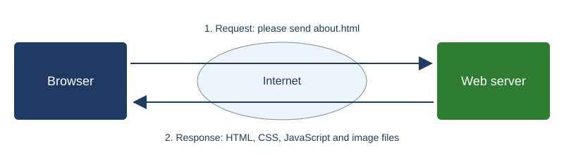

=====================
How the web works
=====================

.. admonition:: Learning intentions

   * Explain what happens when you visit a website
   * Describe the jobs of HTML, CSS and JavaScript
   * Explain why content, structure and presentation are kept separate
   * Set up a folder and code editor for web design

----

From your browser to a server and back
--------------------------------------

   Your browser asks a server for files. The server sends them back.

#. You type a web address, such as ``https://www.abc.net.au``, or click a link.
#. Your computer asks a **DNS server** to turn the name into a number called an
   **IP address**. This is like looking up a phone number in a contacts list.
#. Your **browser** sends a **request** to the **web server** at that address.
#. The server sends back a **response**: HTML, CSS, JavaScript and image files.
#. Your browser reads the files and draws the page on your screen.

.. list-table::
   :header-rows: 1
   :widths: 25 75

   * - Word
     - Meaning
   * - **Internet**
     - The worldwide network of connected computers
   * - **World Wide Web**
     - The web pages and sites you visit **using** the internet
   * - **Browser**
     - The app that shows web pages (Chrome, Edge, Firefox, Safari)
   * - **Web server**
     - A computer that stores websites and sends them when asked
   * - **URL**
     - The full address of a page, such as ``https://example.com/about.html``
   * - **HTTPS**
     - The secure way browsers and servers talk. The padlock means the connection
       is encrypted.
   * - **Domain name**
     - The easy-to-remember name, such as ``example.com``

Parts of a URL
~~~~~~~~~~~~~~

.. code-block:: text
   :class: no-copybutton

   https://www.example.com/gallery/photos.html
   \___/   \_____________/ \_____/ \_________/
   protocol  domain name    folder   file

----

Three languages, three jobs
---------------------------

.. list-table::
   :header-rows: 1
   :widths: 18 32 50

   * - Language
     - Job
     - Like a house...
   * - **HTML**
     - **Content and structure**: headings, paragraphs, images, links
     - The walls, rooms and doors
   * - **CSS**
     - **Presentation**: colours, fonts, spacing, layout
     - The paint, carpet and furniture
   * - **JavaScript**
     - **Behaviour**: things that happen when you click or type
     - The electricity: lights and doorbell

.. admonition:: Why keep them separate?

   * You can change the look of a whole site by editing **one** CSS file.
   * The same content can be shown differently on a phone, a big screen, a printer
     or a screen reader for people who are blind.
   * Search engines can understand well-structured HTML.
   * Code is easier to read, fix and share with a team.

----

Set up your workspace
---------------------

Step 1: Make a folder
~~~~~~~~~~~~~~~~~~~~~

#. In your school drive, make a folder called ``web_design``.
#. Download and extract the **web student kit** into it.

.. tip::

   **Web file naming rules**

   * Use **lower case** only: ``about.html`` not ``About.html``
   * **No spaces**: use ``my_photo.jpg`` or ``my-photo.jpg``
   * The home page is always called ``index.html``

   Many web servers treat ``Photo.JPG`` and ``photo.jpg`` as **different** files,
   so mixed-up capitals break images and links when you publish.

Step 2: Open VS Code
~~~~~~~~~~~~~~~~~~~~

#. Open **Visual Studio Code**.
#. Click **File > Open Folder...** and choose your ``web_design`` folder.
#. The files appear in the **Explorer** panel on the left.

Step 3 (optional): Install Live Server
~~~~~~~~~~~~~~~~~~~~~~~~~~~~~~~~~~~~~~

#. Click the **Extensions** icon on the left (four squares).
#. Search for **Live Server** (by Ritwick Dey) and click **Install**.
#. Right-click an HTML file and choose **Open with Live Server**. The page opens in
   your browser and refreshes every time you save.

If you cannot install extensions, just double-click your HTML file to open it in
a browser and press **F5** to refresh after each change.

----

Developer tools
---------------

Every browser has built-in tools for looking at code.

* Right-click any part of a web page and choose **Inspect**.
* The **Elements** panel shows the HTML. The **Styles** panel shows the CSS.
* You can change things here to experiment. Nothing is saved, so you cannot break
  the real website.

.. admonition:: Try it

   Open a news website. Right-click a heading and choose **Inspect**. Double-click
   the heading text in the Elements panel and change it to your name. Then refresh
   the page: it goes back to normal.

----

Check your understanding
------------------------

.. classifying::
   :delimiter: =>
   :instructions: Which language does each job?

   Adds a heading and a paragraph => HTML
   Puts an image on the page => HTML
   Makes a link to another page => HTML
   Changes the background colour => CSS
   Sets the font and text size => CSS
   Places three boxes side by side => CSS
   Shows a message when a button is clicked => JavaScript
   Switches the page to dark mode on click => JavaScript

.. mcqgroup::
   :show-instant-feedback:
   :shuffle-questions:

   .. multichoice::

      What is the job of a **web server**?

      [x] To store websites and send the files when a browser asks | Yes.
      [ ] To show web pages on your screen | That is the browser.
      [ ] To turn names into IP addresses | That is DNS.
      [ ] To write HTML code | People write HTML.

   .. multichoice::

      What does **DNS** do?

      [x] Turns a domain name into an IP address | Yes. Like a phone book for the internet.
      [ ] Draws the web page | That is the browser.
      [ ] Encrypts the connection | That is HTTPS.
      [ ] Stores images | No.

   .. multichoice::

      What should the home page file be called?

      [ ] home.html | Servers look for index.html by default.
      [x] index.html | Yes.
      [ ] Home Page.html | No spaces or capitals.
      [ ] main.css | That is a CSS file.

   .. multichoice::

      Which file name follows the web naming rules?

      [ ] My Photo.JPG | Has a space and capitals.
      [ ] Beach Day.png | Has a space and capitals.
      [x] beach_day.png | Yes. Lower case, no spaces.
      [ ] BEACH-DAY.PNG | Use lower case.

   .. multichoice::

      What is the difference between the internet and the World Wide Web?

      [x] The internet is the network; the web is the pages you visit using it | Yes.
      [ ] They are exactly the same | They are different things.
      [ ] The web is the cables; the internet is the pages | The other way round.
      [ ] The internet is only for email | No.

   .. multichoice::

      Why do we keep HTML and CSS separate?

      [x] So the look of a whole site can be changed by editing one CSS file | Yes.
      [ ] Because browsers cannot read them together | They can, but it is messy.
      [ ] To make websites slower | No.
      [ ] Because CSS is only for printing | No.
