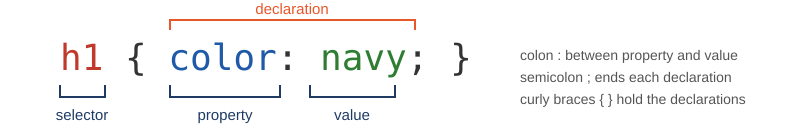

=================
CSS basics
=================

.. admonition:: Learning intentions

   * Link a CSS file to an HTML page
   * Write CSS rules with selectors, properties and values
   * Style text, colours and backgrounds
   * Use classes and ids to style particular elements

----

What CSS looks like
-------------------

CSS (Cascading Style Sheets) is a list of **rules**. Each rule says **what** to
style and **how**.

   The parts of a CSS rule.

.. code-block:: css

   h1 {
     color: navy;
     font-size: 48px;
   }

* ``h1`` is the **selector**: which elements to style.
* ``color: navy;`` is a **declaration**.
* ``color`` is the **property**, ``navy`` is the **value**.
* Each declaration ends with a **semicolon** ``;``.
* The declarations go inside **curly braces** ``{ }``.

.. important::

   CSS uses **American spelling**: ``color``, ``center``, ``gray``. If you write
   ``colour`` or ``centre`` in your CSS, it will not work. (Keep using Australian
   spelling in your page **content**.)

----

Linking a stylesheet
--------------------

Put your CSS in its own file, such as ``style.css``. Then link it inside the
``<head>`` of **every** page:

.. code-block:: html

   <head>
     <meta charset="UTF-8">
     <title>My page</title>
     <link rel="stylesheet" href="style.css">
   </head>

Now one CSS file can style your whole website.

----

Useful properties
-----------------

Text
~~~~

.. code-block:: css

   body {
     font-family: "Segoe UI", Arial, sans-serif;  /* first choice, backups, then generic */
     font-size: 18px;
     line-height: 1.6;           /* leading: space between lines */
     color: #222222;
   }

   h1 {
     font-size: 2.5rem;          /* 2.5 times the base size */
     font-weight: bold;
     text-align: center;
     letter-spacing: 2px;        /* tracking */
     text-transform: uppercase;
   }

   a {
     color: #2e7d32;
     text-decoration: none;      /* removes the underline */
   }

   a:hover {
     text-decoration: underline; /* underline when the mouse is over it */
   }

Colours and backgrounds
~~~~~~~~~~~~~~~~~~~~~~~

.. code-block:: css

   body {
     background-color: #fff8e7;
   }

   header {
     background-color: rgb(46, 125, 50);
     color: white;
   }

   .hero {
     background-image: url("images/beach.jpg");
     background-size: cover;    /* fill the box, cropping if needed */
   }

Colours can be written as **names** (``tomato``), **hex** (``#ff6347``) or
**rgb** (``rgb(255, 99, 71)``). These are the same RGB colours you used in
:doc:`/graphic_design/gd_02_colour`.

Units
~~~~~

.. list-table::
   :header-rows: 1
   :widths: 15 85

   * - Unit
     - Meaning
   * - ``px``
     - Pixels. A fixed size.
   * - ``%``
     - A percentage of the box it is inside.
   * - ``rem``
     - A multiple of the page's base font size (usually 16 px). ``2rem`` = 32 px.
       Good for text because it respects the user's settings.
   * - ``vw`` / ``vh``
     - A percentage of the browser window's width or height.

Google Fonts
~~~~~~~~~~~~

#. Go to `Google Fonts <https://fonts.google.com>`_ and choose a font.
#. Click **Get font**, then **Get embed code**.
#. Copy the ``<link>`` lines into your ``<head>`` **above** your own stylesheet.
#. Use the font in CSS, for example ``font-family: "Nunito", sans-serif;``.

----

Classes and ids
---------------

Sometimes you only want to style **some** paragraphs, not all of them.

.. code-block:: html

   
This paragraph is special.

   
This one is normal.

   
Made by Sam

.. code-block:: css

   .highlight {            /* a dot means a class */
     background-color: #f9c80e;
     padding: 10px;
   }

   #footer-note {          /* a hash means an id */
     font-size: 14px;
   }

.. list-table::
   :header-rows: 1
   :widths: 15 15 70

   * - Selector
     - Written as
     - Use
   * - Element
     - ``p``
     - Every element of that type
   * - Class
     - ``.highlight``
     - Any elements with that class. Can be used **many** times on a page.
   * - Id
     - ``#footer-note``
     - **One** element only. Each id must be unique on the page.

Grouping and descendant selectors
~~~~~~~~~~~~~~~~~~~~~~~~~~~~~~~~~

.. code-block:: css

   h1, h2, h3 {         /* a comma: style all three */
     font-family: "Nunito", sans-serif;
   }

   nav a {              /* a space: links INSIDE nav only */
     color: white;
   }

The cascade
~~~~~~~~~~~

What happens if two rules disagree? CSS follows the **cascade**:

#. A **more specific** selector wins: an id beats a class, and a class beats an
   element.
#. If they are equally specific, the rule written **later** wins.

----

Tutorial: style your fact page
------------------------------

#. Open the ``04_css_basics`` folder (or your own fact page).
#. Create a new file called ``style.css`` next to ``index.html``.
#. Link it in the ``<head>`` of every page.
#. Add rules to:

   * set a font, base size and line height on ``body``
   * set a background colour on ``body``
   * style ``h1`` and ``h2`` with a heading font and a brand colour
   * remove link underlines and add a ``:hover`` style
   * make a class ``.fact-box`` with a background colour and some padding, and
     use it on one paragraph

#. Use **3 colours or fewer**, chosen with a colour scheme (hex codes).
#. Check: is the text easy to read? Is there enough contrast?

----

Debugging CSS
-------------

.. list-table::
   :header-rows: 1
   :widths: 45 55

   * - Bug
     - Fix
   * - Nothing changes at all
     - Check the ``<link>`` path and file name. Did you save the CSS file?
   * - One rule does not work
     - Check for a missing ``;`` on the line **before**, or a missing ``}``.
   * - ``colour`` or ``centre`` does nothing
     - Use American spelling: ``color``, ``center``.
   * - A class does nothing
     - Did you forget the dot (``.box``)? Does the HTML say ``class="box"``?

.. tip::

   Use **Inspect** in your browser. The Styles panel shows which rules apply, and
   crosses out rules that lost the cascade.

----

Check your understanding
------------------------

.. classifying::
   :delimiter: =>
   :bins: Selector, Property, Value
   :instructions: Is each part of a CSS rule a selector, a property or a value?

   h1 => Selector
   .highlight => Selector
   #footer => Selector
   color => Property
   font-size => Property
   background-color => Property
   navy => Value
   24px => Value
   #2e7d32 => Value

.. mcqgroup::
   :show-instant-feedback:
   :shuffle-questions:

   .. multichoice::

      Which line links a stylesheet called ``style.css``?

      [x] ``<link rel="stylesheet" href="style.css">`` | Yes.
      [ ] ``<style src="style.css">`` | Not correct.
      [ ] ``<a href="style.css">`` | That makes a link people click.
      [ ] ``<css>style.css</css>`` | Not a real tag.

   .. multichoice::

      Which selector styles every element with ``class="card"``?

      [x] ``.card`` | Yes. A dot means class.
      [ ] ``#card`` | A hash means id.
      [ ] ``card`` | That would look for a ``<card>`` element.
      [ ] ``*card`` | Not correct.

   .. multichoice::

      Why doesn't ``text-align: centre;`` work?

      [x] CSS uses American spelling, so it must be ``center`` | Yes.
      [ ] ``text-align`` is not a property | It is.
      [ ] It needs to be in capitals | No.
      [ ] It only works on images | No.

   .. multichoice::

      What must end each declaration in CSS?

      [x] A semicolon ``;`` | Yes.
      [ ] A full stop | No.
      [ ] A comma | Commas separate selectors.
      [ ] A colon | The colon goes between property and value.

   .. multichoice::

      Two rules set the colour of the same paragraph. One uses ``p`` and the other uses ``.intro``. Which wins?

      [x] ``.intro``, because a class is more specific than an element | Yes.
      [ ] ``p``, because it is shorter | Length does not matter.
      [ ] Neither | One must win.
      [ ] Both mix together | Colours do not mix.

   .. multichoice::

      What does ``nav a`` select?

      [x] Links that are inside a ``<nav>`` | Yes. A space means "inside".
      [ ] Every ``<nav>`` and every link | That would be ``nav, a``.
      [ ] Only the first link | No.
      [ ] Nothing | It is a valid selector.

.. clozegroup::
   :show-instant-feedback:

   .. cloze:: text

      In a CSS rule the part that chooses the elements is the @@selector@@.
      In color: navy the word color is the @@property@@ and navy is the value.
      A class selector starts with a @@dot@@.
      An id selector starts with a @@hash@@.
      When rules disagree CSS uses the @@cascade@@ to decide which one wins.
