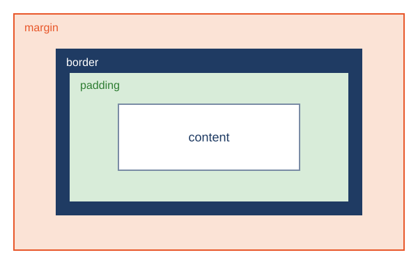

=================
The box model
=================

.. admonition:: Learning intentions

   * Explain the four layers of the CSS box model
   * Use padding, border and margin to space out elements
   * Control width and centre content on the page
   * Tell block elements and inline elements apart

----

Everything is a box
-------------------

To the browser, every element is a rectangle. Each box has four layers.



   The CSS box model.

.. list-table::
   :header-rows: 1
   :widths: 20 80

   * - Layer
     - Meaning
   * - **Content**
     - The text or image itself
   * - **Padding**
     - Space **inside** the box, between the content and the border. Takes the
       box's background colour.
   * - **Border**
     - A line around the padding
   * - **Margin**
     - Space **outside** the box, pushing other boxes away. Always see-through.

.. code-block:: css

   .card {
     width: 300px;
     padding: 20px;
     border: 3px solid #2e7d32;
     margin: 30px;
     background-color: white;
   }

Writing padding and margin
~~~~~~~~~~~~~~~~~~~~~~~~~~

.. code-block:: css

   padding: 20px;               /* all four sides */
   padding: 10px 20px;          /* top and bottom 10, left and right 20 */
   padding: 5px 10px 15px 20px; /* top, right, bottom, left (clockwise) */
   padding-top: 40px;           /* one side only */

.. tip::

   Remember the order **top, right, bottom, left** as "**TRouBLe**".

Borders
~~~~~~~

.. code-block:: css

   border: 2px solid black;     /* width, style, colour */
   border: 4px dashed tomato;
   border-bottom: 1px solid #ccc;
   border-radius: 12px;         /* rounded corners */
   border-radius: 50%;          /* a circle (on a square box) */

----

Box sizing
----------

By default, ``width`` only sets the **content**. Padding and border are added on
top, so a ``300px`` box with ``20px`` padding and a ``3px`` border is really
346 px wide. This confuses everyone, so most designers add this rule at the top
of their CSS:

.. code-block:: css

   * {
     box-sizing: border-box;
   }

Now ``width`` includes the padding and border. A 300 px box is 300 px.

----

Block and inline
----------------

.. list-table::
   :header-rows: 1
   :widths: 20 40 40

   * -
     - **Block** elements
     - **Inline** elements
   * - Examples
     - ``<h1>``, ``<p>``, ``<div>``, ``<ul>``, ``<section>``
     - ``<a>``, ``<strong>``, ``<em>``, ``<span>``, ````
   * - Starts a new line?
     - Yes
     - No, sits inside a line of text
   * - Width
     - Fills the full width available
     - Only as wide as its content

``<div>`` and ``<span>`` have no meaning of their own. They are containers you
use to group things so you can style them: ``<div>`` for blocks, ``<span>`` for a
few words.

----

Centring a page
---------------

Long lines of text are hard to read on a wide screen. Limit the width and centre
it:

.. code-block:: css

   .container {
     max-width: 900px;   /* never wider than 900px */
     margin: 0 auto;     /* 0 top and bottom, auto left and right = centred */
     padding: 0 20px;    /* space at the sides on small screens */
   }

.. code-block:: html

   <body>
     <div class="container">
       ... all your page content ...
     </div>
   </body>

----

Tutorial: profile cards
-----------------------

#. Open the ``05_box_model`` folder from the kit. It has three ``<div class="card">``
   elements, each with an image, a heading and a paragraph.
#. In ``style.css``, add the ``box-sizing`` rule.
#. Style ``.card`` with a width of ``280px``, padding, a border, rounded corners,
   a margin and a white background.
#. Give the card image ``width: 100%;`` and ``border-radius: 8px;``.
#. Add a ``.container`` with ``max-width`` and ``margin: 0 auto;``.
#. Open **Inspect**, click a card, and look at the box model diagram in the
   **Computed** tab. Check the numbers match your CSS.

Extension: add a shadow with ``box-shadow: 0 4px 10px rgba(0, 0, 0, 0.15);``.

----

Check your understanding
------------------------

.. ordering:: text
   :no-indent:

   Content (innermost)
   Padding
   Border
   Margin (outermost)

.. mcqgroup::
   :show-instant-feedback:
   :shuffle-questions:

   .. multichoice::

      Which layer is space **inside** the border?

      [x] Padding | Yes.
      [ ] Margin | Margin is outside the border.
      [ ] Content | Content is the text or image itself.
      [ ] Outline | Not part of the box model we studied.

   .. multichoice::

      ``margin: 10px 30px;`` gives...

      [x] 10px top and bottom, 30px left and right | Yes.
      [ ] 10px left and right, 30px top and bottom | The other way round.
      [ ] 10px top, 30px bottom | Not with two values.
      [ ] 40px on all sides | No.

   .. multichoice::

      Which rule centres a box that has a ``max-width``?

      [x] ``margin: 0 auto;`` | Yes. Auto margins share the space equally.
      [ ] ``text-align: center;`` | That centres text inside the box.
      [ ] ``padding: center;`` | Not valid.
      [ ] ``align: middle;`` | Not valid.

   .. multichoice::

      What does ``box-sizing: border-box;`` do?

      [x] Makes ``width`` include the padding and border | Yes.
      [ ] Adds a border to every box | No.
      [ ] Removes all margins | No.
      [ ] Makes every box square | No.

   .. multichoice::

      Which of these is an **inline** element?

      [ ] ``<p>`` | Block.
      [ ] ``<div>`` | Block.
      [x] ``<a>`` | Yes. Links sit inside a line of text.
      [ ] ``<h2>`` | Block.

   .. multichoice::

      Which property makes rounded corners?

      [x] ``border-radius`` | Yes.
      [ ] ``corner-round`` | Not real.
      [ ] ``border-style`` | That sets solid, dashed and so on.
      [ ] ``padding`` | No.
