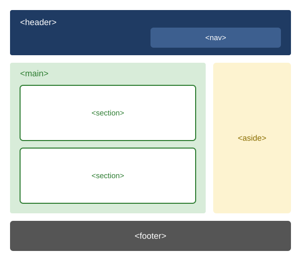
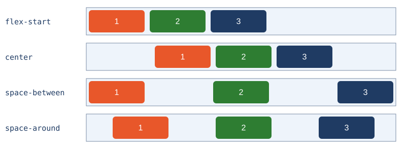

======================================
Page layout: semantic HTML and flexbox
======================================

.. admonition:: Learning intentions

   * Use semantic elements to give a page a clear structure
   * Use flexbox to place items in a row or column
   * Build a navigation bar and a row of cards

----

Semantic elements
-----------------

**Semantic** means "having meaning". Semantic elements tell the browser, search
engines and screen readers **what each part of the page is for**.

   A typical page built from semantic elements.

.. list-table::
   :header-rows: 1
   :widths: 20 80

   * - Element
     - Use for
   * - ``<header>``
     - The top of the page: logo, site name, often the navigation
   * - ``<nav>``
     - The main menu of links
   * - ``<main>``
     - The main content of this page. Only **one** per page.
   * - ``<section>``
     - A themed group of content, usually with its own heading
   * - ``<article>``
     - A piece that makes sense on its own, such as a blog post or project
   * - ``<aside>``
     - Extra content on the side, such as related links
   * - ``<footer>``
     - The bottom of the page: copyright, contact links

.. code-block:: html

   <body>
     <header>
       <h1>Sam's Portfolio</h1>
       <nav>
         <ul>
           <li><a href="index.html">Home</a></li>
           <li><a href="animation.html">Animation</a></li>
           <li><a href="design.html">Design</a></li>
         </ul>
       </nav>
     </header>

     <main>
       <section>
         <h2>Welcome</h2>
         
...

       </section>
     </main>

     <footer>
       
&copy; 2026 Sam Nguyen

     </footer>
   </body>

.. admonition:: Why not just use ``
`` for everything?

   A ``
`` tells the browser nothing. A screen reader user can jump straight
   to ``<main>`` or ``<nav>``, but cannot do that with a pile of divs. Semantic
   HTML also helps search engines understand your site.

----

Flexbox
-------

**Flexbox** is a CSS tool for laying out items in a **row** or a **column**. You
put ``display: flex;`` on the **parent** (the container), and its **children**
line up.

   ``justify-content`` spreads items along the row.

.. code-block:: css

   .card-row {
     display: flex;
     gap: 20px;                        /* space between items */
     justify-content: space-between;   /* spread along the row */
     align-items: center;              /* line up across the row */
     flex-wrap: wrap;                  /* move to a new line if there is no room */
   }

.. list-table::
   :header-rows: 1
   :widths: 30 70

   * - Property (on the parent)
     - Common values
   * - ``flex-direction``
     - ``row`` (default, left to right) or ``column`` (top to bottom)
   * - ``justify-content``
     - Along the main direction: ``flex-start``, ``center``, ``flex-end``,
       ``space-between``, ``space-around``
   * - ``align-items``
     - Across the other direction: ``stretch`` (default), ``flex-start``,
       ``center``, ``flex-end``
   * - ``gap``
     - The space between items, such as ``20px``
   * - ``flex-wrap``
     - ``wrap`` lets items move to the next line

On a **child**, ``flex: 1;`` means "grow to share the spare space equally".

.. tip::

   Play `Flexbox Froggy <https://flexboxfroggy.com>`_ to practise flexbox with a
   game.

----

Tutorial: a navigation bar
--------------------------

Open the ``06_layout`` folder from the kit. The HTML already has a ``<header>``
with a site name and a ``<nav>`` list.

.. code-block:: css

   header {
     display: flex;
     justify-content: space-between;   /* name on the left, menu on the right */
     align-items: center;
     padding: 15px 30px;
     background-color: #1f3b63;
     color: white;
   }

   nav ul {
     display: flex;          /* menu items in a row */
     gap: 25px;
     list-style: none;       /* remove the bullets */
     margin: 0;
     padding: 0;
   }

   nav a {
     color: white;
     text-decoration: none;
     font-weight: bold;
   }

   nav a:hover {
     color: #f9c80e;
   }

Tutorial: a row of cards
------------------------

.. code-block:: html

   <section class="card-row">
     <article class="card">...</article>
     <article class="card">...</article>
     <article class="card">...</article>
   </section>

.. code-block:: css

   .card-row {
     display: flex;
     gap: 20px;
     flex-wrap: wrap;
   }

   .card {
     flex: 1;
     min-width: 220px;   /* stop cards getting too thin */
     padding: 20px;
     border-radius: 10px;
     background: white;
     box-shadow: 0 4px 10px rgba(0, 0, 0, 0.1);
   }

#. Add both sets of CSS to ``style.css``.
#. Make the browser window narrower. What happens to the cards? (``flex-wrap``)
#. Change ``justify-content`` in the header to ``center``. What happens?
#. Add a ``<footer>`` and centre its text.

----

Check your understanding
------------------------

.. classifying::
   :delimiter: =>
   :instructions: Which semantic element suits each part of a page?

   The site logo and name at the top => header
   The main menu of links => nav
   The copyright line at the bottom => footer
   A related links box at the side => aside
   A single blog post or project write-up => article
   The main content of this page => main

.. mcqgroup::
   :show-instant-feedback:
   :shuffle-questions:

   .. multichoice::

      Where do you put ``display: flex;``?

      [x] On the parent container | Yes. Its children become flex items.
      [ ] On each child item | The parent controls the layout.
      [ ] On the ``<html>`` element only | No.
      [ ] In the HTML file | It is CSS.

   .. multichoice::

      Which property spreads items along a row with equal space between them?

      [x] ``justify-content: space-between;`` | Yes.
      [ ] ``align-items: center;`` | That lines items up across the row.
      [ ] ``flex-direction: column;`` | That stacks items.
      [ ] ``text-align: justify;`` | That is for text.

   .. multichoice::

      How many ``<main>`` elements should a page have?

      [x] One | Yes.
      [ ] One per section | Use ``<section>`` for sections.
      [ ] None | Every page should have one.
      [ ] As many as needed | Only one.

   .. multichoice::

      Why is semantic HTML better than using ``
`` for everything?

      [x] It tells browsers, search engines and screen readers what each part is for | Yes.
      [ ] Semantic elements look nicer | They look the same until you style them.
      [ ] Divs do not work any more | They still work.
      [ ] It makes the page load faster | Not the main reason.

   .. multichoice::

      What does ``list-style: none;`` do to a navigation list?

      [x] Removes the bullets | Yes.
      [ ] Hides the links | No.
      [ ] Puts the items in a row | That is ``display: flex``.
      [ ] Removes the underlines | That is ``text-decoration: none``.

   .. multichoice::

      Cards in a flex row get squashed on a small screen. Which property lets them move to a new line?

      [x] ``flex-wrap: wrap;`` | Yes.
      [ ] ``gap: 20px;`` | That adds space between items.
      [ ] ``align-items: stretch;`` | No.
      [ ] ``display: block;`` | That turns off flexbox.
