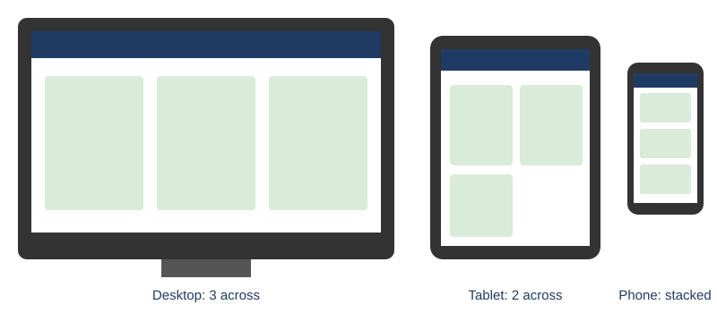

====================================
Responsive design and accessibility
====================================

.. admonition:: Learning intentions

   * Explain why websites must work on phones, tablets and computers
   * Use media queries to change a layout on small screens
   * Make images flexible
   * Check a page for accessibility problems

----

Responsive design
-----------------

More than half of web visits come from phones. A **responsive** website changes
its layout to fit any screen size.

   One website, three screen sizes.

The three things you need
~~~~~~~~~~~~~~~~~~~~~~~~~

**1. The viewport tag** (already in your page skeleton):

.. code-block:: html

   <meta name="viewport" content="width=device-width, initial-scale=1.0">

Without it, phones pretend to be a big screen and shrink the whole page.

**2. Flexible images**:

.. code-block:: css

   img {
     max-width: 100%;   /* never wider than the box it is in */
     height: auto;      /* keep the shape */
   }

**3. Media queries**: CSS that only applies when the screen is a certain size.

.. code-block:: css

   /* Normal styles for all screens */
   nav ul {
     display: flex;
     gap: 25px;
   }

   /* Only when the screen is 600px wide or less */
   @media (max-width: 600px) {
     header {
       flex-direction: column;   /* stack the logo above the menu */
     }

     nav ul {
       flex-direction: column;
       gap: 10px;
       text-align: center;
     }

     h1 {
       font-size: 1.8rem;
     }
   }

A **breakpoint** is the width where the layout changes. Common breakpoints are
about **600px** (phones) and **900px** (tablets).

Testing on different sizes
~~~~~~~~~~~~~~~~~~~~~~~~~~

#. Open your page and press **F12** (or right-click > **Inspect**).
#. Click the **Toggle device toolbar** icon (a phone and tablet) or press
   **Ctrl + Shift + M**.
#. Choose a phone from the list at the top, or drag the edge of the page to change
   the width.

----

Accessibility
-------------

**Accessibility** means making websites everyone can use, including people who:

* are blind or have low vision and use a **screen reader** or zoom
* are colour blind
* are deaf or hard of hearing
* cannot use a mouse and use only a **keyboard**
* have learning or reading difficulties

The international guidelines are called the **Web Content Accessibility
Guidelines (WCAG)**. Australian government websites are expected to follow them.

Accessibility checklist
~~~~~~~~~~~~~~~~~~~~~~~

.. list-table::
   :header-rows: 1
   :widths: 35 65

   * - Check
     - How
   * - **Alt text** on every image
     - Describe meaningful images. Use ``alt=""`` for decoration.
   * - **Headings in order**
     - One ``<h1>``, then ``<h2>``, ``<h3>``... Do not skip levels just to get a
       smaller size.
   * - **Colour contrast**
     - Normal text needs a contrast ratio of at least **4.5 : 1** with its
       background. Check with the `WebAIM Contrast Checker <https://webaim.org/resources/contrastchecker/>`_.
   * - **Do not rely on colour alone**
     - "Required fields are in red" fails for colour-blind users. Add a ``*`` or
       the word "required" too.
   * - **Meaningful link text**
     - Not "click here".
   * - **Keyboard works**
     - Press **Tab** to move through links and buttons. Can you see where you are?
       Can you reach everything?
   * - **Labels on form inputs**
     - Every input has a ``<label>``.
   * - **Captions on video**
     - Turn on captions for YouTube videos, or add your own.
   * - **Language set**
     - ``<html lang="en-AU">``
   * - **Text can be resized**
     - Use ``rem`` for font sizes. Zoom to 200%: does the page still work?

.. admonition:: Try a screen reader

   Windows has a built-in screen reader called **Narrator** (**Windows + Ctrl +
   Enter** to turn it on and off). Turn it on, close your eyes and try to use
   your fact page. What was hard?

----

Tutorial: make your layout responsive
-------------------------------------

#. Open your page from the layout lesson (or ``07_responsive`` in the kit).
#. Add the flexible image rule.
#. Add a ``@media (max-width: 600px)`` block that stacks the header and the nav
   links, and makes the cards full width (``.card { flex: 1 1 100%; }``).
#. Test with the device toolbar at 375 px (a phone), 768 px (a tablet) and
   1280 px (a laptop).
#. Run the accessibility checklist above. Fix at least **two** problems.
#. Check your colours in the WebAIM Contrast Checker and record the ratios.

----

Check your understanding
------------------------

.. mcqgroup::
   :show-instant-feedback:
   :shuffle-questions:

   .. multichoice::

      What does a **media query** do?

      [x] Applies CSS only when the screen matches a condition, such as a maximum width | Yes.
      [ ] Plays a video | No.
      [ ] Searches for images | No.
      [ ] Links a stylesheet | That is ``<link>``.

   .. multichoice::

      Which CSS stops images from being wider than their container?

      [x] ``max-width: 100%;`` | Yes.
      [ ] ``width: 2000px;`` | That makes them huge.
      [ ] ``display: none;`` | That hides them.
      [ ] ``float: left;`` | No.

   .. multichoice::

      What is the minimum contrast ratio WCAG asks for normal-sized text?

      [ ] 1 : 1 | That is no contrast at all.
      [ ] 2 : 1 | Too low.
      [x] 4.5 : 1 | Yes.
      [ ] 21 : 1 | That is black on white, the maximum.

   .. multichoice::

      Which is an accessibility problem?

      [x] "Fields in red are required", with no other clue | Yes. Colour-blind users may not see the red.
      [ ] Using ``alt`` text on images | That helps.
      [ ] Headings in order | That helps.
      [ ] Labels on inputs | That helps.

   .. multichoice::

      How can you test a page without a mouse?

      [x] Press Tab to move through links and buttons | Yes.
      [ ] Press F5 | That refreshes.
      [ ] Zoom out | Not a keyboard test.
      [ ] You can't | You can.

   .. multichoice::

      What does the viewport ``<meta>`` tag do?

      [x] Makes the page fit the phone's real screen width | Yes.
      [ ] Adds a title to the tab | That is ``<title>``.
      [ ] Links the CSS | That is ``<link>``.
      [ ] Makes the page load faster | No.

.. clozegroup::
   :show-instant-feedback:

   .. cloze:: text

      A website that changes its layout to fit any screen is @@responsive@@.
      CSS that only works at certain screen sizes is written in a media @@query@@.
      The width where the layout changes is called a @@breakpoint@@.
      Making websites that everyone can use is called @@accessibility@@.
      A program that reads web pages aloud is a @@screen reader@@.
