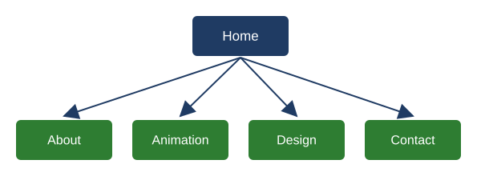
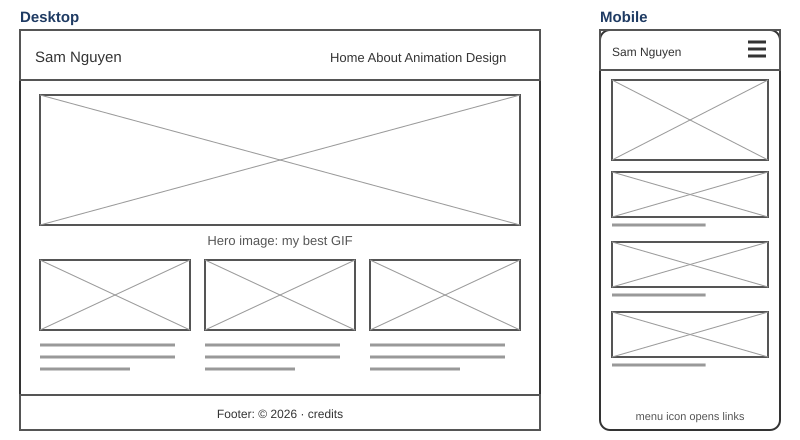

=====================================
UX and UI design: planning a website
=====================================

.. admonition:: Learning intentions

   * Explain the difference between UX and UI
   * Write design criteria for a website
   * Draw a site map and wireframes
   * Compare and evaluate different design ideas

----

UX and UI
---------

.. list-table::
   :header-rows: 1
   :widths: 20 40 40

   * -
     - **UX: user experience**
     - **UI: user interface**
   * - Question
     - Is it **easy and pleasant to use**?
     - What does it **look like**?
   * - Includes
     - How people find things, how many clicks it takes, whether it makes sense
     - Colours, fonts, buttons, icons, spacing
   * - Like a car...
     - Is it comfortable and easy to drive?
     - What colour is it? What do the controls look like?

A website can look beautiful (good UI) but be confusing to use (bad UX). You need
both.

Good UX habits
~~~~~~~~~~~~~~

* **Consistent navigation**: the menu is in the same place on every page.
* **Clear labels**: "Contact" is better than "Reach out to the vibe".
* **Show where you are**: highlight the current page in the menu.
* **Three clicks**: important things should be easy to reach.
* **Fast**: small images, simple pages.
* **Readable**: short paragraphs, headings, good contrast.

----

Design criteria
---------------

**Design criteria** are the tests you will use to judge whether your website is
successful. Write them **before** you build, so you can check against them at the
end. Good criteria are specific and can be tested.

.. list-table::
   :header-rows: 1
   :widths: 50 50

   * - Too vague
     - Specific and testable
   * - The site looks good
     - The site uses no more than 3 colours and 2 fonts, all listed in a style guide
   * - It's easy to use
     - A new user can reach any page from the home page in 2 clicks or fewer
   * - It works on phones
     - All pages display without sideways scrolling at 375 px wide
   * - It's accessible
     - All images have alt text and all text passes a 4.5 : 1 contrast check

----

Site map
--------

A **site map** shows every page and how they link.

   A simple site map for a portfolio.

----

Wireframes
----------

A **wireframe** is a simple sketch of a page layout. It uses boxes and labels,
not colours or real pictures. It lets you plan **where things go** before you
write any code.

   Desktop and mobile wireframes of the same page.

Wireframe rules
~~~~~~~~~~~~~~~

* Draw a box with a cross through it for an **image**.
* Draw wavy or straight lines for **paragraphs**.
* Write the real headings and menu labels.
* Draw both a **desktop** and a **mobile** version.
* Add notes: colours, fonts, what happens when something is clicked.

You can draw wireframes on paper, or use a free tool such as **Figma**,
**Canva** or **Whimsical** if your school allows it.

----

Generating and comparing ideas
------------------------------

Do not stop at your first idea. Draw **two or three different** home page
layouts, then compare them against your design criteria.

.. list-table::
   :header-rows: 1
   :widths: 40 20 20 20

   * - Design criterion
     - Idea A
     - Idea B
     - Idea C
   * - Work is visible on the home page without scrolling
     - ✓
     - ✗
     - ✓
   * - Menu is easy to find
     - ✓
     - ✓
     - ✗
   * - Layout will work on a phone
     - ✓
     - ✓
     - ✓
   * - **Total**
     - 3
     - 2
     - 2

Then explain your choice: "I chose Idea A because it meets all three criteria and
shows my best GIF straight away."

----

Activity: evaluate a real website
---------------------------------

Choose a website you use (a game, a shop, a sport club, your school). Answer:

#. Who is the audience? What do they want to do on the site?
#. **UX:** try to do one task (find the opening hours, the price, a contact
   email). How many clicks did it take? What was confusing?
#. **UI:** describe the colours, fonts and images. Do they suit the audience?
#. Test it on a phone (or the device toolbar). What changes?
#. Give **two** specific improvements.

----

Check your understanding
------------------------

.. classifying::
   :delimiter: =>
   :bins: UX, UI
   :instructions: Is each item mostly about UX (how it works) or UI (how it looks)?

   The number of clicks to reach the shop => UX
   Whether users can find the contact page => UX
   The menu is in the same place on every page => UX
   The page loads quickly on mobile data => UX
   The colour of the buttons => UI
   The font used for headings => UI
   The style of the icons => UI
   Rounded corners on the cards => UI

.. mcqgroup::
   :show-instant-feedback:
   :shuffle-questions:

   .. multichoice::

      What is a **wireframe**?

      [x] A simple sketch of where things go on a page, using boxes and labels | Yes.
      [ ] The finished website | No.
      [ ] A list of all the pages | That is a site map.
      [ ] The CSS file | No.

   .. multichoice::

      Which is the best design criterion?

      [ ] The website is cool | Not testable.
      [ ] People will like it | Not specific.
      [x] Every page can be reached from the home page in 2 clicks or fewer | Yes. Specific and testable.
      [ ] It uses nice colours | Not testable.

   .. multichoice::

      What does UX stand for?

      [x] User experience | Yes.
      [ ] User extra | No.
      [ ] Universal exchange | No.
      [ ] Unique explanation | No.

   .. multichoice::

      Why draw a mobile wireframe as well as a desktop one?

      [x] The layout often needs to change to fit a small screen | Yes.
      [ ] Phones cannot show websites | They can.
      [ ] Teachers like more drawings | The real reason is responsive design.
      [ ] Mobile sites have different content | Usually the same content, different layout.

   .. multichoice::

      Why write design criteria **before** you build?

      [x] So you can test your finished site against clear goals | Yes.
      [ ] Because it is required by law | No.
      [ ] So you do not need to test | You still test.
      [ ] So the site loads faster | No.
